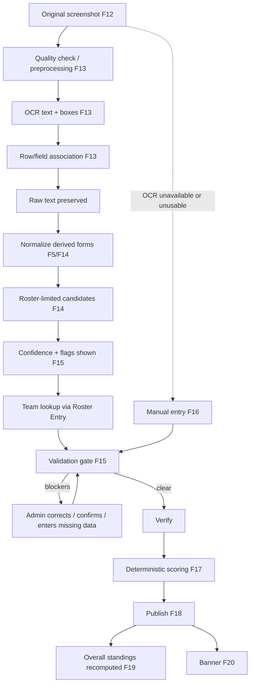

# ideation.md: Evidence-First Tournament Operations Platform for College Free Fire MAX Esports

> **Status:** Ideation stage, following `problem.md` (Draft v1.0, 2026-10-18). Not a PRD, schema, API spec, or plan.
> **Working product name:** *placeholder, none established* (referred to below as "the platform").
> **Date:** 2026-10-18

**How references work in this document.** `problem.md` already defines stable IDs, which are reused exactly: **P1–P9** (sub-problems, §3.1), **FR-xx** (functional requirements, §23), **NFR areas** (§24), **BR-xx** (business rules, §14, §25), **A-xx** (assumptions, §31), **Q-xx** (open questions, §32), and edge-case IDs **ER-, EP-, ES-, EM-, EO-, EL-, EX-** (§28; the reliability rows are `ER-01R…ER-11R`). Section references written `§n` point to `problem.md`. The evidence tags **[BRIEF] / [INFERENCE] / [PROPOSAL] / [ASSUMPTION] / [OPEN]** keep their meanings. Feature IDs **F1–F26** are introduced here and are ideation-only.

---

# 1. The idea in one paragraph

The platform is a tournament operations system for college and community Free Fire MAX battle-royale events. It carries a tournament from public discovery through team registration, roster and in-game-name capture, payment review, approval, slot assignment, scheduling, protected room-credential release, match-result screenshot intake, OCR-assisted extraction, roster-based player identification, human verification, deterministic configurable scoring, match and overall leaderboards, banners, corrections, final podium, and archival. Its central value is turning the admin's inter-match chore of *read screenshot, find each player's team, add kills, compute points, re-rank* **[BRIEF: ~5-minute window]** into *review a pre-filled draft next to the original evidence and confirm*. The key idea is that a screenshot shows in-game names, not team names, so the platform derives team attribution from a verified link between detected IGN and that tournament's roster, and it refuses to turn uncertainty into official points.

**What it is not.** It is not a generic tournament website or a registration form. It is not a spreadsheet clone, because every state (payment, approval, slot, result) is explicit and audited. It is not an OCR demo: OCR is one fallible input among several, and a manual path always exists. It does not observe the game itself (§11.F), process payments, or guarantee accuracy or a five-minute turnaround; those claims wait for measurement (§30).

---

# 2. Design rules derived from `problem.md`

| # | Rule | Why it matters | Source |
|---|---|---|---|
| D1 | **Evidence → draft → verified → published.** Original screenshots are immutable evidence; OCR output is a draft; only verified data scores; only published data is public. | Prevents silent errors becoming official standings (P7). | §16.1, §18.1, BR-X1 |
| D2 | **Identity before attribution.** Kills belong to a team only through a confirmed Roster Entry of that tournament. | Screenshots lack team names (P4). | §17.1, §26 |
| D3 | **Never guess silently.** Uncertain identity, kills, or placement stay flagged and block verification until a human resolves them. | Wrong totals can change the podium (§5 causal chain). | §16.6, BR-X2, §18.3 |
| D4 | **Preserve original IGNs; store derived forms separately and versioned.** | Different players can collapse to the same simplified name (P5). | §17.2, §17.4 |
| D5 | **Manual path always exists.** Every automated step has a manual equivalent usable under time pressure. | OCR may be unavailable, wrong, or unsuitable for a layout. | §29.1, ER-01R |
| D6 | **Optimize the review step, not just extraction.** Review time is the dominant term when ambiguity exists. | The inter-match window is the core constraint (P6). | §12.2 |
| D7 | **Rules are configuration, versioned and frozen.** No hardcoded Free Fire scoring. | Official tables are not supplied (Q-07). | §19.1–19.2, BR-X4 |
| D8 | **Scoring is deterministic and independent of any language model.** | Testability and trust. | §19.5 |
| D9 | **Registration, payment, approval, and slot are independent states with enforced dependencies.** | Ambiguity between "paid" and "approved" is a stated problem (P2). | §14, BR-P2 |
| D10 | **Private by default.** Payment proof and room credentials are gated server-side by eligibility, not merely hidden in the UI. | P3, privacy. | §15, §27 |
| D11 | **Corrections create versions, never overwrite; every consequential action is audited.** | Disputes need traceability (P8). | §22, BR-X5, FR-AU1 |
| D12 | **Idempotent and concurrency-safe operations.** | Duplicate and stale writes are expected in live use (P9). | BR-X9, BR-X10, EX-06…08 |
| D13 | **Focus on the college Free Fire MAX scenario; multi-game support is a bounded later extension.** | Scope control. | §8 |
| D14 | **No unsupported promises.** Accuracy, latency, and scale targets are measured, then set. | Honesty. | §6.1, §24, §30 |

---

# 3. Core objects and shared vocabulary

Conceptual only; not a schema (see §26).

| Object | Meaning |
|---|---|
| **Tournament** | One event: game, format, capacity, fee, schedule, scoring ruleset, lifecycle state. |
| **Player Profile** | A person's platform-wide account identity. |
| **Team** | A reusable team name/captain identity across tournaments. |
| **Registration** | A Team's application to one Tournament; carries registration, payment, approval, slot states. |
| **Roster Entry** | A Player Profile's membership in one Registration, with that tournament's claimed IGN. Team attribution of kills flows through this object. |
| **In-Game Name (IGN) record** | Raw submitted text (never altered), exactness (`Exact`/`Approximate`/`Unverified`), optional UID, verification history, derived normalized forms (versioned), confirmed aliases. |
| **Payment** | A proof submission plus its verification decision; separate from approval. |
| **Slot** | A tournament-specific numbered place assigned to an approved Registration (not a permanent team property). |
| **Match / Match Attempt** | A scheduled round; an attempt distinguishes restarts so evidence is not conflated. |
| **Match Participant** | A slotted Registration expected in a match. |
| **Room Credentials** | Versioned room ID/password with release time and an access log. |
| **Evidence** | Uploaded screenshot or proof file, hashed and immutable. |
| **Processing Job / Extraction Draft** | One OCR run on one Evidence and its raw text, boxes, confidences, pipeline version. |
| **Identity Match** | Candidate set and decision linking a draft row to a Roster Entry (`Unmatched/Suggested/Confirmed/Overridden/Rejected`). |
| **Player-Match Statistic** | Verified kills (and other configured stats) of a Roster Entry in an attempt. |
| **Team-Match Result** | Placement, team kills, points, penalties, rule version, version number, publication state. |
| **Scoring Ruleset (versioned)** | Points per kill, placement table, penalties policy, tie-break order. |
| **Match Leaderboard / Overall Standings** | Ranked views computed from published results; stored as snapshots. |
| **Result Publication** | The explicit act making a Verified Result official. |
| **Dispute / Correction** | A challenge and any resulting new result version. |
| **Audit Event** | Append-only record of actor, action, before/after, reason. |
| **Result Banner** | Image generated from a published snapshot (versioned; may be superseded). |

**Identity distinction made explicit:** *Player Profile* (a person) ≠ *Team* (a reusable name) ≠ *Registration* (that team in this tournament) ≠ *Roster Entry* (that person on that registration, with that IGN) ≠ *Slot* (that registration's numbered place). A kill is attributed *Player IGN → Roster Entry → Registration → Team result*.

---

# 4. What happens when a user lands on the platform

| Visitor | Entry point | Primary action | Path to a useful next step |
|---|---|---|---|
| **Public visitor / spectator** | Home with Live and Upcoming tournaments, recent published results | Open a tournament to read rules, schedule, capacity, fee, standings | If interested: "How to participate" → sign up (§9.1). Unpublished results show an explicit "pending" state, not a blank. |
| **Captain / player (new)** | Sign-up from tournament page | Create account, then create team/Registration, or accept an invitation | Guided checklist: roster → IGNs → payment proof → submit. Sign-in is required before any registration action; the authentication method is **[OPEN]** (not specified in `problem.md`, A-05 only assumes phone or email). |
| **Returning team** | "My tournaments" | See one status panel: registration, payment, approval, slot, next match, credentials availability, results | Each pending item states exactly what is missing and who must act. |
| **Tournament administrator** | Admin overview (F24) | Create a tournament, or open the operations queue for a running one | Queue-first: pending payments, approvals, unresolved identities, results awaiting review. |
| **Platform administrator** | Organizer/role management | Grant organizer access, handle escalations | Whether this is a distinct v1 role is **Q-20**; assumed single super-admin initially. |

---

# 5. Roles and permissions

| Role | Responsibilities | Important limits |
|---|---|---|
| Public viewer | Browse tournaments, published standings, podium | No private data; no unpublished results; no credentials or proofs. |
| Player | Maintain profile, confirm own IGN, see own team and published results | Sees only own team's private data. |
| Team captain | Register team, manage roster, submit payment proof, receive status, open disputes (Q-16) | Cannot approve own team, view others' registrations, or edit results. |
| Tournament admin | Operate assigned tournaments end to end | Scoped to assigned tournaments; corrections require a reason; audit entries cannot be edited. |
| Designated uploader (optional **[PROPOSAL]**) | Upload screenshots only | No verification or publication rights. |
| Platform admin | Organizer management, escalations, controlled reopen of completed tournaments | Actions on results attributed and reasoned; not a routine editor of results. |

**Sensitive access rules (server-enforced, per §27):**

| Item | Who | Notes |
|---|---|---|
| Room credentials | Eligible roster members of approved, slotted, non-disqualified teams after release time; admins | BR-X3; access logged; versioned on change. |
| Payment proof | Submitting captain; tournament admins; platform admin on escalation | Never public; short-lived file access. |
| Raw OCR drafts and unverified data | Admins only | BR-X1. |
| Unpublished results | Admins only | Visible to teams only after publication. |
| Corrections | Authorized admins with reason | New version, impact preview. |
| Audit history | Admins (tournament scope); platform admin (all) | Append-only. |

Hiding UI controls is never treated as authorization; object-level checks apply to every request (§27.3, EX-01…EX-05).

---

# 6. Feature-by-feature walkthrough

Scope labels: **Core** (essential to a coherent first product, §8.1), **Validate** (needs evidence first, §8.2), **Later** (§8.3). Feature order follows the user workflow. Layout per feature: See / Do / System / Why / Scope / Risks.

## Public and setup

### F1. Tournament discovery and public tournament page
- **See:** Live and upcoming tournaments (with explicit empty states); per tournament: game, format, dates, capacity and remaining spots, entry fee, maps and match list, scoring rules summary, registration status, published match leaderboards, overall standings, podium.
- **Do:** Browse, open, follow "how to participate", view results.
- **System:** Serves only published data; derives registration state (open/closed/full) from tournament and capacity state; marks standings "as of Match N" and "pending review" when a dispute is open (§20).
- **Why:** P1 (fragmented info); §7 outcome 1; FR-T3; §13 public-facing needs.
- **Scope:** Core.
- **Risks:** Showing stale standings after correction (mitigated by snapshots, F19); exposing player stats prematurely (Q-19); archived tournament states must render read-only.

### F2. Accounts and role-based entry
- **See:** Sign-up/login, profile (display name, contact, game identifiers).
- **Do:** Create an account, edit profile; admins sign in to scoped consoles.
- **System:** Maintains roles and tournament-scoped grants; session expiry on sensitive admin actions; rate-limits login.
- **Why:** FR-R1, FR-AC1; §27.3.
- **Scope:** Core. Authentication provider **[OPEN]**.
- **Risks:** Account sharing among teammates; lost access during match day (admin-assisted recovery needed); contact data privacy (§27.1).

### F3. Tournament creation and configuration
- **See:** A step-by-step configuration: game, format, capacity, fee and payment instructions, registration window, match list (time, map), eligibility fields, roster-lock policy, dispute window, scoring ruleset (F17), summary for confirmation.
- **Do:** Save as Draft, validate, publish, open/close registration, reschedule, cancel, complete, archive.
- **System:** Validates (non-overlapping matches, scoring present, capacity ≥ 2) before publish; transitions follow §13 and are audited; reschedule triggers notifications (F21).
- **Why:** P1; FR-T1…T5; BR-X4; §11.A.
- **Scope:** Core.
- **Risks:** Misconfigured scoring (EL-05, mitigated by a sample-match preview); schedule conflicts (ES-09); cancellation consequences for fees are off-platform (Q-11).

## Registration and eligibility

### F4. Team registration and roster management
- **See:** A registration checklist: team name, captain, required player slots (and substitutes if allowed), each player's IGN and contact, completeness indicator.
- **Do:** Captain creates Team and Registration, invites or adds players, submits; requests roster changes after lock; withdraws.
- **System:** Enforces BR-R1…R3 (complete roster, one active Registration per player per tournament, unique normalized team names); changes after submission follow policy with admin approval and audit (BR-L1).
- **Why:** P1; FR-R2, FR-R4…R6; §11.B; ER-01…ER-04, ER-06, ER-09.
- **Scope:** Core.
- **Risks:** Roster quality directly drives OCR identification accuracy (§11.B dependency); late changes (Q-09); invite flows may be unnecessary if captains enter details directly (**[OPEN]**).

### F5. IGN identity capture and support
- **See:** For each player: a field for the exact in-game name, an option "I can't type my exact name", optional UID field, optional profile-screenshot upload, an exactness badge (`Exact`/`Approximate`/`Unverified`/`Admin-confirmed`).
- **Do:** Paste the exact name when possible; otherwise enter a keyboard approximation; admin may confirm approximate names before match day by comparing with the in-game profile screenshot.
- **System:** Stores raw text unchanged; computes NFKC-folded, case-folded, and confusable-skeleton forms as separate, versioned derived values; warns on collisions with other Roster Entries in the same tournament; never blocks registration solely for approximate IGNs (§17.3); allows tournament-scoped aliases from admin confirmation.
- **Why:** P5; FR-R3; §17.2–17.4, §17.6; ER-07, ER-08, ER-12, ER-15.
- **Scope:** Core (exactness status, raw preservation, derived forms); optional profile-screenshot confirmation = Validate.
- **Risks:** Normalization folds only some characters (inference, Q-28); UID may not be visible on result screens (Q-05) so UID cannot be assumed as a match key; players may change IGNs mid-tournament (ER-07).

### F6. Payment submission and manual verification
- **See:** Payment instructions; proof upload; payment status (`Pending/ProofSubmitted/Verified/Rejected/Waived`) with reasons; admin queue with proof viewer.
- **Do:** Captain submits proof and optional transaction reference; admin verifies or rejects with a reason; captain resubmits.
- **System:** Stores proof privately; flags duplicate proof hashes or references (BR-P4); keeps full submission history; reversal of a verified payment needs a reason and flags the team's approval for re-review (BR-P3).
- **Why:** P2; FR-P1…P4; §11.C; EP-01…EP-11.
- **Scope:** Core. Payment itself is off-platform (A-04); the verification workflow details are Q-25.
- **Risks:** Edited or fraudulent proof (EP-11, human judgment only); admin disagreement (EP-10); late verification after close (BR-L2).

### F7. Eligibility, approval, and rejection
- **See:** Per registration: completeness, payment, eligibility checks, capacity, "ready to approve" indicator, rejection reason visible to the captain.
- **Do:** Admin approves, rejects, waitlists, requests correction, or disqualifies.
- **System:** Approval requires complete roster ∧ payment `Verified`/`Waived` (reason) ∧ eligibility (BR-A1, BR-A2); disqualification applies the configured policy (Q-14); all transitions recorded.
- **Why:** P2; FR-A1; §14.2; EP-06, EP-07, ES-04.
- **Scope:** Core.
- **Risks:** Waiver misuse (audited with reason); eligibility fields vary by college (Q-26).

### F8. Slot allocation and participant list
- **See:** Participant list with slot numbers, capacity bar, waitlist.
- **Do:** Admin assigns, reassigns, or releases slots; promotes from waitlist.
- **System:** Only approved teams get slots; one team per slot, one slot per team; uniqueness and version checks prevent duplicates; withdrawal releases the slot (BR-S1…S3). The Slot is tournament-specific, not a permanent team identity.
- **Why:** P1, P2; FR-S1; §11.D; ES-01…ES-05.
- **Scope:** Core (assignment); waitlist = Validate (Q-12).
- **Risks:** Concurrent assignment (ES-01); mid-tournament withdrawals affect match participant lists.

## Match preparation and operations

### F9. Match scheduling and lifecycle
- **See:** Match list: number, map, start time, state, participants; changes highlighted.
- **Do:** Admin creates and edits matches; sets Ready/InProgress/Completed (admin-declared); reschedules, interrupts, restarts, cancels.
- **System:** Validates overlap; follows the match state machine (§13); a restart creates a new attempt so earlier evidence is retained but not scored (EM-05); notifies teams of schedule changes.
- **Why:** P1, P6; FR-M1, FR-M2; §11.E–F; ES-06, ES-08, ES-09, EM-03…EM-05.
- **Scope:** Core.
- **Risks:** The platform cannot observe game state, so statuses depend on admin discipline (§11.F); interruption policy is Q-27.

### F10. Private room-credential management
- **See (admin):** Credential entry with a confirmation summary ("Match 3 · Map X · 15:00"), release time, version history, access log. **(participant):** "Available at HH:MM", then the current credentials.
- **Do:** Admin enters, edits, rotates; eligible members view.
- **System:** Server-side eligibility check (§14.2) and release-time enforcement; versioning on change with notification; view logging; denial after withdrawal or disqualification.
- **Why:** P3; FR-C1, FR-C2; §15; ES-07, ES-10, EX-02.
- **Scope:** Core.
- **Risks:** Players can share credentials off-platform (not preventable; rotation is the mitigation, feasibility Q-13); wrong-match entry (confirmation step).

### F11. Match operations board (admin)
- **See:** Current/next match, expected teams, credential state, evidence received?, job status, review status, "next action" prompt, countdown to the next match.
- **Do:** Jump directly to the step needed (upload, review, publish, prepare next).
- **System:** Aggregates state from F9, F10, F12–F18; highlights blockers (unresolved rows, missing placement).
- **Why:** P6; §12.2; ER-10R, ER-11R.
- **Scope:** Core.
- **Risks:** An overloaded board hurts speed; its content must be limited to the next action and blockers.

## Evidence and extraction

### F12. Screenshot upload and evidence management
- **See:** Upload control tied to an explicitly selected match attempt; thumbnails; processing status; duplicate and resolution warnings.
- **Do:** Admin or designated uploader submits one or several screenshots; replaces or adds; re-links a wrong-match upload (audited).
- **System:** Validates type by content, size, decodability; hashes for duplicate detection (BR-X9); stores originals privately and immutably (BR-X8); replacement creates a new evidence version and supersedes the earlier job.
- **Why:** P7, P9; FR-E1, FR-E2; §11.G; EM-06…EM-10, EX-09.
- **Scope:** Core.
- **Risks:** Blurry or cropped captures (warn and ask for re-upload); screenshots contain others' names/UIDs, so access is admin-only by default (§27.1); multi-screenshot matches (Q-04).

### F13. Image preprocessing and OCR extraction
- **See:** Job status (`Queued/Running/Succeeded/PartiallySucceeded/Failed/TimedOut`), extracted rows with per-field confidence, highlighted source regions.
- **Do:** Admin retries or cancels; chooses to enter manually.
- **System:** Runs asynchronous, idempotent jobs per (evidence hash, attempt, pipeline version); crops and scales for readability; extracts text with bounding boxes; assembles rows (names with their numeric fields by position); stores raw text, boxes, confidences; applies structural sanity checks that raise flags, never silent corrections; reprocessing creates a new draft version and never touches verified data. Engine choice is deferred to a bake-off (Q-08); an optional second reader for flagged crops is Validate.
- **Why:** P4, P6, P7; FR-O1…O4; §16; EO-04…EO-07, EO-13, ER-01R…ER-05R.
- **Scope:** Core (single extraction path, first supported layout); second engine = Validate; custom model training = Later, only if corpus evidence shows other options insufficient.
- **Risks:** OCR cannot read what is not visible (placement or UID may be absent, Q-02, Q-03, Q-05); layout variants (Q-01, Q-04); external-service downtime, cost, or privacy (Q-08).

### F14. Player identity matching
- **See:** For each detected row: IGN crop, detected text, ranked candidates (from the lobby's approved roster) with the evidence tier (exact / normalized / skeleton / fuzzy), status (`Suggested`, `Ambiguous`, `Collision`, `Unreadable`, `UnknownPlayer`, `Confirmed`).
- **Do:** Admin confirms, picks another candidate, maps an unknown row to a Roster Entry, marks "outside player/ignore" with a reason, or revokes a learned alias.
- **System:** Candidate universe = approved roster of the match's participants (A-07); tiered comparison (§17.5) with controlled OCR-confusion substitutions; auto-suggestion needs both a minimum score and a minimum margin over the runner-up (thresholds from corpus calibration, Q-22); `Approximate` IGNs never reach `Confirmed` automatically; collisions always need a human; confirmed OCR strings become tournament-scoped aliases (FR-I3, Validate); team is then looked up from the Roster Entry.
- **Why:** P4, P5; FR-I1, FR-I2; §17; EO-01…EO-03, EO-08…EO-10, EO-12, EO-15, EO-16.
- **Scope:** Core (roster-limited matching, no auto-confirmation of weak tiers); alias learning = Validate.
- **Risks:** Similarity is evidence, not proof; the correct IGN could be paired with the wrong row (EO-14); intruding or substitute players not on the roster.

## Verification, scoring, publication

### F15. Result review and verification
- **See:** Side-by-side screen: zoomable screenshot with row highlighting beside the editable table; flagged rows first; team panels showing resolved players (n/4), derived team kills, and a placement input; blocker list.
- **Do:** Quick-confirm unflagged high-confidence rows; correct identity, kills, placement; mark players "did not play"; click Verify; then Publish as a separate step.
- **System:** Autosaves with version checks (BR-X10); runs the verification gate: all rows resolved or explicitly ignored, every participating team placed with valid unique placement, kills non-negative integers, no unresolved flags (§18.3); sanity warnings do not block; optional second-admin confirmation (Q-17); roster correction is a separate audited action.
- **Why:** P4, P6, P7; FR-V1, FR-V2; §18; EO-06, EO-07, EL-03, EM-01.
- **Scope:** Core.
- **Risks:** Review becomes the bottleneck if too many fields are flagged (measure correction rate, §30); stale or concurrent edits (EX-06, EX-07); bulk-accept must exclude flagged rows.

### F16. Manual result entry (guaranteed fallback)
- **See:** A result sheet pre-populated with the lobby's roster by team, empty kill and placement fields, evidence attached if any.
- **Do:** Admin types kills per player (or team totals if per-player data is unavailable **[OPEN]**) and placements, with reason noting why OCR was not used.
- **System:** Feeds the same verification gate and scoring as F15; records source = manual.
- **Why:** D5; §29.1; ER-01R, EM-06, ER-11R.
- **Scope:** Core. It is the first thing built (§10 below) and it proves the pipeline before OCR exists.
- **Risks:** Slower than the OCR path by design; team-level-only entry loses per-player statistics.

### F17. Scoring rules configuration and deterministic calculation
- **See:** Ruleset editor: points per kill, placement table, kill caps (optional), penalty policy, tie-break order, disqualification policy; a preview using a sample match; per-team **score breakdown** after calculation.
- **Do:** Organizer defines and confirms rules before the tournament; adds penalties with reason; triggers an audited rescore if rules change (Q-15).
- **System:** Versioned, immutable once used; frozen at first match (BR-X4); pure function of verified data, rule version, and penalties; idempotent; no language-model arithmetic (§19.5).
- **Why:** P7; FR-SC1, FR-SC2; §19; EL-02, EL-05, EL-06, EL-09, EL-12.
- **Scope:** Core. No official Free Fire table is asserted (Q-07); default tie-break list is provisional (Q-10).
- **Risks:** Wrong configuration silently affects all matches (preview and confirmation mitigate); penalty/disqualification semantics are policy (Q-14).

### F18. Match leaderboard
- **See:** Ranked teams for a match: placement, team kills, kill points, placement points, penalties, match points; per-player kills where policy permits (Q-19).
- **Do:** Admin publishes after verification; teams open their own breakdown and linked evidence (policy-dependent).
- **System:** Built from the Verified Result under its recorded rule version; appears publicly only after publication; sorted by configured within-match ordering.
- **Why:** P1, P7; FR-L1; §20; EL-04.
- **Scope:** Core.
- **Risks:** Publishing before verifying (blocked by state machine); tie ordering within a match (Q-10).

### F19. Overall tournament standings
- **See:** Cumulative ranking, per-match columns, "as of Match N", pending-review markers.
- **Do:** Read; admins review the impact preview when a correction occurs.
- **System:** Recomputed from all **published** results (plus penalties) on every publish, correction, void, or rescore; stored as snapshots with a diff of rank changes; unresolved or unpublished matches are excluded and shown as pending.
- **Why:** P7, P8; FR-L1, FR-L2; §20; EL-07…EL-09.
- **Scope:** Core.
- **Risks:** Corrections that change the podium need explicit confirmation and re-announcement (EL-08); finalizing with a missing match (blocked, EL-10).

### F20. Result banner / image export
- **See:** A result card (tournament, match, map, top teams, points), download or public display.
- **Do:** Admin generates, downloads, regenerates after a correction.
- **System:** Built only from a published snapshot; failure never blocks publication (ER-06R); superseded banners are marked as such.
- **Why:** P1; FR-B1; §21.
- **Scope:** Validate (not required to run a tournament; value depends on organizer demand).
- **Risks:** Posting a banner for a result later corrected; asset and permission issues for team names/logos.

### F21. Notifications and status communication
- **See:** In-app status changes; messages for approval/rejection, payment outcome, slot, schedule change, credentials available/changed, results published, correction.
- **Do:** Users read; admins optionally resend.
- **System:** Event-driven, idempotent; credentials themselves are not placed in message bodies by default (§15.1).
- **Why:** P1, P3; FR-N1; §11.A, §15.4.
- **Scope:** Core for in-app status; external channels = Validate (Q-23); no provider assumed.
- **Risks:** Missed notices when contact info is wrong (ER-05); notification volume during corrections.

### F22. Disputes, corrections, and audit
- **See:** For teams: a "report a problem" form on a published match, dispute status, final explanation. For admins: dispute queue, original vs. updated values, evidence, impact preview, audit timeline per entity.
- **Do:** Captain opens a dispute within the window (Q-16); admin investigates, upholds or rejects, corrects with a reason, and replies.
- **System:** Corrections create new result versions; re-verification, rescoring, snapshot recomputation, and banner regeneration run in order; every action is appended to the audit log (§22.3); audit entries are not editable or deletable by tournament admins.
- **Why:** P8; FR-D1, FR-AU1; §22; EL-07, EL-08, EX-05, EX-10.
- **Scope:** Audit and corrections: Core. Dispute submission workflow beyond a simple report: Validate.
- **Risks:** Disputes during the live tournament compete for admin time; admin conflict of interest when disputing own team (Q-17 second-admin option).

### F23. Tournament completion, winners, history, and archival
- **See:** A finalization checklist (all matches completed/cancelled, no results under review, no blocking disputes, ties resolved), final ranking, podium, winners record, archived tournament page.
- **Do:** Admin resolves blockers, confirms finalization; platform admin may reopen with a reason (Q-18).
- **System:** Enforces BR-X6; tie-break resolution recorded; archive makes the tournament read-only (FR-T5); evidence retained per policy (Q-15).
- **Why:** P7, P8; FR-L3, FR-T5; §11.L; EL-10, EL-11.
- **Scope:** Core.
- **Risks:** Podium ties unresolved by rules; retention duties for personal data and payment proofs (Q-15).

## Operations and expansion

### F24. Admin overview and operational monitoring
- **See:** Counts and queues: pending registrations, payments to verify, ready to approve, upcoming matches, jobs by status, rows unresolved, results awaiting review, failures, and timing metrics (upload→draft, review time, upload→publication).
- **Do:** Open any queue item directly.
- **System:** Derives from entity states; records timing metrics needed by §30.
- **Why:** P1, P6; §24 observability; §30 metrics.
- **Scope:** Core for the queues; timing dashboards = Validate.
- **Risks:** Dashboard sprawl; metrics themselves must not expose private data.

### F25. Settings, rules text, and organizer guidance
- **See:** Tournament rules text, in-context guidance (e.g., how to copy an exact IGN, screenshot guidelines for uploaders), retention and dispute-window settings.
- **Do:** Organizer edits text and policy fields; participants read guidance where needed.
- **System:** Publishes rules text with the tournament; guidance content is static and versioned.
- **Why:** P5, P7; §17.3, §16.2; Q-06, Q-15.
- **Scope:** Core for rules text and screenshot guidance; the rest as policies are decided.
- **Risks:** Guidance can mislead if the game UI changes (Q-06 must be verified with the game).

### F26. Future multi-game / multi-format support
- **See:** Nothing initially; later, per-game result layouts and format types.
- **Do:** (Later) organizers choose a game or format.
- **System:** The first game's layout, field set, and scoring concepts remain isolated behind game-specific configuration so another layout can be added without altering the verification and publication pipeline.
- **Why:** §8.3; D13.
- **Scope:** Later. Build only after the first game works on real screenshots in a real or simulated tournament.
- **Risks:** Premature generalization slowing the first release.

---

### OCR-to-publication flow (connected sequence)

**Human intervention points:** ambiguous or unknown identities; unreadable names; missing or conflicting kills/placement; incomplete screenshots; final Verify; Publish. OCR cannot supply information absent from the screenshot (e.g., placement on a different screen); those fields go to explicit admin input, never inferred or invented. Fuzzy matching and any vision model are suggestions only.

---

# 7. Scope summary

| Grouping | Capabilities | Rationale | Dependencies |
|---|---|---|---|
| **Initial core path** | F1, F2, F3, F4, F5 (raw + exactness + derived forms), F6, F7, F8, F9, F10, F11, F12, F15, F16, F17, F18, F19, F22 (audit + corrections), F23, F24 (queues), F25 (basic) | Smallest set that runs a real tournament from registration through verified results and final standings with a manual fallback. | Scoring ruleset (Q-07, Q-10), roster policy (Q-09), screenshot evidence (A-01, A-02). |
| **Important differentiators (need validation)** | F13 OCR extraction, F14 roster matching, alias learning, profile-screenshot IGN confirmation, second reader for flagged crops | Reduce manual work and the inter-match burden, but accuracy is unproven. | Screenshot corpus; Q-01…Q-06, Q-08, Q-22, Q-28. |
| **Operational maturity** | Dispute workflow beyond a simple report, notifications beyond in-app, timing dashboards, banner generation (F20), waitlist, second-admin confirmation | Improve trust and polish; prioritize by observed risk. | Q-12, Q-16, Q-17, Q-23. |
| **Future expansion** | Other games and formats (F26), custom OCR models, payment integration, live-game integrations, player lifetime stats, multi-organization marketplace | Not supported by current evidence. | Proven first game; data showing need. |

No free/paid tiers or revenue model exists in `problem.md` and none is proposed.

---

# 8. The complete user playbook

| Stage | Actor | Action | Features | Output | Failure / fallback |
|---|---|---|---|---|---|
| Discovery | Visitor | Browse tournament, read rules | F1 | Informed decision | Registration closed/full → explanatory state or waitlist (ES-02, ER-11) |
| Registration and roster | Captain | Create team, add players with IGNs | F2, F4, F5 | Submitted Registration | Duplicates/incomplete roster blocked (ER-01…06); approximate IGN flagged (ER-08) |
| Payment and approval | Captain, admin | Proof → verification → approval | F6, F7 | Payment `Verified`; team `Approved` | Rejected proof, duplicate, late (EP-xx); waiver with reason |
| Slot and readiness | Admin | Assign slots, finalize participant list | F8, F11 | Slotted teams | Duplicate/withdrawal (ES-01, ES-03) |
| Pre-match | Admin, teams | Schedule, enter credentials; release at set time | F9, F10, F21 | Eligible teams see credentials | Wrong match/changed credentials (ES-07, ES-10) → new version + notice |
| Match completion | Admin/uploader | Mark ended, upload screenshot | F9, F12 | Evidence stored, job queued | Wrong match, duplicate, blurry (EM-09, EM-10, EO-05) |
| OCR and matching | System | Extract, normalize, rank candidates | F13, F14 | Extraction Draft with flags | OCR down/timeout → manual entry F16 (ER-01R/02R) |
| Verification and publication | Admin | Review, resolve flags, Verify, Publish | F15, F17, F18 | Published Result | Unresolved rows block verification (BR-X2) |
| Leaderboard/banner | System | Rank match, update overall, generate banner | F18, F19, F20 | Public views | Banner failure doesn't block (ER-06R) |
| Next match prep | Admin | Prepare next match while previous results close | F11, F9, F10 | Ready next match | Backlog → ETA and manual fallback (ER-10R/11R) |
| Final match and standings | System, admin | Cumulative standings; tie resolution | F19, F23 | Final ranking | Unresolved match blocks finalization (EL-10) |
| Disputes/corrections | Captain, admin | Report, investigate, correct | F22, F19 | New version, diffs, notices | Podium change needs explicit confirm (EL-08) |
| Podium and archive | Admin | Finalize, announce, archive | F23, F20 | Archived tournament | Reopen only by platform admin (Q-18) |

**Minimizing repetitive work while retaining human approval:** pre-fill and prioritize rows so effort goes to uncertain items only; keep Verify and Publish as explicit human acts; derive all totals mechanically so the admin never adds numbers by hand.

---

# 9. Coverage matrix

Labels: **Addressed**, **Partly** (mitigated, not eliminated), **Validate** (depends on real-world evidence), **Admin** (needs human intervention), **Outside** (beyond platform control).

| `problem.md` item | Features | Coverage |
|---|---|---|
| P1 Fragmented information | F1, F3, F4, F7, F11, F24 | Addressed |
| P2 Payment/approval ambiguity (EP-xx) | F6, F7, F8 | Addressed; fraud judgment = Admin |
| P3 Room-credential leakage (EX-02, ES-07) | F10, F21 | Partly (players can share credentials; rotation mitigates, Q-13); Outside for off-platform sharing |
| P4 IGN→team identity gap | F5, F14, F15 | Partly / Validate; ambiguous cases = Admin |
| P5 Stylized/Unicode/approximate IGNs (EO-01…03, ER-08) | F5, F14, F25 | Partly / Validate (Q-28) |
| P6 Time pressure | F11, F13–F16, F24 | Validate (no timing claim until measured) |
| P7 Silent errors (EL-xx) | F15, F17, F18, F19 | Addressed by gates and determinism; input mistakes still Admin |
| P8 No audit/dispute trail | F22, F23 | Addressed |
| P9 Duplicate/stale data (EX-06…08, EM-10, EL-01) | F12, F15, F17 | Addressed |
| Short time between matches (§5, §12.2) | F11, F15, F16 | Validate |
| Roster quality, payments, approval, slots (ER-xx, EP-xx, ES-xx) | F4–F8 | Addressed |
| Screenshot upload and poor evidence (EM-xx, EO-05) | F12 | Partly; re-upload = Admin |
| OCR misreads and row association (EO-06, EO-07, EO-14) | F13, F15 | Partly / Validate |
| Ambiguous, unknown, duplicate players (EO-08…10, EO-16) | F14, F15 | Partly; human decision required |
| Team lookup from roster, not screenshot team name | F14, §3 identity chain | Addressed in design; accuracy Validate |
| Missing/conflicting kills or placement (EO-11, EL-03) | F15, F16 | Admin (not inferable from absent evidence) |
| Configurable deterministic scoring (EL-02, EL-05) | F17 | Addressed; rule content depends on Q-07, Q-10 |
| Leaderboard consistency, corrections (EL-07…09) | F18, F19, F22 | Addressed |
| Privacy/security (EX-01…05) | F2, F6, F10, F12, F22 | Addressed in requirements; implementation to be verified |
| Failures/retries (ER-01R…11R) | F13, F15, F16, F20 | Partly; fallback to manual |
| Match interruptions (EM-03…05) | F9, F22 | Partly; policy Q-27 |
| Game-side issues (disconnects, cheating) | — | Outside |
| Multi-game/format | F26 | Later |

---

# 9b. Risks, assumptions, and open questions

| # | Item | Why it matters | Affected | Mitigation / validation | Belongs to |
|---|---|---|---|---|---|
| R1 | OCR quality on real Free Fire MAX result screens is unknown | May require heavy review | F13–F15 | Corpus bake-off (Q-08) | OCR testing |
| R2 | Screenshots may not show all needed fields (Q-02, Q-03, Q-05) | Drives manual burden | F13, F15, F16 | Screenshot audit; manual placement entry | Product discovery |
| R3 | Stylized names not safely normalizable (Q-28) | Wrong or no candidates | F5, F14 | Name census; exactness status; admin confirmation | OCR testing |
| R4 | Similar/duplicate nicknames | Misattribution | F14 | Roster-limited search, margin rule, collision flag | OCR testing |
| R5 | Incorrect automatic team attribution | Wrong totals | F14, F15 | No auto-confirm of weak tiers; metric "incorrect auto-match" (§30) | OCR testing |
| R6 | Review bottleneck if many rows flagged | Misses time window | F15, F11 | Prioritized queue; measure correction rate | UX research |
| R7 | Wrong scoring rules/tie-breaks | Wrong podium | F17, F19 | Preview, freeze, versioning; Q-07, Q-10 | Organizer policy |
| R8 | Wrong-match or duplicate screenshot | Wrong scores | F12 | Explicit match selection; hash dedupe; roster mismatch detection | Technical design |
| R9 | Late correction changes podium | Trust, disputes | F19, F22, F23 | Impact preview, confirmation, notices | Organizer policy |
| R10 | Unauthorized credential/proof access | Fairness, privacy | F6, F10 | Server-side RBAC, logs, short-lived links | Technical design |
| R11 | External OCR downtime, cost, privacy, rate limits | Pipeline failure, data export | F13 | Manual fallback; provider decision after cost/privacy review (D-01, Q-08) | Technical design / business |
| R12 | Over-expansion to many games | Delays first release | F26 | Defer until first game proven | Product discovery |
| R13 | Admin shortage on match day (one volunteer) | Single point of failure | F11, F15 | Designated uploader, optional second reviewer (Q-17) | Organizer policy |
| R14 | Unvalidated personas and problem frequencies | Misplaced priorities | All | Interviews; shadow a tournament | Product discovery |
| R15 | Retention/personal-data obligations (Q-15) | Compliance | F6, F12, F23 | Obtain policy/legal input | Organizer / legal |

Assumptions A-01…A-10 and D-01…D-03 in `problem.md` §31 apply unchanged.

---

# 10. Suggested product/build order

| Stage | Contents | Why here | Outcome proving it works |
|---|---|---|---|
| 0 | Evidence gathering: screenshot corpus, scoring rulebook, organizer interviews (Q-01…Q-07, Q-10) | Decisions here constrain everything | Layout inventory and signed-off ruleset |
| 1 | Accounts, tournament config, roster and IGN capture (F2–F5) | Roster quality is the foundation of identity | A complete roster with exactness statuses |
| 2 | Payments, approval, slots, participant list (F6–F8) | Independent state model before matches | Approved, slotted teams |
| 3 | Match scheduling, credentials, operations board (F9–F11) | Needed for live operation | Matches run with gated credentials |
| 4 | **Manual result entry, verification gate, deterministic scoring, leaderboards (F16, F15 gate, F17–F19)** | Proves the full path and gives the fallback first | A simulated tournament finishes with correct standings from hand entry |
| 5 | Publication rules, corrections, audit, finalization (F22, F23) | Integrity before automation | Corrected result updates standings with history |
| 6 | Evidence storage and OCR as draft input (F12, F13) | Automation feeds an existing verified path | Drafts appear beside evidence; manual path still works |
| 7 | Normalization and roster matching, review UI for uncertainty (F14, F15 full) | Depends on stages 1 and 6 | Measured identification metrics on the corpus; zero silent wrong confirms |
| 8 | Banners, notifications, dashboards, disputes (F20, F21, F24, F22 full) | Polish after core reliability | Operators report reduced load |
| 9 | Live trial in a real tournament; then evaluate second reader, custom model, multi-game | Only with evidence | Measured results against §30 |

**Validate before investing in custom ML or multi-game support:** corpus-measured accuracy of off-the-shelf options; share of rows needing manual resolution; whether review time fits the window in a live trial.

---

# 11. Implications for subsequent project documents

| Artifact | Input from this document | Decisions to resolve first |
|---|---|---|
| PRD and prioritized requirements | §6 features, §7 scope, §9 coverage | Q-07, Q-09, Q-10, Q-14, Q-16, Q-19, Q-23 |
| User journeys, workflow/state diagrams | §4, §8, OCR flow | Q-27 (interruptions) |
| Business rules, scoring spec | D1–D12, F7, F8, F15, F17 | Q-07, Q-10, Q-14, Q-15 |
| UI/UX IA and screens | §4, F1, F11, F15, F24 | Layout inventory (Q-01, Q-04); accessibility target |
| Conceptual DB design / ERD | §3 objects and identity chain, versioning and immutability rules | Evidence/attempt model; retention (Q-15) |
| System architecture | F12–F14 async processing, fallbacks, boundaries | Q-08, Q-21, Q-24 |
| API contracts | State machines, idempotency, RBAC | Final object model |
| OCR and identity-matching design | F5, F13, F14, §9b R1–R5 | Corpus, Q-01…Q-06, Q-08, Q-22, Q-28 |
| Security and access control | §5 sensitive rules, F6, F10, F12 | OCR provider data flow; retention |
| Testing and OCR evaluation plan | `problem.md` §28 "Test" column, §30 metrics | Labeling protocol |
| Deployment/operations | F11, F24, §29 recovery | Q-24; RPO/RTO |
| Implementation phases and AI-agent tasks | §10 stages | Agreed priorities |

---

# Sources and references

| Claim | Source | Last checked |
|---|---|---|
| NFKC applies compatibility decompositions (e.g., width variants fold together) | Unicode UAX #15, https://unicode.org/reports/tr15/ | 2026-10-18 |
| NFKC is lossy; a deliberate choice for search/recall, not a safe default | Apache OpenNLP `NfkcCharSequenceNormalizer` docs | 2026-10-18 |
| Reference site structure (live/upcoming split, ranking scopes, "my tickets") used only as a presentation pattern | https://eagleesport.com/ (home, tournaments, rankings pages only; dynamic data not rendered) | 2026-10-18 |

All other content restates `problem.md` or is a labelled proposal. No competitor content or design is copied.
