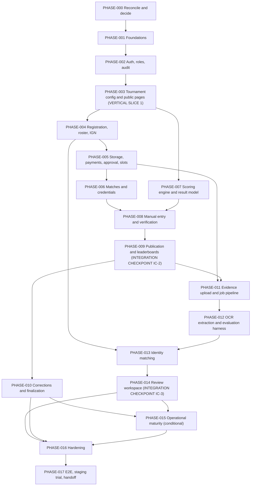

# implementation_phases.md — Frontend and backend delivery plan

> **Companion to** `implementation_reference.md` (the reference; IDs `REQ/FLOW/ROLE/DATA/API/TEST/DEC/CF` are defined there). Source IDs (`F#`, `FR-*`, `BR-*`, `S##`, `C##`, `M##`, edge-case IDs) are reused unchanged.
> **Status:** Draft for approval. **No dates, estimates, or team capacity are given** (none exist in the sources). **No application code is part of this pack.**
> **Stack status:** only React, Node.js + Express, and PostgreSQL are fixed (tech-stack header). Other technologies named below are **[PROPOSAL]** until their `DEC-###` is approved.

---

# 0. Planning rules (apply to every phase)

1. **Vertical slices, real integration.** Every phase that adds a user-visible capability delivers frontend + API + database + tests together against the real backend. The frontend is never built on mocked data to be "connected later" (tech-stack §2, §4.4: build the backend slice or at least its contract first; never invent endpoints).
2. **Contract first.** For each slice the `API-###` operations and shared schemas in `packages/shared` are agreed before the UI is built. Missing endpoint → add it to the reference §8 first.
3. **Core invariants before parallel feature work.** State machines, constraints, audit, idempotency, and versioning (PHASE-001/002) precede feature modules.
4. **Order of risk:** manual result path (PHASE-007–010) is completed **before** evidence/OCR (PHASE-011–014), as in ideation §10 stages 4–5 before 6–7. OCR is never the only path.
5. **No official scoring before the ruleset and data contracts are explicit** (PHASE-003 ruleset model, PHASE-007 engine). Ruleset *values* come from the organizer (`DEC-013/014`); tests use fixtures labelled illustrative.
6. **Each phase is small enough to review.** A phase that grows may be split by the same exit criteria.
7. **Human blockers are explicit.** A phase marked **BLOCKED-ON** cannot start its dependent tasks until the listed `DEC-###` is approved; preparatory tasks that do not depend on it may proceed.
8. **Conflicts and defaults:** `CF-###` items listed in a phase must be resolved or the recommended default explicitly approved before that phase's affected tasks begin.
9. **Docs travel with code:** each phase updates the reference (contracts), decision log, and runbooks when behavior changes.

## Dependency graph

Text equivalent: PHASE-000→001→002→003→004→005→006 is the registration-to-credentials spine; PHASE-007 (pure scoring/result model) can run in parallel with 004–006 after 003; PHASE-008 needs both 006 and 007; 009→010 complete the manual tournament; 011→012→013→014 add evidence and OCR on top of an already working manual path; 015 is conditional; 016→017 close out.

**Safe parallel work:** PHASE-007 (pure domain) alongside PHASE-004–006; frontend slice work of one phase alongside backend of the next only if the next phase's contract is frozen; eval corpus collection (PHASE-012 prep) from PHASE-000 onward; test-fixture authoring. **Must stay sequential:** migrations (single owner per phase), shared types/routing config, state-machine tables, PHASE-008→009→010.

**Integration checkpoints:** IC-1 after PHASE-006 (a registered, approved, slotted team sees credentials at release time only); IC-2 after PHASE-009 (a simulated tournament completes via manual entry with correct standings); IC-3 after PHASE-014 (an OCR-assisted match goes from upload to published result with fake provider, then with the real provider if selected).

---

# PHASE-000 — Source reconciliation, decision triage, bootstrap decisions

- **Objective:** make the source set usable: approve or defer the decisions that block setup; confirm conflict handling.
- **Why now:** stack and process decisions (`DEC-001`, `002`, `003`, `011`, `012`) change every later file.
- **Prerequisites:** the five source documents and this pack.
- **Frontend tasks:** none (confirm design token source is `design.md` §4; confirm that no screens are generated before contracts exist).
- **Backend tasks:** none.
- **Database/migration tasks:** none.
- **Integrations:** none. **Evidence work starts here:** begin collecting the screenshot corpus (privacy review first, problem §30) because PHASE-012 depends on it.
- **Security:** decide privacy handling for the corpus (it contains other players' names).
- **Testing tasks:** none; define the test naming rule (TEST-### + edge-case IDs).
- **Documentation:** create `docs/decision-log.md` seeded from reference §16; record approved defaults for `CF-001…CF-020`.
- **Deliverables:** decision log with `DEC-001/002/003/011/012/041/042` approved or explicitly defaulted; list of blockers per phase.
- **Acceptance / DoD:** Owner has approved or consciously deferred each item in the "needed before PHASE-001" set; `CF-002` build mode is stated.
- **Risks:** analysis paralysis; a default silently becoming a decision.
- **Must not implement yet:** any code beyond throw-away spikes.
- **Verify:** manual review of the decision log against reference §16/§18.
- **Exit:** approvals recorded. **BLOCKED-ON:** `DEC-001`, `DEC-002`, `DEC-003`, `DEC-011`, `DEC-012`.

# PHASE-001 — Foundations: repository, configuration, database, CI, contracts skeleton

- **Objective:** a running skeleton: monorepo, configuration validation, PostgreSQL via Docker Compose, migration tooling, CI, error/response conventions, shared-contract package, SPA shell with design tokens.
- **Why now:** all slices depend on these; contracts-first rule.
- **Prerequisites:** PHASE-000.
- **Frontend tasks:** SPA shell (C01 variants, routing skeleton), design tokens (design §4) and motion tokens (animations §3), single status-vocabulary catalog (design §10.3), API client, system pages S50–S54, global connection banner (design §5.4), reduced-motion handling baseline (animations §5.2).
- **Backend tasks:** Express app, middleware chain, central error handler producing the §8.1 error shape, correlation IDs, structured logging, config schema with fail-fast, `/health/live` and `/health/ready` (API-190, 191), `/meta/config` (API-194).
- **Database/migration tasks:** migration tool, first empty migration, test database setup, separate DB URLs; conventions: forward-only, integrity rules in SQL.
- **Integrations:** Docker Compose (PostgreSQL; storage emulator may wait for PHASE-005).
- **Security:** secrets only via environment; `.env` ignored; secure headers; strict CORS (MC-06, MC-16).
- **Testing tasks:** unit/integration harness with real PostgreSQL; config-failure test (TEST-078); migration-from-empty test (TEST-094); vocabulary catalog test (TEST-087); CI runs lint, type-check, tests, migrations.
- **Documentation:** README (run, test), env table (reference §14), module map.
- **Deliverables:** green CI; `docker compose up` yields API + DB + SPA shell with health page.
- **Acceptance / DoD:** TEST-078, 087, 094 pass; S50–S54 render; error shape verified.
- **Risks:** over-building infrastructure; adding unapproved dependencies.
- **Must not implement yet:** business tables beyond what PHASE-002 needs; storage; queue; any screen with data.
- **Verify:** automatic (CI) + manual (`curl` health, load SPA on phone-width viewport).
- **Exit:** CI green on a clean checkout. **Dependencies:** PHASE-000. **BLOCKED-ON:** `DEC-001/002/011`.

# PHASE-002 — Authentication, profiles, roles, authorization, audit core, idempotency/versioning

- **Objective:** real accounts and server-enforced authorization, plus the cross-cutting write machinery (audit in-transaction, idempotency keys, optimistic versions).
- **Why now:** every later endpoint needs authorization, audit, idempotency, and version checks.
- **Prerequisites:** PHASE-001.
- **Frontend tasks:** S07 sign-in/sign-up, S44 profile (theme toggle only if `DEC-037`), S43 shell stub, session-expiry dialog and S53, role-based navigation (absent vs Locked, design §5.2), S50 access denied.
- **Backend tasks:** API-001–006 (and 007 if password method), sessions, CSRF, role grants (DATA-002), authorization middleware + object-level check helpers, audit writer (DATA-030), idempotency middleware (DATA-033), version-conflict helper, rate limiting on auth routes.
- **Database/migration tasks:** DATA-001, 002, 003, 030, 033; audit immutability (permissions/trigger) (MC-10).
- **Integrations:** none (email only if `DEC-003` requires it).
- **Security:** MC-01, 02, 03, 12, 13, 15; non-enumerating errors; session revoke.
- **Testing tasks:** TEST-069, 070, 071 (framework + first routes), 072, 073 (matrix harness), 074, 076, 077, 109; Playwright sign-in flow.
- **Documentation:** authorization policy table (role × endpoint) skeleton in the reference.
- **Deliverables:** a user can register, sign in, see role-appropriate navigation; admin/user separation proven by tests.
- **Acceptance / DoD:** listed tests pass; no endpoint exists without a declared policy.
- **Risks:** auth method change late (`DEC-003`); forgetting audit in new routes.
- **Must not implement yet:** tournament-scoped admin grants beyond a seeded super-admin (`DEC-026`); roster-member linking.
- **Verify:** automatic + manual attempt to hit admin endpoints as a normal user.
- **Exit:** TEST-072, 073, 076, 077 green. **Dependencies:** PHASE-001. **BLOCKED-ON:** `DEC-003`.

# PHASE-003 — Tournament configuration, ruleset model, public pages (**VERTICAL SLICE 1**)

- **Objective:** the first real end-to-end slice: an admin creates, validates, publishes, and opens registration for a tournament; the public sees it.
- **Why now:** proves FE↔API↔DB↔tests and the audit/version/idempotency machinery on a small workflow, before registration complexity.
- **Prerequisites:** PHASE-002. `CF-004` semantic default for tournament states is already defined by problem §13.
- **Frontend tasks:** S21, S22 (steps incl. matches list; scoring step embeds S23), S23 (blank/valid/invalid/frozen states, no preview yet), S01, S02, S03 (CTA states), M01; C04, C10, C11, C35, C43, C44, C16.
- **Backend tasks:** API-010–015, 020–025, 030–033; transitions (Draft → Published → RegistrationOpen → Closed, Cancelled); publish validation (FR-T2); ruleset versions with confirm; auto `InProgress` rules deferred to PHASE-006.
- **Database/migration tasks:** DATA-005, DATA-006, DATA-013 (match rows needed for schedule validation; status enum per `DEC-045`).
- **Integrations:** none.
- **Security:** published-only public reads; ROLE-004 scope checks; audit on every transition (MC-03, MC-12).
- **Testing tasks:** TEST-106, 107, 055, 062 (public), 021 (overlap), 022 (tournament part); E2E: admin creates and publishes → visitor sees it.
- **Documentation:** update reference §8 if the contract moved.
- **Deliverables:** deployed-in-dev slice; demo seeds clearly labelled illustrative.
- **Acceptance / DoD:** an admin cannot publish an invalid tournament; a visitor never sees a Draft.
- **Risks:** scope creep into scoring preview/rescore (later); inventing default scoring values.
- **Must not implement yet:** scoring calculation, preview (API-034), rescore, registration.
- **Verify:** automatic + manual walk-through on desktop and phone width.
- **Exit:** TEST-055, 062, 106, 107 pass; M01 reduced-motion equivalent present (TEST-086 for M01). **BLOCKED-ON:** `DEC-045` for match-status enum; `DEC-042` timezone display.

# PHASE-004 — Teams, registration, roster, IGN capture, normalization library

- **Objective:** captains can register a team with roster and IGNs; IGN raw/derived storage and collision warnings work.
- **Why now:** roster quality drives identity resolution (problem §11.B); normalization is needed at registration time.
- **Prerequisites:** PHASE-003.
- **Frontend tasks:** S09, S10 (wizard; payment step per `DEC-044`), S11, S13 (status rows), C05, C09, C35 checklist, C46 IGN text with codepoint toggle.
- **Backend tasks:** API-040–052; `normalization` pure module (F1–F3 forms, versioned; reference §9.7); constraints for BR-R1–R3; server-time deadlines; roster lock; change requests (API-051, 064 if `DEC-015`); object-level authorization for registrations.
- **Database/migration tasks:** DATA-004, 007, 008, 009, 034 with partial unique indexes (one active registration per team/tournament; one active registration per player per tournament; normalized team-name uniqueness).
- **Integrations:** none.
- **Security:** MC-03, 08, 17; collision-warning privacy (`CF-018`); IDOR protection (EX-01).
- **Testing tasks:** TEST-001–009, 038 (normalization fixtures), 075; unit tests for normalization with a fixture set of ASCII, full-width, math-alphanumeric, small-capital, bidi/control strings.
- **Documentation:** normalization table version and confusable table location.
- **Deliverables:** a captain registers a complete team; admin sees roster flags.
- **Acceptance / DoD:** raw IGN round-trips byte-exact; approximate IGN does not block; duplicates blocked.
- **Risks:** invitation flow (`DEC-035`) expanding scope; confusable-table overreach (keep penalties as config).
- **Must not implement yet:** matching against OCR, alias learning, approval, payment.
- **Verify:** automatic + manual registration on a phone viewport.
- **Exit:** TEST-001–008, 038 pass. **BLOCKED-ON:** `DEC-035`, `DEC-044`, `DEC-029`.

# PHASE-005 — Private storage, payments, approval, slots, in-app notifications core

- **Objective:** payment proof upload, admin verification, gated approval, transactional slot assignment; storage and upload pipeline reusable for screenshots.
- **Why now:** the storage/upload pipeline must exist and be hardened before OCR evidence; approval gates later match participation.
- **Prerequisites:** PHASE-004.
- **Frontend tasks:** S12, S24, S25 (payment preview C15, approval gate panel), S26 (C13, C39, M02), C06 upload zone, C19-lite viewer; S43 notifications list (core events).
- **Backend tasks:** storage adapter + signed links (API-075), upload pipeline (type/size/decode/hash/re-encode), API-060–067, 070–074, notifications module (API-152–154) for approval/payment/slot events; slot assignment with row locking; duplicate proof flags; waiver; reversal flags approval.
- **Database/migration tasks:** DATA-011, 012, 018, 019, 031.
- **Integrations:** object storage (emulator locally; provider per `DEC-005`).
- **Security:** MC-04, 07, 09, 10, 11; private storage; signed link expiry.
- **Testing tasks:** TEST-010–020, 028–031 (storage parts), 079 (partial), 104 (later with match evidence).
- **Documentation:** upload limits config (`DEC-041`).
- **Deliverables:** approved, slotted teams; payment history preserved.
- **Acceptance / DoD:** approval impossible without verified/waived payment; concurrent slot assignment safe.
- **Risks:** limits unknown; waitlist temptation (`DEC-017`).
- **Must not implement yet:** match screenshots, jobs, waitlist (unless approved).
- **Verify:** automatic (real PostgreSQL concurrency test) + manual proof upload from a phone.
- **Exit:** TEST-010–020 pass. **BLOCKED-ON:** `DEC-041` values, `DEC-017` (waitlist scope), `DEC-028`.

# PHASE-006 — Matches, attempts, state machine, protected credentials, operations board

- **Objective:** schedule matches, run admin-declared status transitions, manage versioned credentials released only to eligible roster members.
- **Why now:** needs approved/slotted teams; precedes results.
- **Prerequisites:** PHASE-005; `CF-004` approved or its recommendation explicitly adopted (`DEC-045`).
- **Frontend tasks:** S27, S28 (C41, C45, Next-action card), S29, S14 (C14 participant view, M03), S20 overview (queues available so far), C12.
- **Backend tasks:** API-080–087, 090–095, 027; match state machine (pure table); attempts and restart isolation; participants derivation; credential versions, release timing, access log, rotate/revoke; tournament auto-transitions (InProgress, Finalizing candidates); reschedule notifications.
- **Database/migration tasks:** DATA-014, 015, 016, 017; credential encryption key usage.
- **Integrations:** none new.
- **Security:** MC-05; eligibility check (TEST-024); credentials never in notifications/logs.
- **Testing tasks:** TEST-021–027, 099, 105, 108, 022 (match part); E2E credential access across roles and times.
- **Documentation:** runbook "credential leak → rotate" (problem §29.5).
- **Deliverables:** **IC-1** — registered, approved, slotted team sees credentials only after release.
- **Acceptance / DoD:** wrong-match guard enforced server-side; denied views audited.
- **Risks:** players without linked accounts (`DEC-050`); timezone confusion.
- **Must not implement yet:** evidence, results, standings.
- **Verify:** automatic + manual time-travel test of release time.
- **Exit:** IC-1 demonstrated. **BLOCKED-ON:** `DEC-045`, `DEC-050`, `DEC-030` (interruption behavior).

# PHASE-007 — Scoring engine (pure) and result data model

- **Objective:** deterministic scoring/ranking/tie-break as pure functions, plus the result/stat/team-result data model and state machine, with no UI.
- **Why now:** must exist before verification/publication; can run in parallel with PHASE-004–006 because it depends only on PHASE-003 ruleset model.
- **Prerequisites:** PHASE-003. Ruleset **values** not required; tests use fixtures labelled illustrative.
- **Frontend tasks:** none (design reference only: C17 breakdown anatomy).
- **Backend tasks:** `scoring-engine` in `domain/` (team kills, kill points, placement points, penalties, match points, match ranking, overall standings, tie-break resolution), result state machine (Draft/InReview/Verified/Published/Superseded/Voided), gate evaluation function (reference §10, problem §18.3).
- **Database/migration tasks:** DATA-024, 025, 026, 027, 028 with constraints (kills integer ≥ 0; one Published per attempt; unique version numbers).
- **Integrations:** none.
- **Security:** none new; no client-supplied totals accepted (MC-20).
- **Testing tasks:** TEST-051–053, 056, 057, 059 (unit/property); gate evaluation unit tests.
- **Documentation:** scoring test-vector file with worked examples (marked illustrative).
- **Deliverables:** a tested pure library and migrations.
- **Acceptance / DoD:** scoring twice = one result; order-independence property holds; ties deterministic.
- **Risks:** inventing default tables or tie-breaks; floating-point for fractional points (use exact decimal).
- **Must not implement yet:** any endpoint that mutates results.
- **Verify:** automatic (unit/property).
- **Exit:** TEST-051–053, 056 pass. **BLOCKED-ON:** none for the engine; `DEC-013/014` block *real tournaments*.

# PHASE-008 — Manual result entry and verification gate

- **Objective:** the guaranteed fallback and the verification gate: admin enters per-player kills and placements for a match attempt and verifies.
- **Why now:** proves the whole result path before OCR (ideation §10 stage 4).
- **Prerequisites:** PHASE-006, PHASE-007.
- **Frontend tasks:** S34 (C23 team panels pre-populated with participants, C24 bar, C22 gate, C45), reason field, maturity chips (design §4.5), S35 Verify panel (publish panel inert/locked), M06.
- **Backend tasks:** API-120–123, 126–128, 131; row edits with version checks; did-not-play and ignore with reasons; placement validity/uniqueness; server-derived team totals; verify locks data; reopen-for-review while unpublished.
- **Database/migration tasks:** none beyond PHASE-007 (add indexes/columns found necessary via new migrations only).
- **Integrations:** none.
- **Security:** version checks (BR-X10), audit (MC-12).
- **Testing tasks:** TEST-049, 050, 051, 069, 101, 102, 103, 110 (if `DEC-047`); E2E manual entry to Verified.
- **Documentation:** gate rules reference.
- **Deliverables:** a match can be fully entered and verified by hand.
- **Acceptance / DoD:** Verify impossible with blockers; no global override exists.
- **Risks:** UI computing totals (forbidden; TEST-089).
- **Must not implement yet:** publishing, evidence, OCR rows.
- **Verify:** automatic + manual with two admins editing concurrently.
- **Exit:** manual match reaches Verified. **BLOCKED-ON:** `DEC-047`.

# PHASE-009 — Publication, leaderboards, standings snapshots, public results (**INTEGRATION CHECKPOINT IC-2**)

- **Objective:** publish verified results; match and overall leaderboards from published data; snapshots and rank diffs.
- **Why now:** completes the core value path using manual data.
- **Prerequisites:** PHASE-008.
- **Frontend tasks:** S35 Publish panel (C31 consequences), S36, S37 (no penalties/correction yet), S04, S05, M07, M08, C17, C18, C37 (preview of standings impact).
- **Backend tasks:** API-129, 012, 013, 131, 142–144; publish transaction (score, Published, snapshot, audit, notifications); standings recompute with diff; "Pending" semantics; ties display.
- **Database/migration tasks:** snapshot tables finalized (DATA-028 lines/inputs).
- **Integrations:** none.
- **Security:** only Published data public (MC-20); idempotent publish.
- **Testing tasks:** TEST-060–063, 053, 056, 095 (manual E2E happy path through publish), 086 for M06–M08.
- **Documentation:** public API examples in the reference.
- **Deliverables:** **IC-2** — a simulated tournament (using clearly labelled demo data and organizer-approved test ruleset if available) completes with correct standings.
- **Acceptance / DoD:** retrying publish yields one Published version; unpublished matches show Pending.
- **Risks:** stale standings; publishing from stale versions.
- **Must not implement yet:** corrections, finalization, banners.
- **Verify:** automatic + manual simulated tournament with an independent spreadsheet recomputation.
- **Exit:** IC-2 signed off. **BLOCKED-ON:** `DEC-014` for within-match/overall ordering in a real tournament.

# PHASE-010 — Corrections, penalties, rescore, finalization, podium, archive, audit viewer

- **Objective:** integrity after publication and a clean end of the tournament.
- **Why now:** integrity before automation (ideation §10 stage 5).
- **Prerequisites:** PHASE-009; `DEC-019/021/024` as applicable.
- **Frontend tasks:** S38 (C37 impact preview, podium-change acknowledgement), S37 penalties, S23 rescore flow, S42 checklist + tie resolution, S06 podium (C38, M10), S46 reopen dialog, S41 audit (C26), M09.
- **Backend tasks:** API-132–134, 035, 036, 140, 141, 025 (archive), 026, 028, 029, 145, 150, 151; disqualification policy application; void; finalization gate.
- **Database/migration tasks:** correction versioning use of DATA-024; penalties; tie-resolution record.
- **Integrations:** none.
- **Security:** reasons required; platform-admin-only reopen; audit viewer scoping.
- **Testing tasks:** TEST-054, 057, 058, 063–068, 071, 098.
- **Documentation:** runbook "wrong publication → correction".
- **Deliverables:** corrections with history; finalized, archived tournament; podium.
- **Acceptance / DoD:** podium-change requires explicit acknowledgement; archive is read-only.
- **Risks:** policy ambiguity for DQ/rescore; accidental rule changes mid-tournament.
- **Must not implement yet:** dispute workflow, banners.
- **Verify:** automatic + manual correction scenario with a podium change.
- **Exit:** TEST-063–068, 098 pass. **BLOCKED-ON:** `DEC-019`, `DEC-021`, `DEC-024`.

# PHASE-011 — Evidence upload, job queue, OCR adapter interface with fake provider

- **Objective:** the screenshot lifecycle and asynchronous job mechanics **without** a real OCR engine.
- **Why now:** upload/storage/data lifecycle must be understood before OCR (planning rule 4); jobs, retries, and UI states are testable with a fake.
- **Prerequisites:** PHASE-005 (storage), PHASE-009 (manual path done).
- **Frontend tasks:** S30 (upload, list, replace, re-link), S31 queue table, S28 job card, C36 states incl. failure/timeout/unsupported/no text, M04 (quiet), "Enter results manually" beside every extraction state (DR-19).
- **Backend tasks:** API-100–104, 110–113; job queue **[PROPOSAL: pg-boss in PostgreSQL; `DEC-051`]**, workers, bounded retries, timeouts, dedupe key, backlog visibility; `OcrProvider` interface + fake provider emitting canned drafts and injectable faults; transactional enqueue; typed errors.
- **Database/migration tasks:** DATA-020, 021, 022 (raw JSONB immutable); evidence attachment use for attempts.
- **Integrations:** queue (in-DB); no real OCR.
- **Security:** MC-04, 07, 10, 14; duplicate handling; roster-mismatch warning plumbing.
- **Testing tasks:** TEST-029, 030, 032, 033, 034, 035, 037, 090, 097, 104; fault-injection tests via fake.
- **Documentation:** job state table; runbook "OCR outage".
- **Deliverables:** upload → job → fake draft visible in the API; manual path still works.
- **Acceptance / DoD:** duplicate upload dedupes; provider timeout leaves manual path available.
- **Risks:** treating the fake's output as evidence of OCR quality.
- **Must not implement yet:** matching to roster, review UI, real provider.
- **Verify:** automatic + manual outage simulation.
- **Exit:** TEST-032–035 pass. **BLOCKED-ON:** `DEC-041` limits; `DEC-051`.

# PHASE-012 — Screenshot corpus, OCR provider(s), preprocessing, row assembly, evaluation harness

- **Objective:** bake-off and first real extraction path behind the adapter, with measurement.
- **Why now:** engine choice requires evidence (problem §16.4, Q-08).
- **Prerequisites:** PHASE-011; the labeled corpus (human work started in PHASE-000).
- **Frontend tasks:** none except unsupported-layout/no-text messages already specified.
- **Backend tasks:** preprocessing module (crop/scale per supported layout), layout registry, provider implementations for candidates (**[PROPOSAL]** Python worker engines, managed API; Node engine), row/field assembly with sanity flags, raw-output storage; `eval/harness` computing reference §9.12 metrics per `pipeline_version`.
- **Database/migration tasks:** as needed for pipeline version records; none speculative.
- **Integrations:** chosen OCR engine/service (**BLOCKED-ON `DEC-004`** for the production choice; candidates run in evaluation only).
- **Security:** disclosure of external data flow before production use (problem §27.3.8); no corpus images committed to public repos.
- **Testing tasks:** TEST-036, 082; recorded-output tests for assembly.
- **Documentation:** bake-off report (metrics, not claims), layout registry doc.
- **Deliverables:** evidence-based engine recommendation; assembled rows with flags for the first supported layout.
- **Acceptance / DoD:** harness reproduces metrics; unsupported layouts route to manual.
- **Risks:** corpus not available (**blocker**); accuracy too low for usefulness (the manual path remains the MVP).
- **Must not implement yet:** custom model training; second reader (unless `CF-003`/FR-O4 approved).
- **Verify:** automatic harness runs + manual spot checks.
- **Exit:** engine decision proposal recorded for `DEC-004`. **BLOCKED-ON:** corpus (`DEC-031`), `DEC-004`.

# PHASE-013 — Identity matching engine

- **Objective:** roster-limited candidate ranking with tiers, margins, flags, and measurement.
- **Why now:** needs roster data (PHASE-004) and extracted rows (PHASE-012).
- **Prerequisites:** PHASE-004, PHASE-012; `normalization` from PHASE-004.
- **Frontend tasks:** none (UI in PHASE-014).
- **Backend tasks:** `identity-resolution`: tier computation T1–T5, weighted confusable costs (config), margin rule, Collision/Ambiguous/UnknownPlayer/Unreadable assignment, candidate snapshots, approximate-IGN cap, identity decision endpoint (API-124 service) and bulk-accept validation (API-125), alias support only if `DEC-046`; matching metrics in the harness.
- **Database/migration tasks:** DATA-023 with DB check that only humans set confirmed-type statuses; DATA-010 only if approved.
- **Integrations:** none.
- **Security:** MC-09 (DB check); candidates limited to participants.
- **Testing tasks:** TEST-038–048; wrong-suggestion rate on corpus (TEST-082).
- **Documentation:** thresholds config table; calibration notes.
- **Deliverables:** deterministic matcher with a conservative default (suggest only).
- **Acceptance / DoD:** system cannot confirm; ambiguity never preselected.
- **Risks:** threshold overfitting to the dev set; Unicode census surprises (`DEC-034`).
- **Must not implement yet:** auto-confirmation (see `CF-019`).
- **Verify:** automatic + corpus evaluation.
- **Exit:** TEST-038–047 pass; metrics recorded. **BLOCKED-ON:** `DEC-033` calibration values (defaults conservative).

# PHASE-014 — Review workspace and OCR-assisted results (**INTEGRATION CHECKPOINT IC-3**)

- **Objective:** the critical S32/S33 screen wired to real drafts, matches, and the existing gate/verify/publish path.
- **Why now:** depends on everything before it; reuses PHASE-008/009 backend.
- **Prerequisites:** PHASE-008, 009, 013.
- **Frontend tasks:** S32 (C19 viewer with numbered boxes and keyboard controls, C20 rows, C21 chooser, C23, C24, C22, shortcuts, stale-version banner), S33, M04/M05/M06; responsive `sm` tabbed layout; codepoint view; bulk-accept dialog.
- **Backend tasks:** API-114, 120 (ocr_assisted), 121–125; draft → working result rows; carry-over rules (none automatic); autosave with versions; roster-mapping edit action (audited, flags registration).
- **Database/migration tasks:** as needed for row-to-stat linkage.
- **Integrations:** fake provider and (if selected) the real provider.
- **Security:** evidence access via signed links; admin-only.
- **Testing tasks:** TEST-040–047, 083, 096, 097, 084, 085 (for S32), 086 (M04–M06); Playwright review flow with fixtures (Match 3 scenario analogues).
- **Documentation:** reviewer guide.
- **Deliverables:** **IC-3** — an OCR-assisted match goes upload → draft → review → verify → publish; the manual path still works.
- **Acceptance / DoD:** ambiguous/collision/unknown rows block Verify; bulk-accept excludes flagged rows; everything keyboard-operable.
- **Risks:** review becomes the bottleneck (measure correction rate, §30); offline edit semantics (`DEC-049`).
- **Must not implement yet:** second reader, alias learning (unless approved).
- **Verify:** automatic + admin walkthrough on real screenshots.
- **Exit:** IC-3 demonstrated. **BLOCKED-ON:** `DEC-049`.

# PHASE-015 — Operational maturity (conditional on approvals)

- **Objective:** deliver approved SHOULD/COULD items: alias learning, waitlist, simple dispute report, timing metrics, banners, second-admin confirmation, extended notifications, uploader role, dark theme.
- **Why now:** polish after core reliability (ideation §10 stage 8).
- **Prerequisites:** PHASE-010 and PHASE-014; each item needs its `DEC-###`.
- **Frontend tasks (per approved item):** S16, S39 (disputes), S40 + C25 + M11 (banner), S26 waitlist, S20 timing views, alias checkbox in C21, dark tokens, S44 motion setting.
- **Backend tasks:** API-068, 160–163, 170–171, 192; alias logic; second-admin gate; notification channel adapter.
- **Database/migration tasks:** DATA-010, 029, 032, 035 as approved.
- **Integrations:** notification channel (`DEC-007`), banner renderer (`DEC-008`).
- **Security:** dispute window/eligibility enforced server-side; banners only from published snapshots.
- **Testing tasks:** TEST-019, 048, 079, 080, 081 as applicable.
- **Documentation:** update reference scope table.
- **Deliverables:** only the approved items.
- **Acceptance / DoD:** each shipped item has its tests and does not alter core gates.
- **Risks:** scope creep; dispute load on match day.
- **Must not implement yet:** anything not explicitly approved; multi-game.
- **Verify:** automatic + manual per item.
- **Exit:** each item either shipped with tests or deferred with sign-off. **BLOCKED-ON:** corresponding `DEC-007/008/017/022/023/036/037/040/046`.

# PHASE-016 — Hardening: security, accessibility, responsive, motion, performance, resilience

- **Objective:** close MC-01…MC-20, accessibility/responsive/motion gaps, and rehearse recovery.
- **Why now:** before the trial; defects found here are cheaper than during a live event.
- **Prerequisites:** PHASE-010, 014 (and 015 items shipped).
- **Frontend tasks:** accessibility audit (keyboard, focus, contrast verification with real fonts, live regions), responsive pass per design §12.3, reduced-motion verification and low-end device throttle test (animations §5, §13), copy audit against design §10, empty/error/offline states per design §11.
- **Backend tasks:** rate limits tuned, invariant-check job and CLI (§13), health/degraded behavior, log review for secrets, dependency audit, credential-encryption key rotation notes.
- **Database/migration tasks:** index/performance review on real data volumes; verify immutability permissions.
- **Integrations:** backup tooling.
- **Security:** full checklist review against MC list; internal abuse-case review (EX-*).
- **Testing tasks:** TEST-072, 074–078, 084–092, 094; load test of the job queue with a realistic burst (ER-10R).
- **Documentation:** runbooks (§13), security notes.
- **Deliverables:** hardening report; restore rehearsal log.
- **Acceptance / DoD:** TEST-083–092 pass; backup restored successfully.
- **Risks:** accessibility target undecided (`DEC-010`); performance numbers unmeasured (do not claim).
- **Must not implement yet:** new features.
- **Verify:** automatic + manual restore and device tests.
- **Exit:** hardening report signed. **BLOCKED-ON:** `DEC-010`, `DEC-048`.

# PHASE-017 — End-to-end tests, staging deployment, simulated tournament, handoff

- **Objective:** prove the MVP on a deployed environment and hand it over.
- **Why now:** final gate against the Definition of Done (reference §15.5).
- **Prerequisites:** PHASE-016; hosting decision (`DEC-006`).
- **Frontend tasks:** final defects only.
- **Backend tasks:** deployment scripts, migrations at deploy, smoke tests, production configuration checklist.
- **Database/migration tasks:** apply migrations in staging/prod; seed disabled in prod.
- **Integrations:** production storage, OCR provider (if selected), notification channel (if selected).
- **Security:** production secrets provisioned outside the repository; HTTPS verified.
- **Testing tasks:** TEST-093, 095–100; simulated tournament trial capturing §30 metrics with organizer participation.
- **Documentation:** handoff pack: current reference, decision log (all `DEC` resolved or deferred), runbooks, OpenAPI, known limitations, deferred items.
- **Deliverables:** deployed MVP, trial report, handoff.
- **Acceptance / DoD:** every item in reference §15.5 satisfied.
- **Risks:** hosting/budget unresolved; organizers unavailable for trial.
- **Must not implement yet:** post-MVP features.
- **Verify:** automatic E2E in staging + manual trial.
- **Exit:** Owner/Organizer sign-off. **BLOCKED-ON:** `DEC-006`, `DEC-020`.

---

# Blocker summary (human decisions)

| Needed before | Decisions |
|---|---|
| PHASE-001 | DEC-001, 002, 011, 012 |
| PHASE-002 | DEC-003 |
| PHASE-003 | DEC-042, 045 |
| PHASE-004 | DEC-029, 035, 044 |
| PHASE-005 | DEC-017, 028, 041 |
| PHASE-006 | DEC-030, 050 |
| Real tournament use (not engine code) | DEC-013, 014, 019, 021 |
| PHASE-010 | DEC-019, 021, 024 |
| PHASE-012 | DEC-004, 031 (corpus) |
| PHASE-013 | DEC-033, 034 |
| PHASE-014 | DEC-049 |
| PHASE-016/017 | DEC-006, 010, 020, 048 |
