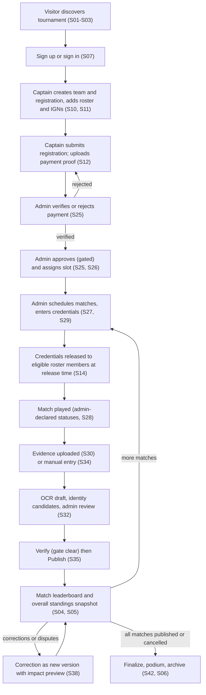
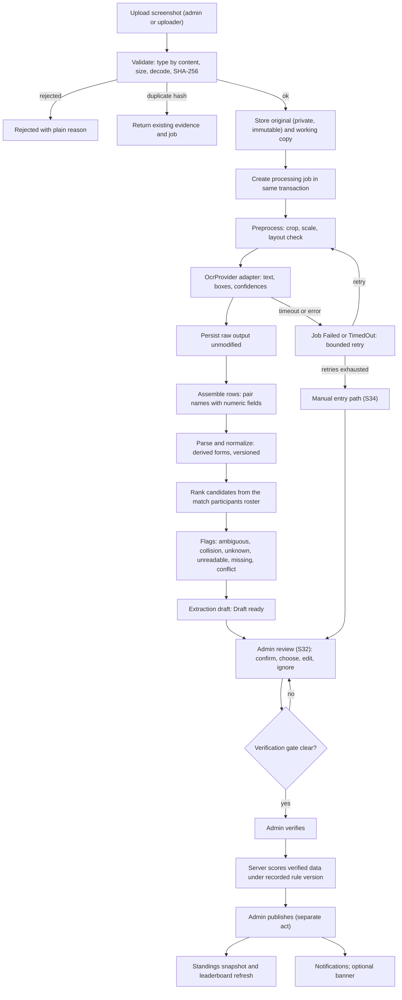
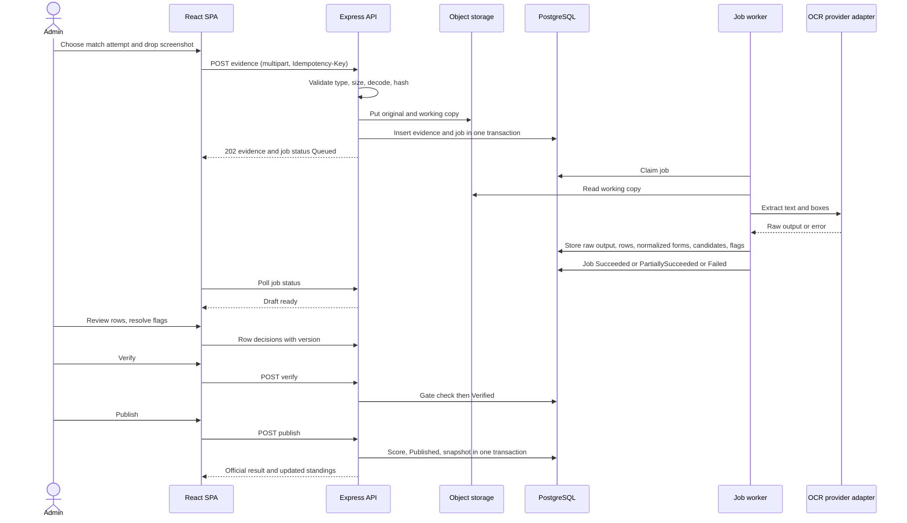
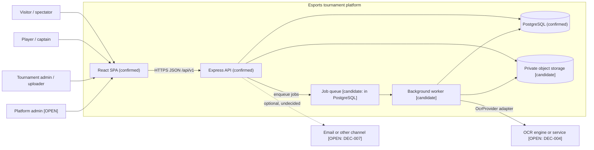
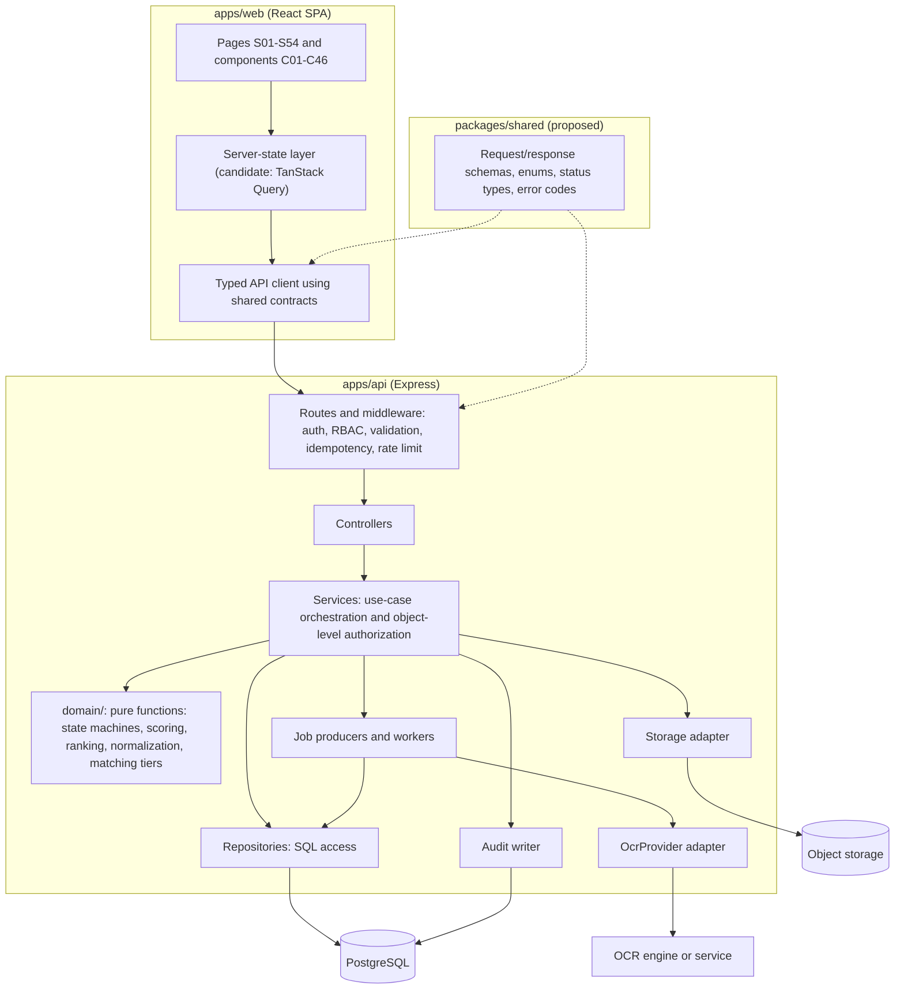
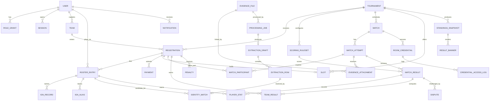

# implementation_reference.md — Implementation Reference Pack (entry point)

> **Product:** evidence-first esports tournament operations platform, initially college Free Fire MAX battle-royale tournaments (working name: "the platform"; no product name is established in the sources).
> **Pack date:** 2026-10-18 (same date as the source documents).
> **Pack status:** Draft for approval. Everything here is derived from the five attached source documents. **No application code is included or implied.**
> **Companion files:** `implementation_phases.md` (delivery plan), `ai_coding_agent_guide.md` (agent operating rules), `requirements_traceability.csv` (machine-readable traceability).

**Status tags used in this pack**

| Tag | Meaning |
|---|---|
| **[CONFIRMED]** | Stated by at least one source document (cited). |
| **[PROPOSAL]** | Proposed by a source document or by this pack; not approved. The source it comes from is cited when it is a source proposal. |
| **[PACK-DEFAULT]** | A conservative default chosen by this pack to let work proceed; **awaiting approval**; recorded in the Open Decisions Register (§16, `DEC-###`). |
| **[OPEN]** | Unresolved; needs a human decision or evidence. |
| **[CONFLICT]** | Two sources disagree or a source disagrees with the task brief; recorded in §18 (`CF-###`). The relevant source continues to govern until the recommendation is approved. |
| **[VALIDATE]** | Source scope label (ideation §6/§7, design §1.4): depends on real-world evidence; not promoted to a hard requirement by this pack. |

---

# 1. Document purpose and reading order

## 1.1 The input documents

| File | What it is | Self-declared status | Governs | Consult it when |
|---|---|---|---|---|
| `problem.md` | Problem definition: users, constraints, as-is/to-be workflows, lifecycles and state tables (§13, §14, §16.7, §17.7, §22, §25), business rules (`BR-*`), functional requirements (`FR-*`), edge-case catalogue (`ER-/EP-/ES-/EM-/EO-/EL-/EX-`, §28), assumptions (`A-*`), open questions (`Q-*`), success measures (§30) | Draft v1.0 | **Product behavior, states, rules, edge cases, privacy, open business questions** | Before implementing any state machine, rule, validation, permission, failure path, or metric |
| `ideation.md` | Product concept: design rules `D1–D14`, features `F1–F26` with scope labels Core / Validate / Later, role limits (§5), OCR-to-publication flow, coverage matrix, build order (§10) | Ideation stage; "Not a PRD, schema, API spec, or plan" | **Scope and feature intent**; MVP boundary | Before deciding whether something is in scope, and for the intended behavior of each feature |
| `design.md` | UI/UX specification: tokens, shell/IA, components `C01–C46`, screens `S01–S54`, state matrix, score display rules, vocabulary (§10.3), banned patterns `DR-01…DR-22` | Draft v1.0 | **Visual design, layout, component anatomy, copy/status vocabulary, accessibility and responsive behavior** | Before building or changing any screen, component, label, or visual state |
| `animations.md` | Motion spec: tokens, frequency tiers, component/screen motion, signature moments `M01–M11`, reduced-motion rules, motion budgets | Draft v1.0; "reasoned design targets to test" | **Motion and interaction timing, reduced-motion behavior** | Before adding any transition, moment, or loading/processing indicator |
| `tech-stack.md` | Technology stack: **fixed** = React frontend, Node.js + Express backend, PostgreSQL; **everything else [PROPOSAL]**; backend language/ORM/auth/jobs/storage/OCR/testing/deployment options; `T-01…T-11` open decisions | Draft v1.0; "Proposal for decision, not an architecture document" | **Technology constraints and the three fixed choices** | Before adding a dependency, choosing a library, or defining module layering |

**Stack-status rule [CONFIRMED]:** the only fixed technology choices are React (frontend), Node.js + Express (backend), and PostgreSQL (tech-stack.md header). Every other stack item (TypeScript, Drizzle, Zod, sessions, pg-boss, S3-compatible storage, sharp, OCR engine, Vite, Tailwind, TanStack Query, etc.) is a proposal in the source and stays **[PROPOSAL]** in this pack until approved (`DEC-001…DEC-012`).

## 1.2 Precedence when documents are consulted together

| Question | Authoritative source | Notes |
|---|---|---|
| What must the product do / what are the rules, states, edge cases? | `problem.md` | `ideation.md` refines scope; if they disagree on behavior, `problem.md` wins and the disagreement is a `CF-###`. |
| Is feature X in the MVP? | `ideation.md` §6 scope labels and §7 scope summary (then this pack's §2 MoSCoW) | Where `ideation.md` is internally inconsistent (OCR), see `CF-003`. |
| What does it look like, what is it called, how does it behave on small screens? | `design.md` | Never changes behavior or permissions. |
| How does it move? | `animations.md` | Never changes behavior; every motion has a static equivalent. |
| Which technology? | `tech-stack.md`, only for the three fixed items; the rest are proposals | Do not silently convert proposals into decisions. |
| How should we implement it (modules, API, phases, tests)? | **This pack** | Subordinate to the sources: where the pack records a recommendation for a conflict, the recommendation is **not in force** until approved. |

## 1.3 How to handle contradictions, gaps, and defaults

1. **Contradiction between two sources:** do not pick silently. Follow the precedence table, record/lookup the `CF-###` in §18, state the implementation impact in the completion report, and use the **recommended default only if** the item is marked **[PACK-DEFAULT]** in §16 *and* the work cannot wait; otherwise stop that task and escalate.
2. **Missing information:** consult §16 (Open Decisions Register). If a safe default exists it is labelled **[PACK-DEFAULT]**; implement it behind configuration where possible so that approval can change it without schema surgery. If no default exists the task is **blocked on a human decision** (the phase plan marks such blockers).
3. **Proposed items:** anything tagged **[PROPOSAL]** may be implemented as the working choice only after its `DEC-###` is approved, except where a phase explicitly authorizes a spike.
4. **Never invent** scoring values, tie-breaks, official Free Fire rules, OCR accuracy figures, upload limits, retention periods, or timing guarantees. These are configuration or measured values (problem §19, §30; design DR-16, DR-20).

## 1.4 Compact document map

```
problem.md ──(problems, rules, states, edge cases, Q-xx)──┐
ideation.md ─(features F1–F26, scope labels, build order)─┼─▶ implementation_reference.md  (WHAT + HOW it connects)
tech-stack.md (fixed: React/Node+Express/PostgreSQL;      │        │
               rest = proposals, T-xx)                    │        ├─▶ implementation_phases.md   (ORDER of work, gates)
design.md ──(S01–S54, C01–C46, tokens, vocabulary)────────┤        ├─▶ ai_coding_agent_guide.md   (HOW the agent behaves)
animations.md ─(M01–M11, motion rules, reduced motion)────┘        └─▶ requirements_traceability.csv (IDs ↔ tests)
```

## 1.5 Identifier registry and mapping

Source identifiers are **reused exactly** and never renamed: `P1–P9`, `FR-*`, `BR-*`, `NFR` areas, `A-01…A-10`/`D-01…D-03` (problem §31), `Q-01…Q-28`, `ER-/EP-/ES-/EM-/EO-/EL-/EX-*` (and `ER-01R…ER-11R`), `F1–F26`, `D1–D14`, `T-01…T-11`, `S01–S54`, `C01–C46`, `DR-01…DR-22`, `MP-1…MP-10`, `M01–M11`, `MO-1…MO-8`, `O-1…O-20`.

Identifiers introduced by this pack:

| Prefix | Meaning | Where defined |
|---|---|---|
| `REQ-###` | Pack requirement (traceability unit) | `requirements_traceability.csv` |
| `FLOW-###` | End-to-end workflow | §4.2 |
| `ROLE-###` | Role/actor | §3 |
| `DATA-###` | Entity | §7 |
| `API-###` | API operation (provisional) | §8 |
| `TEST-###` | Acceptance/test unit | §15.3 |
| `PHASE-###` | Delivery phase | `implementation_phases.md` |
| `DEC-###` | Open decision | §16 |
| `CF-###` | Source conflict | §18 |
| `OUT-##` | Observable MVP outcome | §2.5 |

**Reconciliations (no source ID is renamed):**

| Requested scheme | Reconciliation |
|---|---|
| `UI-###` | **Not created.** Screens and components already have IDs in `design.md`; in this pack `UI-###` ≡ `Sxx` (screen) or `Cxx` (component). No duplicate ID space is introduced. |
| `ANIM-###` | **Not created.** `animations.md` defines `M01–M11` (signature moments); for non-signature motion this pack cites `animations.md` section numbers (e.g., "§7 C20"). In this pack `ANIM-###` ≡ `Mxx`. |
| Assumption numbering | problem §6.3 lists `A1–A4` as a summary; the full list in §31 uses `A-01…A-10`. Mapping: `A1`≈`A-03` (trusted uploader), `A2`≈`A-05`, `A3`≈`A-04`, `A4`≈`A-06`. This pack cites the `A-xx` form only. (`CF-007`) |
| `Q-15` | Covers two distinct decisions (data retention; rule-freeze timing). Split as `DEC-020` and `DEC-021` while `Q-15` is cited for both. (`CF-008`) |
| Match status "Completed" | See `CF-004`; resolved only as a recommendation. |

---

# 2. Product scope and MVP outcome

## 2.1 Confirmed product goal [CONFIRMED]

A single platform that carries a college Free Fire MAX battle-royale tournament from discovery through registration, roster and in-game-name capture, payment-proof review, approval, slot assignment, scheduling, protected room-credential release, result-screenshot intake, OCR-assisted extraction, roster-based player identification, human verification, deterministic configurable scoring, match and overall leaderboards, corrections with audit, final podium, and archival (problem §1; ideation §1). The central operational objective is to turn the admin's inter-match chore of *read, map, add, rank* into *review a pre-filled draft beside the original evidence and confirm* (problem §1, §7). **No accuracy or five-minute guarantee is claimed**; these are measured later (problem §30; ideation D14).

Three principles bind every requirement (problem §1; ideation D1–D3, D8):
1. **Evidence → draft → verified → published.** OCR output is never official. Only verified data scores; only published data is public.
2. **Identity before attribution.** Team kills exist only through a confirmed Roster Entry of that tournament.
3. **Deterministic scoring.** Arithmetic is application logic with versioned organizer-configured rules, never a language model.

## 2.2 MVP definition and boundary

**The MVP is a real, connected, deployable application** (React SPA + Express API + PostgreSQL + private object storage + background job processing + OCR adapter) in which a tournament can be run end to end for a single organizing team: registration through final podium, with a **guaranteed manual path** for results and an **OCR-assisted draft path** that always ends in human verification. A frontend-only prototype or mocked-data demo does **not** satisfy the MVP (see §15.5 Definition of Done).

MVP boundary rule: the MVP = ideation §7 "Initial core path" + the OCR-draft pipeline wiring (F13/F14, see `CF-003`) + the minimum audit/security/operations controls in §12–§13. Items labelled **[VALIDATE]** or **Later** in the sources are not promoted to MUST.

## 2.3 MoSCoW

| Class | Items (source IDs) | Notes |
|---|---|---|
| **MUST** | F1 public pages · F2 accounts/role-based entry · F3 tournament config & lifecycle · F4 team registration & roster · F5 IGN capture (raw preserved, exactness, derived forms stored separately) · F6 payment proof + manual verification · F7 approval/rejection (gated) · F8 slot assignment · F9 match scheduling & lifecycle · F10 protected room credentials · F11 match operations board · F12 screenshot upload & evidence management · F13 OCR extraction (single engine behind an adapter; first supported layout) · F14 roster-limited identity matching, no auto-confirmation · F15 review & verification gate · F16 manual result entry · F17 scoring ruleset & deterministic calculation · F18 match leaderboard · F19 overall standings with snapshots · F22 audit + corrections (versioned) · F23 finalization, podium, archive · F24 operations queues · F25 rules text & screenshot guidance · F21 in-app notifications (status communication) | F13/F14 are MUST **for pipeline wiring and safe behavior**; accuracy thresholds are measured, not promised (`CF-003`, `DEC-004`, `DEC-033`). F16 must exist **before** F13 (ideation §10 stage 4 before 6). |
| **SHOULD** | Alias learning (FR-I3) · simple "report a problem" dispute (FR-D1 minimum) · waitlist (BR-S2, FR-S1 M/V) · timing-event capture needed for §30 metrics · roster-change requests after lock (FR-R5, policy `DEC-015`) · password-reset/lockout for the chosen login method | Each is **[VALIDATE]** in the sources; recommended because they protect integrity or measurement, but they need owner approval. |
| **COULD** | Result banner (F20) · second extraction reader (FR-O4) · profile-screenshot IGN confirmation (F5 Validate) · second-admin confirmation (Q-17) · external notification channel (Q-23) · timing dashboards (F24 Validate) · Dark theme (design §4.1, `DEC-037`) · "Motion: Match system / Reduce" setting (MO-2) · designated-uploader role (ideation §5 PROPOSAL) · full dispute workflow beyond a report | Ship only after the core path is verified; each has a `DEC-###`. |
| **OUT OF SCOPE** | Multi-game/multi-format (F26 Later) · custom OCR model training · in-platform payments, wallets, payouts · anti-cheat · direct game-state/live-feed integration · streaming overlays · player lifetime statistics / public per-player profiles · multi-organization marketplace · platform-admin dashboard (Q-20 open) · localization (design §12.2) · SEO/server rendering (tech-stack §4.1) · asserting official Free Fire scoring rules | problem §8.3–§8.4; design §8.6 "deliberately not made separate pages"; DR-15. |

## 2.4 Explicit non-goals [CONFIRMED]

Cloning any reference product; payouts/wallets; direct game-state integration; automated cheating detection; custom model training as a mandatory step; asserting official Free Fire MAX scoring rules (problem §8.4). The platform does not observe the game: match statuses are administrator-declared (problem §11.F).

## 2.5 Observable user outcomes

| ID | Outcome (what a user can observe) | Primary roles | Source |
|---|---|---|---|
| OUT-01 | A visitor can find a tournament and read rules, schedule, capacity, fee, scoring summary, and (when published) results; unpublished results show an explicit "pending" state, never blank | ROLE-001 | F1, §9.1 |
| OUT-02 | A captain can register a team with a complete roster, exact or approximate IGNs, submit payment proof, and see four independent statuses (Registration, Payment, Approval, Slot) with "what is missing and who acts next" | ROLE-003 | P1, P2, F4–F8 |
| OUT-03 | An admin can verify/reject payment, approve only gated registrations, and assign unique slots | ROLE-004 | F6–F8, §14 |
| OUT-04 | Only eligible, authenticated roster members of approved, slotted, non-disqualified teams can see room ID/password, and only after release time; changes create a new version and notify | ROLE-002/003 | F10, §15 |
| OUT-05 | An admin uploads a result screenshot against an explicitly chosen match attempt and sees the job status; if OCR fails, they can enter results manually | ROLE-004/006 | F12, F13, F16 |
| OUT-06 | An admin reviews a draft beside the original image; ambiguous, unknown, unreadable, or conflicting rows are flagged, never silently assigned | ROLE-004 | F14, F15 |
| OUT-07 | An admin can Verify only when the gate is clear, then Publish as a separate act; scores are computed by the server from verified data | ROLE-004 | §18, §19 |
| OUT-08 | Match leaderboard and overall standings update only from published results, with snapshots and rank diffs | all | F18, F19 |
| OUT-09 | A published result can be corrected only with a reason, as a new version with an impact preview; history is retained | ROLE-004 | F22, BR-X5 |
| OUT-10 | The tournament can be finalized (gated), shows a podium, and becomes read-only when archived | ROLE-004, public | F23, BR-X6/X7 |
| OUT-11 | Every consequential admin action appears in an append-only audit history | ROLE-004/005 | FR-AU1 |

---

# 3. Actors, roles, and permission boundaries

## 3.1 Role inventory

Authentication is **not** assumed for visitors. "Captain" is a **per-team/per-registration relationship**, not a global account type; "player" permissions apply only to authenticated users linked to a Roster Entry. Whether a roster member must have an account before being added, and whether invitations exist, is **[OPEN]** (`DEC-035`, design S08).

| ID | Role | Authenticated? | Status | Source |
|---|---|---|---|---|
| ROLE-001 | Public visitor / spectator | No | [CONFIRMED] | problem §9; design §5.2 |
| ROLE-002 | Registered player (linked to a Roster Entry) | Yes | [CONFIRMED] | problem §9 |
| ROLE-003 | Team captain (owner of a Team/Registration) | Yes | [CONFIRMED] | problem §9 |
| ROLE-004 | Tournament administrator (scoped to assigned tournaments) | Yes | [CONFIRMED] | problem §9; ideation §5 |
| ROLE-005 | Platform administrator | Yes | [OPEN] — may merge into a single super-admin initially (`DEC-026`, Q-20) | problem §9; ideation §4 |
| ROLE-006 | Designated uploader (upload-only) | Yes | [PROPOSAL] (`DEC-036`, `CF-012`) | ideation §5; design §5.2 |
| ROLE-007 | System (workers, scheduler) | n/a (non-human actor) | [PACK-DEFAULT] — needed so audit can say actor = system | problem §22.3 ("actor (user/system)") |

## 3.2 Per-role boundaries

**ROLE-001 Public visitor / spectator**
- *Purpose:* discover tournaments, read rules, view published results (problem §9.1).
- *Allowed:* read public tournament pages (S01–S06); sign up/in.
- *Forbidden:* any registration action; any private data.
- *Can view:* published tournament config, public schedule (no credentials), published match leaderboards, latest published standings, podium after finalization.
- *Can create/change:* nothing except account creation.
- *Approval authority:* none. *Sensitive info:* none.
- *Abuse/failure cases:* scraping; enumeration of tournament IDs (use non-guessable public IDs or accept enumeration of public data only); requests for unpublished results must return nothing (never partial draft data).

**ROLE-002 Registered player**
- *Purpose:* maintain profile, confirm own IGN, see own team's status/schedule/room details/results.
- *Allowed:* edit own profile; edit **own** IGN/UID fields before roster lock (S11, design); view own team's registration status; view room credentials when eligible (problem §15.2: any roster member of an eligible team); view own published results and breakdown; open a dispute if policy allows (Q-16 [OPEN]).
- *Forbidden:* editing other members' data, roster composition, payment, approval, evidence, results; viewing other teams' registrations.
- *Sensitive info:* own contact; room credentials (time-bound); teammates' contact details **not** shown by default (problem §27.1).
- *Abuse cases:* sharing credentials off-platform (not preventable; rotation mitigates, Q-13); claiming another player's roster slot; IDOR on registration IDs (EX-01).

**ROLE-003 Team captain**
- *Purpose:* register the team, manage roster, submit payment proof, receive statuses.
- *Allowed:* everything ROLE-002 can do plus create Team/Registration, add/remove roster entries pre-lock, edit any roster member's IGN fields pre-lock, submit/withdraw registration, upload payment proof, request roster changes after lock, open disputes (Q-16).
- *Forbidden:* approving own team, verifying own payment, editing results, viewing other registrations, any admin endpoint.
- *Sensitive info:* payment proof for **own** registration only; credentials when eligible.
- *Abuse cases:* duplicate registrations (ER-02), players on two teams (ER-03), re-uploading identical proof (EP-03), hitting admin endpoints (EX-04), deadline-second submissions (ER-10).

**ROLE-004 Tournament administrator**
- *Purpose:* operate assigned tournaments end to end (problem §9, §12).
- *Allowed:* create/configure/publish tournaments; review registrations/payments; approve/reject/waitlist/disqualify with reasons; assign slots; schedule matches; enter/rotate credentials; upload evidence; review OCR drafts; confirm identities; enter results manually; verify; publish; correct (reason); add penalties; finalize; archive; view audit for assigned tournaments.
- *Forbidden:* editing/deleting audit events; deleting evidence (retire only, BR-X8); approving own team's registration/dispute (conflict-of-interest guard, design S39; policy `DEC-023`); reopening a completed tournament (platform admin only, Q-18 [OPEN]).
- *Can view:* all registrations, payment proofs, raw screenshots (which contain other players' names), unpublished results, credential access logs, audit for scope.
- *Approval authority:* payment verification; registration approval; slot assignment; identity confirmation; result verification and publication. Second-admin approval is **[OPEN]** (Q-17, `DEC-023`).
- *Abuse/failure cases:* waiver misuse (audited with reason); concurrent edits (EX-06); wrong-match uploads/credentials (EM-09, ES-10); account compromise (EX-11).

**ROLE-005 Platform administrator [OPEN]**
- *Purpose:* organizer management, escalations, controlled reopen of completed tournaments (problem §9).
- *Allowed:* all ROLE-004 actions (audited); grant/revoke organizer access (S45 only if `DEC-026` keeps the role separate); reopen completed tournaments with reason (S46).
- *Constraint:* routine result editing is discouraged; any such action is attributed and requires a reason (problem §9 table).
- **[PACK-DEFAULT]:** until `DEC-026` is resolved implement a single "super-admin" flag that is a superset of ROLE-004; do not build S45.

**ROLE-006 Designated uploader [PROPOSAL]**
- *Allowed:* upload evidence (S30) and read the match list (S27 read-only). *Forbidden:* verify, publish, review, view payments, credentials, or registrations. Built only after `DEC-036` approval; the API permission model must make it a pure subset so it can be omitted cleanly.

**ROLE-007 System**
- *Allowed:* process jobs, set job status, compute candidate suggestions, recompute snapshots on triggers, write audit events with actor = system.
- *Forbidden:* confirming identity, verifying or publishing results, approving registrations (DB-level checks so even a bug cannot set `Confirmed` without a human actor, §9.8).

## 3.3 Capability matrix (server-enforced; hiding UI is never authorization)

✔ = allowed · ◐ = conditional (see note) · – = forbidden/absent. Derived from problem §27.2, ideation §5, design §5.2.

| Capability | 001 Visitor | 002 Player | 003 Captain | 004 Tourn. admin | 005 Platform admin | 006 Uploader |
|---|---|---|---|---|---|---|
| View public pages/published results | ✔ | ✔ | ✔ | ✔ | ✔ | ✔ |
| Own profile | – | ✔ | ✔ | ✔ | ✔ | ✔ |
| Create Team / Registration, submit, withdraw | – | – | ✔ | – | – | – |
| Edit roster pre-lock | – | ◐ own IGN only | ✔ | – | – | – |
| Request roster change post-lock | – | – | ✔ | – | – | – |
| Upload payment proof (own registration) | – | – | ✔ | – | – | – |
| View own registration status | – | ✔ | ✔ | ✔ | ✔ | – |
| View payment proof | – | – | ◐ own | ✔ | ✔ (escalation, audited) | – |
| Verify/reject payment, waive | – | – | – | ✔ | ✔ (audited) | – |
| Approve/reject/waitlist/disqualify | – | – | – | ✔ | ✔ (audited) | – |
| Assign/release slots | – | – | – | ✔ | ✔ | – |
| Create/edit tournament, matches, rulesets | – | – | – | ✔ (assigned) | ✔ | ◐ matches read-only |
| Enter/rotate credentials | – | – | – | ✔ | ✔ | – |
| View credentials | – | ◐ eligible | ◐ eligible | ✔ | ✔ (audited) | – |
| Upload match evidence | – | – | – | ✔ | ✔ | ✔ |
| Review OCR draft, confirm identity, enter manually | – | – | – | ✔ | ✔ (audited) | – |
| Verify / Publish result | – | – | – | ✔ | ✔ (audited) | – |
| Correct published result (reason) | – | – | – | ✔ | ✔ | – |
| Penalties, finalize, archive | – | – | – | ✔ | ✔ | – |
| View audit | – | – | – | ✔ (scope) | ✔ (all) | – |
| Open dispute | – | ◐ if Q-16 allows | ◐ per Q-16 | – | – | – |
| Resolve dispute | – | – | – | ✔ (not own team) | ✔ | – |
| Manage organizers/roles | – | – | – | – | ✔ [OPEN] | – |
| Reopen completed tournament | – | – | – | – | ✔ (reason) | – |

"◐ eligible" means: authenticated roster member ∧ registration Approved ∧ slot Assigned ∧ not Disqualified ∧ release time reached (problem §14.2). Admin viewing credentials is logged.

## 3.4 Cross-cutting authorization rules [CONFIRMED unless noted]

1. Authorization is enforced **server-side on every request** with role/tournament-scope checks in middleware **and object-level checks in services** (problem §27.3.1; tech-stack §3.5).
2. A 403 must not leak object existence where that would disclose data (design S50). Use 404 for cross-tenant object probes by non-admins **[PACK-DEFAULT]**.
3. Frontend input is untrusted: role, eligibility, scores, rank, state transitions, version numbers' validity, and team attribution are always decided by the backend (tech-stack §4.3 rules 1–2; design DR-16).
4. Denied attempts on sensitive objects (credentials, payments, admin endpoints, results) are logged as auditable denials (problem §25.3).
5. Roles are tournament-scoped for ROLE-004 (assigned tournaments only) unless `DEC-026` merges them into a super-admin.

**Open role decisions:** `DEC-023` (second admin), `DEC-024` (reopen), `DEC-026` (platform admin), `DEC-035` (invites / account linking of roster members), `DEC-036` (uploader), `DEC-050` (credential access for roster members without linked accounts).

---

# 4. End-to-end system workflow

## 4.1 Lifecycle overview



The diagram is a summary; the authoritative state machines are problem §13 (tournament, match), §14 (registration/payment/approval/slot), §16.7 (job), §17.7 (identity), §25.2 (result, publication, credentials, dispute). Text equivalent: registration and payment run independently until approval; approval gates slots; slots gate match participation and credentials; evidence feeds a draft that only a human can verify; only a verified result can be published; only published results feed standings.

## 4.2 Workflow catalogue

"Handled by" names backend modules defined in §6.2. "DB changes" name entities defined in §7 (`DATA-###`). Edge-case IDs are from problem §28.

| ID | Workflow | Initiator → handler | Main DB state change | User sees next | Alternate / rejection / failure paths |
|---|---|---|---|---|---|
| FLOW-001 | Discover & view public pages (F1) | Visitor → `tournament` (public read) | none | S01–S06 with explicit empty/pending states | Not found → S51; archived → read-only banner; results unpublished → "pending" (never blank) |
| FLOW-002 | Account sign-up / sign-in (F2) | Visitor → `auth` | DATA-001 user, DATA-003 session | Redirect to intent (S07 → S10/S09) | Wrong credentials (non-enumerating message); rate-limited; session expiry → S53 with draft preserved. Method **[OPEN]** (`DEC-003`) |
| FLOW-003 | Tournament configuration, publish, open registration (F3, F25) | ROLE-004 → `tournament`, `scoring-rules` | DATA-005 Draft → Published → RegistrationOpen; DATA-006 ruleset version; DATA-030 audit | S22 review step with validation list; M01 after Publish | Validation failure blocks publish with per-step messages (FR-T2, ES-09, EL-05); reschedule notifies (FR-T4); cancel flags registrations (Q-11 off-platform refunds) |
| FLOW-004 | Team registration, roster & IGN capture (F4, F5) | ROLE-003 → `team-registration`, `normalization` | DATA-004 team, DATA-007 registration (Draft → Submitted), DATA-008 roster entry, DATA-009 IGN record (raw + derived) | S10 wizard; S13 status; "what's missing" checklist | Duplicate team name (ER-01); duplicate registration (ER-02); player on two teams (ER-03); incomplete roster (ER-04/06); approximate IGN allowed + flagged (ER-08); post-lock change request (BR-L1, `DEC-015`); withdrawal (FR-R6) |
| FLOW-005 | Payment proof & verification (F6) | ROLE-003 uploads → ROLE-004 decides → `payment`, `evidence-storage` | DATA-011 payment (ProofSubmitted → Verified/Rejected/Waived), DATA-018 evidence file | S12 status panel; admin S25 | Missing/unreadable proof (EP-01/02); duplicate hash/ref (EP-03); wrong amount (EP-04); resubmission links to prior (EP-05); reversal flags approval (EP-09) |
| FLOW-006 | Approval & slot assignment (F7, F8) | ROLE-004 → `approval-slots` | DATA-007 approval state, DATA-012 slot | S25 gate; S26 grid; M02 | Approval blocked without verified/waived payment (EP-06/07); capacity → Waitlisted/closed (ES-02); concurrent assign → one wins (ES-01); withdrawal releases slot (ES-03); DQ per policy (ES-04) |
| FLOW-007 | Match scheduling & protected credentials (F9, F10) | ROLE-004 → `match`, `credentials` | DATA-013 match, DATA-014 attempt, DATA-015 participant, DATA-016 credential version, DATA-017 access log | S27, S29; participants see "available at HH:MM" then values (S14, M03) | Overlap blocked (ES-09); wrong-match guard (ES-10); credential change = new version + notify (ES-07); denied view logged (EX-02); reschedule shifts release (ES-08) |
| FLOW-008 | Match status & operations board (F9, F11) | ROLE-004 → `match` | DATA-013 status transitions (admin-declared); DATA-014 new attempt on restart | S28 with Next-action card and blockers | Interrupted/restarted → new attempt, prior evidence not scored (EM-03/05); cancelled excluded (EM-04); delayed flag (`CF-004`) |
| FLOW-009 | Screenshot upload & evidence (F12) | ROLE-004/006 → `evidence-storage`, `jobs` | DATA-018 evidence (immutable) + DATA-019 attachment; DATA-020 job queued (same transaction) | S30 list; S28/S31 job card | Rejected type/size/decode (FR-E1); duplicate hash returns existing (EM-10); low-res warning (EO-05); wrong match re-link audited (EM-09, `CF-010`); replacement supersedes job (BR-X8) |
| FLOW-010 | OCR extraction (F13) | System → `jobs`, `ocr-adapter`, `extraction` | DATA-020 job status; DATA-021 draft; DATA-022 rows (raw text, boxes, confidences) | C36 card: "Draft ready" (M04) | Timeout/failure → bounded retry → manual path (ER-01R/02R); partial → PartiallySucceeded with flagged rows (ER-05R); unsupported layout/no text (design C36) |
| FLOW-011 | Identity resolution & review (F14, F15) | System suggests → ROLE-004 decides → `identity-resolution`, `results` | DATA-023 identity match (Suggested → Confirmed/Overridden/Rejected/Ignored); DATA-024/025/026 working result rows | S32/S33 flagged-first rows; M05 | Ambiguous/Collision/Unknown/Unreadable (EO-08…EO-10, EO-12); approximate IGN capped (FR-I2, EO-15); missing players (EO-11, EM-01); alias revocable (EO-16) |
| FLOW-012 | Manual result entry (F16) | ROLE-004 → `results` | DATA-024 result source = manual with reason | S34 pre-populated roster sheet | Team-totals-only variant **[OPEN]** (`DEC-047`); OCR down banner (ER-01R) |
| FLOW-013 | Verification gate & Verify (F15) | ROLE-004 → `results` | DATA-024 InReview → Verified (locks rows) | M06; "Verified · not yet published" | Gate blockers (BR-X2, EL-03); stale version → STALE_VERSION (EX-06/07); reopen for review if unpublished |
| FLOW-014 | Scoring & Publish (F17, F18) | ROLE-004 → `scoring-engine`, `results`, `standings` | DATA-026 team results scored under rule version; DATA-024 Verified → Published; DATA-028 snapshot | M07; links to S04/S05/S36 | Publish idempotent, single published version per attempt (BR-X9, EL-01); publish failure leaves state Verified (design S35) |
| FLOW-015 | Overall standings recompute (F19) | System on publish/correct/void/rescore/penalty → `standings` | DATA-028 snapshot + rank diff | S05/S37; M08 | Unpublished matches shown "Pending", never 0; tie handling (EL-04); open dispute → "Pending review" chip |
| FLOW-016 | Corrections, penalties, disputes (F22) | ROLE-004 (and ROLE-003 for disputes **[VALIDATE]**) → `corrections`, `disputes` | DATA-024 new version, old Superseded; DATA-027 penalty; DATA-029 dispute | S38 impact preview; M09 | Podium change needs explicit confirm (EL-08); dispute window/eligibility **[OPEN]** (`DEC-022`); conflict-of-interest guard (`DEC-023`) |
| FLOW-017 | Finalization, podium, archive (F23) | ROLE-004 → `finalization`; ROLE-005 reopen | DATA-005 InProgress → Finalizing → Completed → Archived | S42; S06 + M10 | Blocked by unresolved match/review/ties (EL-10, EL-11, BR-X6); reopen = platform admin with reason (Q-18) |
| FLOW-018 | Notifications (F21) | System events → `notifications` | DATA-031 notification | Bell (C40), S43; no credentials in text | External channel **[VALIDATE]** (`DEC-007`); wrong contact (ER-05) |
| FLOW-019 | Result banner (F20) **[VALIDATE]** | ROLE-004 → `banners` | DATA-032 banner (from published snapshot) | S40; M11 | Failure never blocks publication (ER-06R); correction supersedes banner |

## 4.3 OCR-to-publication path (mandatory model)

Stages, owners, and the human gates. Stages marked **[OPEN]** depend on the screenshot corpus (`DEC-031`) and engine choice (`DEC-004`); the pipeline must be designed so they can be filled in without changing the verification/publication stages.

| Stage | Name | Component | Input → output / state | Failure & retry | Human gate |
|---|---|---|---|---|---|
| ST-01 | Screenshot upload | `evidence-storage` (API) | multipart file + explicit match attempt → temp file | Interrupted upload discarded (ER-04R); client retries | Admin/uploader selects the match attempt explicitly (design C45) |
| ST-02 | Validation | `evidence-storage` | magic-byte type, size, decode, dimensions, SHA-256 → accept/reject/duplicate | Reject with plain reason; duplicate returns existing evidence/job (BR-X9) | none |
| ST-03 | Storage | storage adapter | original (immutable) + sanitized working copy → private object keys, DATA-018 | Storage outage → upload fails cleanly, nothing half-written | none |
| ST-04 | Job creation | `jobs` | evidence row + job row in one transaction; dedupe key = (evidence hash, attempt, pipeline version) → job `Queued` | Duplicate key returns the existing job | none |
| ST-05 | Preprocessing | `ocr-adapter` / image preprocessing | working copy → crops, scaled regions per supported layout **[OPEN: layouts, DEC-031]** | Unsupported layout → flagged "unsupported layout" | none |
| ST-06 | OCR extraction | `OcrProvider` adapter | regions → text + boxes + per-field provider confidence + provider/version → `Running` → Succeeded/PartiallySucceeded | Timeout/rate-limit/error → `Failed`/`TimedOut` → bounded retry (`Retrying`) → manual path | Admin may retry, cancel, or enter manually at any time |
| ST-07 | Raw retention | `extraction` | provider output stored unmodified in DATA-021/022 (immutable) | n/a | none |
| ST-08 | Row/field assembly | `extraction` | boxes → rows (name + kills [+ placement if present]); structural sanity flags | Misalignment/missing rows → flags, never silent correction (EO-07, EO-14) | none |
| ST-09 | Parsing & normalization | `normalization` | detected name string → derived forms (NFKC+case-fold, confusable skeleton, stripped) with normalization version; numeric parsing | Unparseable numeric → empty field + flag | none |
| ST-10 | Candidate matching | `identity-resolution` | derived forms + **match participants' roster** → ranked candidates with tier, similarity, margin → status Suggested/Ambiguous/Collision/UnknownPlayer/Unreadable | Provider disagreement → `Conflict` flag (FR-O4 **[VALIDATE]**) | System never sets Confirmed |
| ST-11 | Confidence/ambiguity handling | `identity-resolution` | apply rules in §9.8 (OCR confidence ≠ identity confidence) | n/a | Ambiguous/Collision/Unknown/Unreadable **require** a human decision |
| ST-12 | Admin review | `results` (S32) | draft + evidence → corrected rows, placements, did-not-play marks, ignores with reason | Stale write rejected (BR-X10) | Per-row confirm / bulk-accept (unflagged, non-approximate only) |
| ST-13 | Verification | `results` | gate evaluated server-side → Verified (rows locked) | Gate blocked → blockers listed | **Admin clicks Verify** |
| ST-14 | Score calculation | `scoring-engine` | verified data + rule version + penalties → team/match points (pure function) | Deterministic; idempotent | none |
| ST-15 | Result validation | `results` | recompute team kills from player stats, compare with stored totals; placements valid/unique | Mismatch blocks publish | none |
| ST-16 | Publication | `results` | Verified → Published (single published version per attempt) | Idempotent retry; failure leaves Verified | **Admin clicks Publish** (separate act) |
| ST-17 | Leaderboard refresh | `standings` | snapshot recompute + rank diff in one transaction | Retry-safe | none |
| ST-18 | Side effects | `notifications`, `banners` | notifications; optional banner **[VALIDATE]** | Banner failure never blocks publication | none |





Text equivalent: an upload becomes immutable evidence plus a queued job in one transaction; a worker calls the OCR adapter; raw output is stored unmodified; rows are assembled, normalized and matched against the match's participants only; every uncertain row is flagged; a human reviews, verifies, and (separately) publishes; the server scores from verified data and recomputes standings. If any step before verification fails or is unavailable, the manual path (S34) feeds the same gate.

## 4.4 State vocabularies this pack uses (single source for all documents)

The pack uses problem.md state names as the **stored enum values** and design.md §10.3 labels as **display labels** (mapping never changes meaning). Recommended resolutions for vocabulary gaps are marked.

| Entity | Stored states (problem.md) | Display labels (design §10.3) | Notes |
|---|---|---|---|
| Tournament | Draft, Published, RegistrationOpen, RegistrationClosed, InProgress, Finalizing, Completed, Archived, Cancelled | "Registration open", "In progress", … | problem §13 |
| Registration | Draft, Submitted, NeedsCorrection, Withdrawn, Cancelled | same words spaced | problem §14 |
| Payment | NotRequired, Pending, ProofSubmitted, Verified, Rejected, Waived | "Not required", "Proof submitted" | one submission record per attempt; registration holds the aggregate |
| Approval | Unreviewed, Approved, Rejected, Waitlisted, Disqualified | same | |
| Slot | Unassigned, Assigned, Released | same | |
| Match | Scheduled, Ready, InProgress, AwaitingEvidence, ResultProcessing, UnderReview, Verified, Published, Corrected, Rescheduled, Interrupted, Restarted, Cancelled (+ `delayed` flag) | "Awaiting evidence", "Processing", "Under review", "Delayed", … | `CF-004`: "Completed" and "Delayed" handling is a **recommendation** (§18) |
| Extraction job | Queued, Running, Succeeded, PartiallySucceeded, Failed, TimedOut, Retrying, Cancelled, Superseded | "Draft ready" (= Succeeded), "Partially read", "Timed out", … | `CF-006` |
| Identity match | Unmatched, Suggested, Ambiguous, Collision, Unreadable, UnknownPlayer, Confirmed, Overridden, Rejected, Ignored | "Roster collision", "Not on roster", … | `CF-006`; only a human can set Confirmed/Overridden/Rejected/Ignored |
| Result | Draft, InReview, Verified, Published, Superseded, Voided | "In review" | Match status `UnderReview` ⇔ current result `InReview` |
| Credentials (version) | NotSet, Set, Released, Superseded, Revoked | same | |
| Dispute | Open, UnderInvestigation, Upheld, Rejected, Withdrawn, Closed (+ outcome Corrected) | design omits "Corrected" | `CF-006` |
| IGN exactness | Exact, Approximate, Unverified; verification: AdminConfirmed | "Admin-confirmed" badge | problem §17.2; design C05 |

---

# 5. System context and component architecture

**Status of this architecture:** React SPA, Node.js + Express API, and PostgreSQL are **[CONFIRMED]**. All other boxes below are **candidates** drawn from tech-stack.md and are not approved architecture. No microservices, Redis, or additional infrastructure are introduced as mandatory (tech-stack §9). The single-API-plus-one-worker shape is the default; the OCR worker may be a Python process only if the bake-off chooses a Python engine (`DEC-004`).

## 5.1 System context



Connections and why they exist:
- **User → SPA → API (HTTPS JSON):** the SPA is untrusted; every decision comes from the API (tech-stack §4.3).
- **API → PostgreSQL:** authoritative store for all business state, constraints, transactions, audit.
- **API → object storage:** private evidence and payment proofs; access only through authorized short-lived links.
- **API → queue → worker:** OCR and other slow work must not run in an HTTP request (ER-02R); enqueue is transactional with the evidence row.
- **Worker → OCR adapter → engine/service:** engine choice is deferred to a bake-off (Q-08); the adapter keeps it swappable.
- **API → notification channel (dashed):** in-app is core; external channel undecided (Q-23).

## 5.2 Container / component view



Dependency direction: `routes → controllers → services → (domain, repositories, adapters)`. `domain/` imports nothing from Express, the database, or storage (tech-stack §3.2). The frontend imports only `packages/shared` and talks to the API only over HTTP.

## 5.3 Component responsibilities and boundaries

| Component | Responsibility | Must not |
|---|---|---|
| **Frontend SPA** [CONFIRMED React] | Render screens per design.md, forms, polling/refetch, display server-decided states with required text/glyph/tone, handle 403/409/STALE_VERSION, accessibility, motion | Decide authorization/eligibility, compute scores/ranks/totals, infer state transitions, show unverified data as official, treat hidden controls as security |
| **Backend API** [CONFIRMED Express] | Validate requests (schemas), authenticate, authorize, orchestrate use cases, enforce state machines, version/idempotency checks, return a consistent error shape | Trust client-supplied scores, roles, versions as authoritative, or business totals |
| **Authentication/authorization** [method OPEN, `DEC-003`] | Establish identity; revocable sessions **[PROPOSAL: server-side sessions in PostgreSQL, HTTP-only cookies]**; role + tournament-scope middleware plus object-level checks in services | Rely on UI hiding; cache eligibility on the client |
| **PostgreSQL** [CONFIRMED] | Source of truth; constraints (uniqueness, checks, foreign keys), transactions, row locking, append-only audit, UTF-8 | Hold derived values that cannot be recomputed without recording inputs (standings are snapshots with inputs referenced) |
| **Object storage** [candidate S3-compatible; local disk/MinIO in dev] | Private originals and working copies of evidence and payment proofs; signed short-lived access | Public URLs; deletion of evidence by admins (retire only) |
| **OCR provider adapter** | Uniform `OcrProvider` interface returning text, boxes, per-field provider confidence, provider/version; swappable and testable with fakes | Perform identity matching or scoring; hide provider errors |
| **Image preprocessing** [candidate `sharp`] | Re-encode for safety, crop/scale per supported layout, produce working copy; layout definitions are configuration | Mutate the stored original |
| **Player-name matching** [implemented in Node/TS, tech-stack §3.8 proposal] | Normalization (derived forms, versioned), candidate ranking, tiers, margin rule, flags | Confirm an identity; use a language model; search outside the match's participants |
| **Scoring engine** | Pure deterministic functions of (verified data, rule version, penalties); ranking and tie-break resolution | Call a model; read client-supplied totals; mutate rule versions |
| **Background jobs** [candidate pg-boss] | Run OCR jobs idempotently with bounded retries, timeouts, backlog visibility; transactional enqueue | Be required for correctness of the manual path |
| **Leaderboard/query layer** | Build match/overall views from **published** results; maintain snapshots and rank diffs; serve public reads | Expose Draft/Verified/unpublished data publicly |
| **Audit logging** | Append-only record of actor, action, entity, before/after, reason, correlation ID; written in the same transaction as the state change | Offer update/delete paths; log secrets or credentials |
| **Testing & deployment** | Vitest/Supertest with real PostgreSQL, Playwright E2E, OCR evaluation harness, Docker Compose, CI; HTTPS, backups, migrations at deploy | Mock the database for integrity-critical tests (tech-stack §6) |

## 5.4 Authoritative source for important data

| Data | Authoritative component | Everyone else |
|---|---|---|
| Identity, roles, tournament scope | `auth` + DATA-001/002 | UI displays only |
| Registration/payment/approval/slot states | `team-registration`, `payment`, `approval-slots` in PostgreSQL | UI reflects |
| Raw submitted IGN | DATA-009 `raw` column (never altered) | Derived forms are separate, versioned, recomputable |
| Room credentials | `credentials` (encrypted at rest **[PROPOSAL]**) | UI renders only what the API returns |
| Raw OCR output | DATA-021/022 (immutable) | Corrections live in working result rows |
| Human-corrected statistics | DATA-025 under a result version | Never overwrite raw OCR |
| Team kills, points, ranks | `scoring-engine` + `standings` | Client values ignored |
| Draft vs Verified vs Published | DATA-024 result state | UI maturity chips mirror it |
| Official leaderboard | Latest standings snapshot (DATA-028) from published results | |
| Audit history | DATA-030 | Not editable |

## 5.5 Real-time updates

No realtime transport is selected. **[PACK-DEFAULT]** polling/refetch via the server-state layer, with SSE as a later option (tech-stack §3.6; animations §16.1 assumes the next successful poll). Polling interval is `DEC-043`. Moments M03/M04/M08 appear on the next poll, not instantly.

---

# 6. Repository and module organization

## 6.1 Proposed structure **[PROPOSAL — tech-stack §5; not approved]**

```
repo/
  apps/
    api/                      Express backend
      src/
        app/                  server bootstrap, middleware chain, error handler
        config/               env schema + validation (fail fast)
        modules/<name>/       routes.ts, controller.ts, service.ts, repository.ts per module (see 6.2)
        domain/               PURE logic: state machines, scoring, ranking, normalization, matching tiers
        adapters/             storage, ocr, notifications (interfaces + implementations + fakes)
        jobs/                 job definitions, workers, schedulers
        audit/                audit writer
        shared-kernel/        errors, ids, time, idempotency, pagination helpers
      db/
        migrations/           forward-only SQL migrations (integrity rules live here)
        seeds/                dev/demo seeds clearly marked illustrative
      tests/
        unit/ integration/ fixtures/
    web/                      React SPA
      src/
        routes/               one folder per route group (public, participant, admin, system)
        features/<area>/      feature code per module area
        components/           C01–C46 implementations
        lib/                  API client, status vocabulary catalog, formatting
        styles/               design tokens (design.md §4), motion tokens (animations.md §3)
      e2e/                    Playwright tests
  packages/
    shared/                   schemas, enums, status types, error codes (single definition site)
  services/
    ocr-worker/               OPTIONAL Python worker; exists only if DEC-004 selects a Python engine
  eval/
    corpus/                   labeled screenshot corpus metadata (images stored per privacy decision)
    harness/                  OCR/identity evaluation scripts → problem §30 metrics
  docs/                       source docs + this pack + decision log + runbooks
  docker-compose.yml          PostgreSQL (+ object storage emulator, optional worker)
```

Why each top-level exists: `apps/api` and `apps/web` are the two confirmed runtimes; `packages/shared` is the single definition site for statuses and request shapes so a backend change that breaks the frontend fails type-checking (tech-stack §5); `eval/` makes problem §30 measurable; `services/ocr-worker` exists only if needed (no speculative service).

## 6.2 Backend modules (names used in `requirements_traceability.csv`)

| Module | Purpose | Key entities | Depends on |
|---|---|---|---|
| `auth` | Accounts, sessions, roles, grants, rate limiting hooks | DATA-001, 002, 003 | shared-kernel |
| `audit` | Append-only audit writer/reader | DATA-030 | shared-kernel |
| `tournament` | Tournament CRUD, config validation, lifecycle transitions, public reads | DATA-005 | auth, audit, `scoring-rules` |
| `scoring-rules` | Ruleset versions, validation, preview, freeze, rescore orchestration | DATA-006 | tournament, `scoring-engine` |
| `team-registration` | Teams, registrations, roster entries, IGN capture, change requests, invitations **[OPEN]** | DATA-004, 007, 008, 009, 034 | auth, `normalization` |
| `normalization` | Unicode derived forms (pure) | DATA-009, 010 | domain only |
| `payment` | Payment submissions, decisions, waivers, duplicate detection | DATA-011 | team-registration, `evidence-storage` |
| `approval-slots` | Approval gate, slot assignment/release, waitlist | DATA-007, 012 | payment, team-registration |
| `match` | Matches, attempts, participants, status machine, ops aggregate | DATA-013, 014, 015 | tournament, approval-slots |
| `credentials` | Versioned credentials, release, access log, eligibility | DATA-016, 017 | match, approval-slots |
| `evidence-storage` | Upload pipeline, hashing, storage adapter, signed links, retire/relink | DATA-018, 019 | audit |
| `jobs` | Queue, workers, retries, job status | DATA-020 | evidence-storage |
| `ocr-adapter` | `OcrProvider` interface, providers, fakes, preprocessing | — | jobs |
| `extraction` | Raw output storage, row assembly, sanity flags | DATA-021, 022 | ocr-adapter |
| `identity-resolution` | Candidate ranking, flags, decisions, aliases | DATA-023, 010 | `normalization`, extraction |
| `results` | Result drafts (OCR or manual), row edits, gate, verify, publish, void | DATA-024, 025, 026 | identity-resolution, `scoring-engine` |
| `scoring-engine` | **Pure** scoring, ranking, tie-break (lives in `domain/`) | — | none |
| `standings` | Snapshots, rank diffs, public/admin leaderboards | DATA-028 | results |
| `corrections` | Correction drafts, impact preview, penalties | DATA-024 (versions), 027 | results, standings |
| `finalization` | Checklist, tie resolution, finalize, archive, reopen | DATA-005 | standings |
| `notifications` | In-app notifications, event fan-out, optional channel adapter | DATA-031 | all emitters |
| `disputes` **[VALIDATE]** | Reports and resolution | DATA-029 | corrections |
| `banners` **[VALIDATE]** | Banner generation from published snapshot | DATA-032 | standings |
| `ops-metrics` | Timing events, health, diagnostics | DATA-035 | jobs |

Rules: modules call each other only through service interfaces; no module reads another module's tables directly except through its repository; `domain/` is imported by services, never the reverse; `scoring-engine`, `normalization`, matching tiers, and state machines are pure and unit-tested without a database.

---

# 7. Data model and data ownership

**Status:** conceptual and **provisional**. Entity names come from problem §26 and ideation §3; physical schema, column names, and types are **not approved**. Integrity rules (uniqueness, checks, foreign keys, immutability) belong in SQL migrations, not only application code (tech-stack §3.3). Every mutable entity carries a `version` (optimistic concurrency, BR-X10) and timestamps; evidence is never `DELETE`d (BR-X8).

Legend — **Class:** SRC = source data, DER = derived, AUD = audit record, CFG = configuration. **Owner module** per §6.2.

## 7.1 Entity inventory

| ID | Entity | Purpose | Key fields / identifiers | Relationships | Constraints (important) | Lifecycle / status | Read / write | Class |
|---|---|---|---|---|---|---|---|---|
| DATA-001 | User (Player Profile) | Platform-wide person identity | id, login identifier(s) per `DEC-003`, display name, contact, game identifiers (optional) | 1..n Roster Entries, 1..n role grants, sessions | unique login identifier; contact is high-sensitivity | active/suspended | self read/write; admins read contact for operations | SRC |
| DATA-002 | Role grant | Role + scope | user_id, role, tournament_id (nullable for platform), granted_by, granted_at, revoked_at | User ↔ Tournament | one active grant per (user, role, scope) | active/revoked | ROLE-005 write | SRC/AUD |
| DATA-003 | Session | Revocable login session **[PROPOSAL]** | id, user_id, expiry, revoked_at | User | expiry; revocable | active/revoked/expired | system | SRC |
| DATA-004 | Team | Reusable team identity | id, name, captain_user_id | 1..n Registrations | name normalized-unique **per tournament** is enforced on Registration (BR-R3) | active | ROLE-003 write (own) | SRC |
| DATA-005 | Tournament | One event | id, name, game (fixed Free Fire MAX in Core), format, capacity, fee, registration window, roster-lock policy, dispute window, visibility, timezone, status, version | Registrations, Matches, Ruleset versions, Snapshots | capacity ≥ 2; matches non-overlapping; ruleset present before publish (FR-T2) | Draft → Published → RegistrationOpen → RegistrationClosed → InProgress → Finalizing → Completed → Archived; Cancelled (problem §13) | public read of published; ROLE-004 write | SRC |
| DATA-006 | Scoring ruleset version | Immutable-once-used scoring configuration | id, tournament_id, version_no, points_per_kill, placement_points table, max_rank_awarded, optional kill cap/multipliers, penalty policy, tie_break_order, disqualification policy, cancelled-match policy | Tournament; referenced by Result versions | immutable once used (BR-X4); placement table non-empty and ranks unique | Draft → Confirmed → Frozen (first match start / `DEC-021`) → Superseded by newer version | ROLE-004 | CFG |
| DATA-007 | Registration | A Team's entry in one Tournament | id, tournament_id, team_id, registration_state, payment_state (aggregate), approval_state, slot ref, submitted_at, version | Roster Entries, Payments, Slot | **partial unique**: one active Registration per (team, tournament) (ER-02); normalized team name unique per tournament (BR-R3) | registration: Draft/Submitted/NeedsCorrection/Withdrawn/Cancelled; approval: Unreviewed/Approved/Rejected/Waitlisted/Disqualified | captain (own), admins | SRC |
| DATA-008 | Roster Entry | Player's membership in a Registration with that tournament's IGN | id, registration_id, user_id (nullable until linked **[PACK-DEFAULT]**), role (Captain/Player/Substitute), contact status | Registration, IGN record | a Player Profile on at most one **active** Registration per tournament (BR-R2) | active/removed (soft, history kept) | captain; player (own IGN fields); admins | SRC |
| DATA-009 | IGN record | Raw IGN + exactness + derived forms | roster_entry_id, `raw` (byte-exact, never altered), exactness (Exact/Approximate/Unverified), optional UID, verification (None/AdminConfirmed + by/at/evidence), derived forms: nfkc_casefold, skeleton, stripped, `normalization_version` | Roster Entry; aliases | raw immutable; derived columns are separate and recomputable (D4) | versions retained on change (ER-07 keeps prior as alias) | captain/player write raw; system writes derived; admin sets verification | SRC (raw) / DER (forms) |
| DATA-010 | IGN alias **[VALIDATE]** | Tournament-scoped learned OCR-string → Roster Entry mapping | tournament_id, ocr_string, roster_entry_id, confirmed_by, evidence ref, revoked_at | Roster Entry | scoped to tournament; revocable; never applies silently to a colliding player | active/revoked | ROLE-004 | SRC |
| DATA-011 | Payment | One proof submission and its decision | id, registration_id, payer reference, amount, transaction ref, proof evidence ref, status, decided_by/at, reason, duplicate flags, replaces_payment_id | Registration, Evidence file | unique content hash/ref duplicate **flag** per tournament (BR-P4); never overwritten (history) | ProofSubmitted → Verified/Rejected; Verified → Rejected (reason, flags approval); Waived (admin, reason) | captain create/read own; admins decide | SRC |
| DATA-012 | Slot | Numbered place in a tournament | tournament_id, slot_number 1..capacity, registration_id (nullable), version | Registration | unique (tournament, slot_number); partial unique (tournament, registration) while Assigned (BR-S1); row lock on assignment (ES-01) | Unassigned → Assigned → Released | ROLE-004 | SRC |
| DATA-013 | Match | Scheduled round | id, tournament_id, match_no, map, scheduled_at, status, delayed flag, version | Attempts, Credentials | non-overlapping schedule; transitions validated (§13) | see §4.4 | ROLE-004 write; public read of public-safe fields | SRC |
| DATA-014 | Match attempt | Distinguishes restarts | id, match_id, attempt_no | Match, Evidence, Results | unique (match, attempt_no); only one current attempt | current/archived | system/ROLE-004 | SRC |
| DATA-015 | Match participant | Slotted Registration expected in a match | match_id, registration_id | Match, Registration | approved ∧ slotted ∧ not withdrawn at the time of Ready | derived at Ready, adjustable by admin | ROLE-004 | DER/SRC |
| DATA-016 | Room credential version | Versioned room ID/password | id, match_id, version_no, room_id (protected), password (protected), release_at, status | Match | protected at rest **[PROPOSAL: encrypted]**; never logged; one Released version current | NotSet → Set → Released → Superseded/Revoked | ROLE-004 write; eligible members read via API only | SRC |
| DATA-017 | Credential access log | Who viewed which version | credential_version_id, user_id, viewed_at | Credential version, User | append-only | n/a | system write; ROLE-004 read | AUD |
| DATA-018 | Evidence file | Immutable uploaded file (screenshot, payment proof, profile screenshot) | id, purpose, storage keys (original, working copy), sha256, mime, size, dimensions, uploaded_by, uploaded_at, retired_at/by/reason | Attachments | bytes immutable; no delete (BR-X8); sha256 indexed | Active → Retired; Superseded flag on replacement | admins/uploader write; access via signed link per purpose | SRC |
| DATA-019 | Evidence attachment | Mutable, audited association of evidence to an object | evidence_id, target_type (attempt/payment/dispute/ign), target_id, attached_by/at, detached_at, reason | Evidence, Attempt, etc. | re-link changes the **attachment**, never the file (`CF-010`) | Active → Detached | ROLE-004 | SRC/AUD |
| DATA-020 | Processing job | One OCR run on one evidence at one pipeline version | id, evidence_id, attempt_id, pipeline_version, dedupe key (evidence sha256, attempt, pipeline version), status, attempt_count, timestamps, error code | Evidence, Draft | unique dedupe key (BR-X9, FR-O3) | Queued → Running → Succeeded/PartiallySucceeded/Failed/TimedOut/Cancelled/Superseded; Retrying (bounded) | system; admin retry/cancel | SRC |
| DATA-021 | Extraction draft | Machine output container | id, job_id, provider, provider_version, raw_output (JSONB, immutable), created_at | Job, Rows | raw immutable; reprocess creates a new draft (never overwrites) | draft versioned | system write; ROLE-004 read | SRC (raw) |
| DATA-022 | Extraction row | One detected row | draft_id, row_index, image_index, field values (name text, kills, placement if present), boxes, per-field provider confidence, sanity flags | Draft, Identity match | immutable | n/a | system | SRC/DER |
| DATA-023 | Identity match | Candidate set + decision for one row | row id, candidate snapshot (ranked, tiers, similarity, margin, normalization version), status, decided_by/at/method (confirm/quick-confirm/bulk-accept/override/map/ignore), reason, roster_entry_id | Extraction row, Roster Entry | `Confirmed/Overridden/Rejected/Ignored` require a human `decided_by` (DB check); system cannot write them; candidates only from the attempt's participants (A-07) | Unmatched → Suggested/Ambiguous/Collision/Unreadable/UnknownPlayer → Confirmed/Overridden/Rejected/Ignored | system suggests; ROLE-004 decides | DER → SRC (human decision) |
| DATA-024 | Match result (version) | Result for one attempt | id, attempt_id, version_no, source (ocr_assisted/manual), manual reason, state, rule_version_id, verified_by/at, published_by/at, supersedes_id | Attempt, Player stats, Team results | **partial unique**: one Published (current) per attempt (BR-X9); version_no unique per attempt; Verified/Published rows read-only | Draft → InReview → Verified → Published → Superseded/Voided | ROLE-004 | SRC |
| DATA-025 | Player-match statistic | Human-verified kills (and configured stats) per Roster Entry | result_id, roster_entry_id, kills (integer ≥ 0), did_not_play + reason, source (ocr/manual), original OCR value kept | Result, Roster Entry | integer ≥ 0; unique (result, roster_entry); explicit "did not play" for zero-by-absence (EM-01) | locked at Verified | ROLE-004 | SRC |
| DATA-026 | Team-match result | Placement and computed points for a Registration in a result | result_id, registration_id, placement, team_kills (derived), kill_points, placement_points, penalty_total, match_points, rule_version_id | Result, Registration | placement valid and unique per rules; team_kills **derived**, never typed (EL-02) | computed at preview/verify/publish; replaced by recompute with history | system computes | DER |
| DATA-027 | Penalty / adjustment | Signed point adjustment | tournament_id, registration_id, match_id (nullable), points, reason, actor, reversal_of | Registration | reason required; reversal = new adjustment | active/reversed | ROLE-004 | SRC/AUD |
| DATA-028 | Standings snapshot | Computed match/overall ranking at a time | tournament_id, scope (match/overall), as_of, snapshot_no, lines (rank, registration, per-match points, totals, tie-break step), inputs (result version ids, penalty ids, rule versions), diff vs previous | Tournament, Results | immutable; one current per scope | Current → Superseded | system | DER |
| DATA-029 | Dispute **[VALIDATE]** | Report + resolution | id, match_id/result_id, opened_by, issue, status, assignee, resolution, explanation | Result, Evidence | window check server-side (`DEC-022`) | Open → UnderInvestigation → Upheld/Rejected/Withdrawn → Closed | captain/player create; ROLE-004 resolve | SRC |
| DATA-030 | Audit event | Append-only action record | id, occurred_at, actor (user/system), entity type/id, action, before/after (diff), reason, correlation id | any | no update/delete (permissions/trigger); written in the **same transaction** as the change | immutable | system write; ROLE-004 (scope)/ROLE-005 (all) read | AUD |
| DATA-031 | Notification | In-app message intent + delivery | id, user_id, event type, entity ref, body (no credentials), read_at, delivery status | User | body never contains room credentials (§15.1) | created → read | system; user read | SRC |
| DATA-032 | Result banner **[VALIDATE]** | Image from a published snapshot | id, snapshot_id, template, storage key, status (NotGenerated/Generating/Ready/Failed/Superseded), version | Snapshot | built only from published snapshot | see status | ROLE-004 | DER |
| DATA-033 | Idempotency key | Retry safety for state-changing requests | key, user_id, endpoint, request hash, response snapshot, created_at, expiry | User | unique (user, key); reuse with different payload → conflict | expiring | system | SRC |
| DATA-034 | Roster change request | Post-lock change proposal | id, registration_id, proposed change, reason, status, decided_by | Registration | requires admin decision (BR-L1) | Pending → Approved/Rejected | captain create; ROLE-004 decide | SRC |
| DATA-035 | Operational metric event | Timing facts for §30 | event type, entity refs, timestamp, duration | Job/Result | no personal data/credentials | n/a | system | DER |

## 7.2 Provisional ER diagram



Provisional relationships: invitations/roster-to-user linking (`DEC-035`, `DEC-050`), banner (`DEC-008`), dispute (`DEC-022`), alias (`DEC-046`). The audit log, idempotency keys, and metric events relate to any entity by (type, id) references and are omitted for readability. Text equivalent: a Tournament has Registrations, Matches, Slots, ruleset versions, and snapshots; a Registration has Roster Entries (each with an IGN record), Payments, and at most one Slot; each Match has attempts, credential versions, evidence, and versioned results; a Result holds player statistics and team results and references one ruleset version.

## 7.3 Data ownership principles

1. **Raw is never overwritten.** Raw submitted IGN (DATA-009), raw OCR output (DATA-021/022), and original evidence bytes (DATA-018) are immutable; corrections are new records (human decision on DATA-023, statistics on DATA-025, result versions on DATA-024).
2. **Draft ≠ verified ≠ published.** Result state (DATA-024) is the single authority; leaderboards read only Published; Draft/InReview/Verified are admin-only (BR-X1).
3. **Derived values are recomputable and record their inputs.** Team kills/points (DATA-026) and snapshots (DATA-028) reference result versions, ruleset versions, and penalties so history is reproducible.
4. **Identity chain:** detected IGN → candidate → *human-confirmed* Roster Entry → Registration → Team result. A player's current or past team is never used for attribution (problem §26).
5. **Audit is written in the same transaction as the change**; if the audit insert fails, the change rolls back (EX-10).
6. **Personal data minimization/retention** is `DEC-020`; until decided, retire (do not delete) evidence and do not store more personal data than the confirmed workflows need.

---

# 8. API and integration contract

**Everything in this section is PROVISIONAL.** Routes are proposals under `/api/v1` (tech-stack §3.4). Business rules still marked [OPEN] in §16 may change request fields. Do not invent endpoints: if a screen needs data that no `API-###` provides, add the operation here first (tech-stack §4.4; design §16.4).

## 8.1 Conventions

| Topic | Convention |
|---|---|
| Style | REST/JSON, `/api/v1`, plural nouns; Zod schemas in `packages/shared` are the single definition; OpenAPI generated from them [PROPOSAL] |
| Response envelope | Success: `{ "data": …, "meta"?: { "page"…, "snapshot_no"?, "as_of"? } }`. Error: `{ "error": { "code": "STRING_CODE", "message": "plain words", "details"?: [{ "field", "issue" }], "correlation_id": "…" } }` |
| Error codes (machine-readable) | `VALIDATION_FAILED` 422 · `UNAUTHENTICATED` 401 · `FORBIDDEN` 403 · `NOT_FOUND` 404 · `STALE_VERSION` 409 · `INVALID_TRANSITION` 409 · `NOT_ELIGIBLE` 403/409 · `DUPLICATE` 409 · `IDEMPOTENCY_CONFLICT` 409/422 · `GATE_BLOCKED` 409 (with blocker list) · `UPLOAD_REJECTED` 422 · `RATE_LIMITED` 429 · `PROVIDER_UNAVAILABLE` 503 · `INTERNAL` 500. `STALE_VERSION` and `NOT_ELIGIBLE` are named in tech-stack §3.4; the rest are pack proposals. |
| Optimistic concurrency | Every mutable resource returns `version`; every mutating request sends it; mismatch → `409 STALE_VERSION` including who/when changed (BR-X10, EX-06/07) |
| Idempotency | `Idempotency-Key` header **required** on: registration submit, payment upload, evidence upload, approve/reject, slot assign, verify, publish, correction publish, finalize, rescore. Replays return the stored response; reuse with a different payload → `IDEMPOTENCY_CONFLICT` (EX-08, ER-09R) |
| Pagination | Cursor or page/limit with a server maximum; tables sorted by stable keys; list responses include `total` when cheap |
| Filtering | Query parameters per list (e.g., `status`, `flag`); filters never bypass authorization |
| Times | ISO-8601 UTC in API; display zone is configured per tournament (`DEC-042`, assumption IST) |
| Auth transport | **[PROPOSAL]** HTTP-only, Secure, SameSite cookie session + CSRF token on state-changing requests; strict CORS to the web origin (tech-stack §3.5). Method of login `DEC-003` |
| Authorization enforcement | Middleware (role + tournament scope) **and** object-level checks in services; denied attempts on sensitive objects are audited |
| File uploads | `multipart/form-data` streamed to a temp location; content-type by magic bytes; decode check; re-encode working copy; SHA-256; originals stored unmodified; limits from config (`DEC-041` pending); responses never include storage keys; viewing uses `GET /files/{id}/signed-url` with short TTL |
| Trust rule | **The browser is untrusted.** The API ignores or rejects client-supplied scores, totals, ranks, roles, eligibility, state, or timestamps. Official values are computed or validated server-side from verified data (problem §19.5; design DR-16) |
| Audit | Every state-changing endpoint writes an audit event in the same transaction (§12) |

## 8.2 Operations by domain

Columns: **Roles** (R1 = visitor, R2 player, R3 captain, R4 tournament admin, R5 platform admin, R6 uploader; "auth" = any signed-in user). **Side effects** list entity changes (`DATA-###`) and audit. All write endpoints also return `STALE_VERSION`/`VALIDATION_FAILED`/`FORBIDDEN`/`UNAUTHENTICATED` as applicable; only notable codes are repeated.

### Auth and profile (`auth`)
| ID | Method + route | Roles | Purpose / key request → response | Validation / errors / side effects |
|---|---|---|---|---|
| API-001 | POST `/auth/register` | R1 | Create account: identifier(s) per `DEC-003`, display name, contact → `{user}` + session | Unique identifier (`DUPLICATE`); rate-limited; non-enumerating errors; DATA-001, 003 |
| API-002 | POST `/auth/login` | R1 | Credentials → session | Lockout/rate limit (`RATE_LIMITED`); non-enumerating message |
| API-003 | POST `/auth/logout` | auth | End session | Revokes DATA-003 |
| API-004 | GET `/auth/session` | auth | Current user, roles, tournament grants, linked registrations | Never returns secrets |
| API-005 | GET `/me/profile` | auth | Own profile | — |
| API-006 | PATCH `/me/profile` | auth | Display name, contact, game identifiers + `version` | Audited on contact change (ER-05) |
| API-007 | POST `/auth/password-reset/*` | R1 | Reset flow **only if** password login is chosen | Provisional (`DEC-003`) |

### Public reads (`tournament`, `standings`) — no auth; **published data only**
| ID | Method + route | Roles | Purpose → response | Validation / errors / notes |
|---|---|---|---|---|
| API-010 | GET `/public/tournaments?status=&page=` | R1+ | Live/upcoming/past list with capacity, fee, state | Only Published and later; Draft/Cancelled-draft hidden |
| API-011 | GET `/public/tournaments/{tid}` | R1+ | Detail: config, rules text, scoring summary, public schedule (**no credentials**), registration state | `NOT_FOUND` for Draft; archived marked read-only |
| API-012 | GET `/public/tournaments/{tid}/matches/{mid}/leaderboard` | R1+ | Published match leaderboard + seal (version, timestamp), corrected/disputed markers | Unpublished → `{state:"pending"}` (never partial data); per-player kills only if `DEC-025` allows |
| API-013 | GET `/public/tournaments/{tid}/standings` | R1+ | Latest published standings snapshot, "as of Match N", rank deltas, pending markers | Pending matches `null`, never `0` (design §9.2) |
| API-014 | GET `/public/tournaments/{tid}/podium` | R1+ | Podium + tie note | Only when tournament Completed/Archived (and not reopened) |
| API-015 | GET `/public/home` | R1+ | Live now, registration open, latest official results | Published only |
| API-194 | GET `/meta/config` | R1+ | Safe client config (upload limits, accepted types, timezone label) | No secrets |

### Tournament administration (`tournament`, `finalization`)
| ID | Method + route | Roles | Purpose / key fields | Validation / side effects |
|---|---|---|---|---|
| API-020 | GET `/admin/tournaments` | R4 (assigned), R5 | List with counts | Scope filter enforced |
| API-021 | POST `/admin/tournaments` | R4/R5 | Create Draft: basics, team size, capacity, fee, windows, matches, policies | Capacity ≥ 2; DATA-005 Draft; audit |
| API-022 | GET `/admin/tournaments/{tid}` | R4/R5 | Full config + version | — |
| API-023 | PATCH `/admin/tournaments/{tid}` | R4/R5 | Edit config (Draft freely; later fields restricted by lifecycle) + `version` | Locked fields after publish/first match; audit |
| API-024 | POST `/admin/tournaments/{tid}/validate` | R4/R5 | Publish-readiness report | Non-overlap, scoring present, capacity ≥ 2, end after start (FR-T2); returns per-step failures |
| API-025 | POST `/admin/tournaments/{tid}/transition` | R4/R5 | `{action: publish\|open_registration\|close_registration\|reopen_registration\|cancel\|archive, reason?, version}` | Valid transitions only (`INVALID_TRANSITION`); reopen-registration and cancel require reason; audit; cancel flags registrations |
| API-026 | POST `/admin/tournaments/{tid}/reopen` | R5 only | Reopen Completed tournament `{reason, confirm}` | Q-18 `DEC-024`; podium withdrawn; audited |
| API-027 | GET `/admin/tournaments/{tid}/overview` | R4/R5 | Queue counts + oldest item age + next match | Scope enforced |
| API-028 | GET `/admin/tournaments/{tid}/finalization-checklist` | R4/R5 | BR-X6 checks with links to blockers | Read only |
| API-029 | PUT `/admin/tournaments/{tid}/tie-resolution` | R4/R5 | Admin decision for unresolved podium tie `{positions, reason}` | Reason required; audited; only for ties the rules cannot resolve |

Note: `InProgress` is entered automatically when the first match starts, and `Finalizing` when every match is Published or Cancelled (problem §13); `Completed` is reached only through API-145 (finalize). These are not client-selectable actions.

### Scoring rulesets (`scoring-rules`)
| ID | Method + route | Roles | Purpose | Validation / side effects |
|---|---|---|---|---|
| API-030 | GET `/admin/tournaments/{tid}/rulesets` | R4/R5 | Versions + status | — |
| API-031 | POST `/admin/tournaments/{tid}/rulesets` | R4/R5 | New version draft (blank or copy) | New version only; DATA-006 |
| API-032 | PATCH `/admin/rulesets/{rid}` | R4/R5 | Edit **Draft** version | Frozen/used → `INVALID_TRANSITION`; table validation (EL-05) |
| API-033 | POST `/admin/rulesets/{rid}/confirm` | R4/R5 | Confirm ruleset for use | Validates non-empty placement table, tie-break order, DQ policy set; audited |
| API-034 | POST `/admin/rulesets/{rid}/preview` | R4/R5 | **Server-computed** preview from illustrative inputs | Labelled illustrative; never persisted as results (design C43) |
| API-035 | POST `/admin/tournaments/{tid}/rescore-preview` | R4/R5 | Impact preview of switching published results to ruleset X | Returns before/after per team, podium change flag |
| API-036 | POST `/admin/tournaments/{tid}/rescore` | R4/R5 | Apply rescore `{ruleset_id, reason, preview_token}` | Idempotent; creates new result versions/snapshots; audit (BR-X4) |

### Teams, registration, roster (`team-registration`) — R3 unless noted
| ID | Method + route | Roles | Purpose / key fields | Validation / side effects |
|---|---|---|---|---|
| API-040 | POST `/teams` | R3 (auth) | Create team `{name, mark?}` | Captain = caller; DATA-004 |
| API-041 | GET `/me/teams` | auth | Own teams | — |
| API-042 | GET `/me/registrations` | auth | S09 data: four-state row, next step, next match, credential availability line (no values) | Own only |
| API-043 | POST `/tournaments/{tid}/registrations` | R3 | Create Draft `{team_id}` | Registration open (`NOT_ELIGIBLE` otherwise); one active per team (ER-02); normalized-unique team name (ER-01); server time is cutoff authority (ER-10) |
| API-044 | GET `/registrations/{rid}` | R3, R2 (member) | Four states, roster, messages, checklist | Object-level: member or admin only (EX-01) |
| API-045 | PATCH `/registrations/{rid}` | R3 | Edit draft/eligibility fields + `version` | Draft/NeedsCorrection only |
| API-046 | POST `/registrations/{rid}/roster` | R3 | Add entry `{display name, ign_raw, ign_exact: bool, uid?, role, contact}` | Stores raw byte-exact; computes derived forms; BR-R2 (`DUPLICATE`); similar-name warning returned as boolean/count, not other team's IGN (`CF-018`) |
| API-047 | PATCH `/registrations/{rid}/roster/{eid}` | R3; R2 (own IGN/UID only) | Edit pre-lock; change history kept | After lock → `NOT_ELIGIBLE` (use API-051); prior IGN kept as alias (ER-07) |
| API-048 | DELETE `/registrations/{rid}/roster/{eid}` | R3 | Soft-remove pre-lock | History retained |
| API-049 | POST `/registrations/{rid}/submit` | R3 | Draft → Submitted | **Requires complete roster** (BR-R1); payment proof is **not** required to submit (`CF-005`, `DEC-044`); lists exactly what is missing |
| API-050 | POST `/registrations/{rid}/withdraw` | R3 | Withdraw `{reason}` | Releases slot if assigned (ES-03); audited |
| API-051 | POST `/registrations/{rid}/roster-change-requests` | R3 | Post-lock change `{reason, proposed}` | DATA-034 Pending; admin decides (BR-L1, `DEC-015`) |
| API-052 | GET `/tournaments/{tid}/ign-warnings?ign=` | R3 | Collision/similarity **warning flag** for IGN entry | Returns `{similar:true|false}` only to non-admins (privacy) |
| API-053 | POST `/registrations/{rid}/invitations` | R3 | Invite player **[OPEN `DEC-035`]** | Provisional |
| API-054 | POST `/invitations/{token}/accept` | auth | Accept invite and link account to Roster Entry | Provisional; BR-R2 enforced |

### Registration review, approval, slots (`approval-slots`) — R4/R5
| ID | Method + route | Purpose / key fields | Validation / side effects |
|---|---|---|---|
| API-060 | GET `/admin/tournaments/{tid}/registrations?filter=` | Queue: roster n/4, exactness issues, payment/approval/slot chips, flags | Filters: roster incomplete, payment pending, ready to approve, needs correction |
| API-061 | GET `/admin/registrations/{rid}` | Review detail: roster, IGN exactness/collision flags, payments, approval gate | Gate mirrors §14.2 |
| API-062 | POST `/admin/registrations/{rid}/decisions` | `{decision: approve\|reject\|request_correction\|waitlist\|disqualify, reason?, version}` | **Approve** only if roster complete ∧ payment Verified/Waived ∧ eligibility ∧ capacity (BR-A1/A2) else `GATE_BLOCKED`; reject/request_correction/disqualify require reason; DQ applies configured policy; audit; notification |
| API-063 | PATCH `/admin/roster-entries/{eid}/ign-verification` | Admin confirms an Approximate IGN `{evidence?, note}` | Sets AdminConfirmed with actor/time; audited |
| API-064 | POST `/admin/roster-change-requests/{id}/decision` | Approve/reject post-lock change | Applies change; keeps history; audited |
| API-065 | GET `/admin/tournaments/{tid}/slots` | Slots, approved-unassigned, waitlist | — |
| API-066 | PUT `/admin/tournaments/{tid}/slots/{n}` | Assign `{registration_id, version}` | Row-lock transaction; approved only; one team per slot, one slot per team (BR-S1); conflict → `DUPLICATE`/`STALE_VERSION` (ES-01); idempotent |
| API-067 | DELETE `/admin/tournaments/{tid}/slots/{n}` | Release `{reason}` | Slot Released; credential access denied for that team |
| API-068 | POST `/admin/tournaments/{tid}/waitlist/{rid}/promote` | Promote **[VALIDATE]** | `DEC-017` |

### Payments (`payment`)
| ID | Method + route | Roles | Purpose / key fields | Validation / side effects |
|---|---|---|---|---|
| API-070 | POST `/registrations/{rid}/payments` | R3 | Multipart proof + payer reference, amount, optional transaction ref | Upload pipeline; DATA-011 ProofSubmitted; duplicate hash/ref **flag** (not a block); resubmission links to prior (EP-05) |
| API-071 | GET `/registrations/{rid}/payments` | R3 | Own history; duplicate accusation not shown to captain | Object-level |
| API-072 | GET `/admin/tournaments/{tid}/payments?status=` | R4/R5 | Payments-to-verify queue | — |
| API-073 | POST `/admin/payments/{pid}/decision` | R4/R5 | `{decision: verify\|reject\|reverse, reason?, version}` | Verify records actor/time (BR-P1); reject/reverse require reason; reverse on Approved registration flags approval for re-review, never silently un-approves (BR-P3); verification does **not** approve (BR-P2) |
| API-074 | POST `/admin/registrations/{rid}/payment-waiver` | R4/R5 | `{reason}` | Reason required; audited; only route to approval without verified payment (BR-A2) |
| API-075 | GET `/files/{id}/signed-url` | per purpose | Short-lived authorized link | Payment proof: owner captain + admins; match evidence: admins/uploader; never public; access audited for sensitive purposes |

### Matches, operations, credentials (`match`, `credentials`)
| ID | Method + route | Roles | Purpose / key fields | Validation / side effects |
|---|---|---|---|---|
| API-080 | GET `/admin/tournaments/{tid}/matches` | R4/R5; R6 read-only | Match list with status, attempt, credentials state | — |
| API-081 | POST `/admin/tournaments/{tid}/matches` | R4/R5 | Create `{match_no, map, scheduled_at}` | Overlap blocked (ES-09) |
| API-082 | PATCH `/admin/matches/{mid}` | R4/R5 | Edit map/time `{…, version, reason?}` | Reschedule records old/new, notifies teams, shifts release (ES-08) |
| API-083 | POST `/admin/matches/{mid}/transition` | R4/R5 | `{action: ready\|start\|end\|interrupt\|restart\|cancel\|set_delayed\|clear_delayed, reason?, version}` | Valid per §13 only; `restart` creates attempt n+1 (EM-05); `cancel` requires reason and excludes from standings (EM-04); audited |
| API-084 | GET `/admin/matches/{mid}/operations` | R4/R5 | S28 aggregate: next action, blockers, evidence/job/result status | Server-derived "next action" text |
| API-085 | GET `/admin/matches/{mid}/participants` | R4/R5 | Derived participants | — |
| API-086 | GET `/me/schedule` | auth | Matches for own approved/slotted registration with credential **state** only | No credential values |
| API-087 | GET `/me/results` | auth | Own published results + breakdown (policy for evidence link `DEC-025`) | Published only |
| API-090 | PUT `/admin/matches/{mid}/credentials` | R4/R5 | `{match_id_confirm, room_id, password, release_at, version}` creates a new version | `match_id_confirm` must equal path (ES-10); stored protected; never logged; supersedes prior; notifies on change after release |
| API-091 | POST `/admin/matches/{mid}/credentials/rotate` | R4/R5 | Rotate `{reason, room_id, password}` | Marks prior Superseded; notifies eligible members; audited |
| API-092 | PATCH `/admin/matches/{mid}/credentials/release-time` | R4/R5 | `{release_at}` | Notifies; audited |
| API-093 | POST `/admin/matches/{mid}/credentials/revoke` | R4/R5 | `{reason}` | Access denied thereafter |
| API-094 | GET `/admin/matches/{mid}/credentials` | R4/R5 | Version history (masked), access log; reveal requires `?reveal=true` | Reveal audited |
| API-095 | GET `/me/matches/{mid}/credentials` | R2/R3 | Current credentials if eligible and released | Server checks authenticated roster member ∧ Approved ∧ Slot Assigned ∧ not Disqualified ∧ `now ≥ release_at`; logs access; otherwise `NOT_ELIGIBLE` with a reason code only |

### Evidence and jobs (`evidence-storage`, `jobs`)
| ID | Method + route | Roles | Purpose / key fields | Validation / side effects |
|---|---|---|---|---|
| API-100 | POST `/admin/attempts/{aid}/evidence` | R4/R5/R6 | Multipart image(s) for an **explicit** attempt | Magic-byte type, size, decode, dimensions, SHA-256; duplicate hash → returns existing (EM-10); DATA-018/019 + DATA-020 in one transaction; 202 with job status |
| API-101 | GET `/admin/attempts/{aid}/evidence` | R4/R5/R6 | List with hashes, uploader, time, job status | — |
| API-102 | POST `/admin/evidence/{eid}/replace` | R4/R5/R6 | Upload replacement | New evidence; earlier job `Superseded`; original retained |
| API-103 | POST `/admin/evidence/{eid}/relink` | R4/R5 | `{target_attempt_id, reason}` | Changes attachment only; audited (EM-09) |
| API-104 | POST `/admin/evidence/{eid}/retire` | R4/R5 | `{reason}` | Retire, never delete (BR-X8) |
| API-110 | GET `/admin/attempts/{aid}/jobs` | R4/R5 | Job cards: status, retries used/max, durations | — |
| API-111 | POST `/admin/jobs/{jid}/retry` | R4/R5 | Retry failed/timed-out job | Bounded retries; creates a new job record (no `Succeeded → Running`) |
| API-112 | POST `/admin/jobs/{jid}/cancel` | R4/R5 | Cancel queued/running | — |
| API-113 | GET `/admin/tournaments/{tid}/processing-queue` | R4/R5 | S31 table | Backlog notice without invented ETA |
| API-114 | GET `/admin/attempts/{aid}/draft` | R4/R5 | Extraction draft rows + identity candidates + flags + boxes | Admin only |

### Results: draft, review, verify, publish (`results`)
| ID | Method + route | Roles | Purpose / key fields | Validation / side effects |
|---|---|---|---|---|
| API-120 | POST `/admin/attempts/{aid}/results` | R4/R5 | Create result draft `{source: ocr_assisted\|manual, reason?}` | Pre-populates roster of participants; one open draft per attempt; manual requires reason (§29.1) |
| API-121 | GET `/admin/results/{resid}` | R4/R5 | Working view: rows, teams (derived kills read-only), blockers/warnings | — |
| API-122 | PATCH `/admin/results/{resid}/rows/{rowId}` | R4/R5 | Edit kills / mark did-not-play (reason) / ignore (reason) + `version` | Kills integer ≥ 0; no edits when Verified/Published; stores original OCR value |
| API-123 | PUT `/admin/results/{resid}/teams/{regId}/placement` | R4/R5 | `{placement, version}` | Valid range and uniqueness per rules; error names the other team |
| API-124 | POST `/admin/results/{resid}/rows/{rowId}/identity` | R4/R5 | `{action: confirm\|override\|reject\|map\|ignore\|mark_outside, roster_entry_id?, reason?, remember_alias?, version}` | Only human actions; candidates limited to the attempt's participants; approximate-IGN candidate requires explicit acknowledgement flag; alias only if `DEC-046` approved |
| API-125 | POST `/admin/results/{resid}/bulk-accept` | R4/R5 | `{row_ids, version}` | Server re-checks each row is unflagged, non-approximate, tier T1/T2; ineligible rows returned as rejected; records method `bulk_accept` per row |
| API-126 | GET `/admin/results/{resid}/gate` | R4/R5 | Gate evaluation (§18.3 items), blocker vs warning counts, "go to first" refs | Same logic as verify |
| API-127 | POST `/admin/results/{resid}/verify` | R4/R5 | `{version}` | `GATE_BLOCKED` unless clear; locks rows; records reviewer; second-admin if `DEC-023`; idempotent |
| API-128 | POST `/admin/results/{resid}/reopen-review` | R4/R5 | Verified → InReview if unpublished `{reason}` | Audited |
| API-129 | POST `/admin/results/{resid}/publish` | R4/R5 | `{version}` | Requires Verified (`INVALID_TRANSITION` otherwise); server recomputes scores; single published version per attempt; transaction: Published + snapshot + audit + notifications queued; idempotent |
| API-130 | POST `/admin/results/{resid}/void` | R4/R5 | `{reason}` | Excludes from standings; recompute snapshot |
| API-131 | GET `/admin/results/{resid}/preview` | R4/R5 | Server-scored preview + impact on overall standings | Never persisted as official |
| API-132 | POST `/admin/matches/{mid}/corrections` | R4/R5 | Create correction draft from the Published version `{reason}` | New version number; previous remains official until published |
| API-133 | POST `/admin/results/{resid}/publish-correction` | R4/R5 | `{version, reason, impact_token, podium_ack?}` | Podium change requires `podium_ack`; old version Superseded; snapshot recomputed; notifications; audited |
| API-134 | GET `/admin/results/{resid}/impact` | R4/R5 | Impact preview (match ranks, overall ranks, podium) | Read only |

### Standings, penalties, finalization (`standings`, `corrections`, `finalization`)
| ID | Method + route | Roles | Purpose | Validation / side effects |
|---|---|---|---|---|
| API-140 | POST `/admin/tournaments/{tid}/penalties` | R4/R5 | `{registration_id, match_id?, points, reason}` | Reason required; triggers snapshot recompute |
| API-141 | POST `/admin/penalties/{pid}/reverse` | R4/R5 | `{reason}` | New adjustment, history kept |
| API-142 | GET `/admin/tournaments/{tid}/standings?snapshot=` | R4/R5 | Admin standings with diffs, pending markers, tie steps | — |
| API-143 | GET `/admin/tournaments/{tid}/standings/snapshots` | R4/R5 | Snapshot history | — |
| API-144 | GET `/admin/matches/{mid}/leaderboard?version=` | R4/R5 | Draft/Verified/Published views (S36) | Draft views admin-only |
| API-145 | POST `/admin/tournaments/{tid}/finalize` | R4/R5 | `{version}` | BR-X6 gate (all matches Published/Cancelled; none UnderReview/unresolved; no blocking disputes; podium ties resolved); `GATE_BLOCKED` with items; idempotent |

### Audit and notifications
| ID | Method + route | Roles | Purpose | Notes |
|---|---|---|---|---|
| API-150 | GET `/admin/tournaments/{tid}/audit` | R4/R5 | Filterable timeline | Scoped; no secrets |
| API-151 | GET `/admin/audit` | R5 | Platform-wide | — |
| API-152 | GET `/notifications` | auth | Own list | No credentials in bodies |
| API-153 | POST `/notifications/{id}/read` | auth | Mark read | — |
| API-154 | POST `/notifications/read-all` | auth | Mark all read | — |

### Disputes **[VALIDATE]**, banners **[VALIDATE]**, platform, operations
| ID | Method + route | Roles | Purpose | Notes |
|---|---|---|---|---|
| API-160 | POST `/matches/{mid}/disputes` | R3 (R2 per `DEC-022`) | Report a problem | Window and eligibility server-side |
| API-161 | GET `/me/disputes` | auth | Own disputes | — |
| API-162 | GET `/admin/tournaments/{tid}/disputes` | R4/R5 | Queue | Conflict-of-interest guard |
| API-163 | POST `/admin/disputes/{id}/resolution` | R4/R5 | Uphold (→ correction flow)/reject with explanation | Audited |
| API-170 | POST `/admin/matches/{mid}/banner` | R4/R5 | Generate from published snapshot | Failure never blocks publication |
| API-171 | GET `/admin/matches/{mid}/banner` | R4/R5 | Status/preview/download | — |
| API-180 | GET/POST `/admin/organizers` | R5 | Grants (S45) | **[OPEN `DEC-026`]** |
| API-181 | DELETE `/admin/organizers/{grantId}` | R5 | Revoke grant `{reason}` | **[OPEN]** |
| API-190 | GET `/health/live` | none | Liveness | No details |
| API-191 | GET `/health/ready` | internal/R5 | DB, queue, storage, OCR adapter status | No secrets; OCR failure is "degraded", not "down" (manual path still works) |
| API-192 | GET `/admin/ops/metrics` | R4/R5 | Timing metrics **[VALIDATE]** | Aggregates only, no personal data |

**Authorization and validation completeness rule:** every `API-###` above must have, in its implementation, (a) a role + scope policy, (b) a request schema, (c) its error codes, and (d) an audit event if it changes state. The phase plan and agent guide treat a missing item as a failed acceptance check (TEST-071, TEST-073).

---

# 9. OCR and player identity resolution specification

**Governing sources:** problem §16–§18, §28.5, §30; ideation F12–F15, D1–D6; tech-stack §3.7–§3.8; design §7.2, §7.4–§7.7. **Unknowns that shape this subsystem:** which result screens exist, which fields appear, whether UID is visible, whether placement is on the same screen, how many screenshots per match (Q-01…Q-05, `DEC-031`); which engine performs best (Q-08, `DEC-004`); similarity/margin thresholds (Q-22, `DEC-033`); which Unicode characters real IGNs use (Q-28, `DEC-034`). The design below is built so every one of these can be answered later **without changing** verification, scoring, or publication.

## 9.1 Core safety policy (non-negotiable unless a source approves another policy)

1. **The system never sets an identity to Confirmed, and never publishes.** Only a human admin action does (problem §17.7, §18.4; design DR-04). `CF-019` records that problem §17.7/§25.2 could be read to allow system auto-confirmation of unflagged high-tier matches while §16.6, §18.3, and design C08 require review; this pack takes the conservative reading until measured.
2. **Ambiguity is stored as an explicit state** (`Ambiguous`, `Collision`, `UnknownPlayer`, `Unreadable`, `Conflict`/flags), never as a guess. These states **block Verify** until a human resolves them or explicitly ignores the row with a reason.
3. **Approximate roster IGNs never reach Confirmed automatically**; selecting one requires an explicit "I checked this against the screenshot" acknowledgement (design C21).
4. **Uncertain scores are never official.** Draft/Verified/Published separation (§7.3) applies; missing kills or placement block Verify (BR-X2).
5. **A manual path always exists** and feeds the same gate (D5).

## 9.2 Intake, validation, storage, access

| Topic | Specification |
|---|---|
| Accepted formats | **[PACK-DEFAULT]** common raster screenshot formats (JPEG, PNG, WebP), detected by **magic bytes**, not extension. Final list `DEC-041`. |
| Size / dimension limits | **Pending.** Configuration keys `UPLOAD_MAX_BYTES`, `UPLOAD_MIN_WIDTH/HEIGHT_WARN`, `UPLOAD_MAX_PIXELS`; values set after the corpus audit (Q-01, `DEC-041`). No numbers are approved. |
| Validation steps | content-type by magic bytes → size → decodability (a decode failure = "isn't a readable image") → dimension check (low-resolution = **warning**, EO-05) → SHA-256 → duplicate lookup per attempt/tournament → accept/reject. Rejections use plain wording (design C06). |
| Safe handling | Sanitized **re-encoded working copy** via the image library (strips metadata, defends against malformed files); original bytes stored unmodified as evidence; filename sanitized and never used as a path; no execution paths; optional malware scan if feasible (recommended hardening). |
| Storage & access | Private bucket/dir; keys non-guessable and never returned by the API; viewing only through short-lived signed links issued after an authorization check; ROLE-004/005/006 only (raw screenshots contain other players' names, problem §27.1); access to evidence files is audited. |
| Immutability | Evidence bytes are immutable; replacement creates new evidence and supersedes the old job; "retire" instead of delete (BR-X8). Re-linking to another match changes only the attachment, with a reason and audit (`CF-010`, EM-09). |
| Duplicate uploads | Same SHA-256 for the same attempt returns the existing evidence/job (EM-10, BR-X9). Same bytes uploaded to a *different* attempt raises a wrong-match warning (R8, EM-09). |

## 9.3 Image preprocessing stages (candidate: `sharp`)

1. Decode and verify; 2. produce sanitized working copy; 3. layout identification against the **supported-layout registry** (configuration, one entry per known result screen, initially the first supported layout, Q-01/Q-04); 4. crop/scale regions per layout definition (name column, kills column, placement area if present); 5. optional contrast normalization on the working copy only. An image matching no supported layout yields job result "unsupported layout" and routes to manual entry; it is never forced through a layout. The stored original is never altered.

## 9.4 OCR provider abstraction

A single internal `OcrProvider` contract (conceptual, no code here): **input** = one image region (+ language/script hints, timeout); **output** = list of text items each with `text`, `bounding box`, `provider confidence` (provider-native, **not calibrated**), plus `provider name/version` and elapsed time; **errors** = typed (timeout, rate-limited, unavailable, invalid-input). Requirements: providers are interchangeable (Python worker engine, managed API, or a test fake); at least one **fake provider** returns canned output for tests/E2E; two providers can run on the same evidence for comparison (FR-O4 **[VALIDATE]**); provider choice is configuration (`OCR_PROVIDER`). A vision-language model, if ever used, is a *secondary reader* whose output is a suggestion only (problem §16.4). Data leaving the system to an external provider must be disclosed in the privacy notice (problem §27.3.8, design C02) and is part of `DEC-004`.

## 9.5 Raw output retention

Persist the provider's complete raw output unmodified (JSONB, immutable) with provider/version and pipeline version (FR-O2). Parsed rows reference raw items. Reprocessing writes a **new** draft; it never edits an existing draft or any Verified/Published data (FR-O3).

## 9.6 Parsing of names and numbers

- **Names:** the detected string is stored exactly as read (raw). Display uses the Unicode-safe fallback chain (design C46); bidi/control/invisible characters are shown as visible placeholders, never silently removed from the stored raw.
- **Numbers:** parse digits strictly to integers; an unparseable, negative, or non-integer value leaves the field **empty and flagged** ("Missing kills"), never "best guess". Digit confusions (e.g., 8↔6) are handled by sanity checks and the second-reader option **[VALIDATE]**, not by silent correction (EO-06).
- **Structural sanity checks (flags, not corrections):** rows read vs rows expected; kills non-negative integers; placement within 1..N and unique per team; implausible kill totals as **warnings** (bounds are configuration, `DEC-031`); name/number pairing mismatch (EO-07, EO-14).

## 9.7 Unicode normalization and derived forms

| Form | Definition | Stored | Role |
|---|---|---|---|
| **raw** | Exactly as submitted (roster) or detected (OCR); byte-exact | immutable | Display and copy; never replaced (DR-18) |
| **F1 `nfkc_casefold`** | NFKC then case-fold; invisible/control characters removed; whitespace trimmed and runs collapsed | derived, versioned | Candidate-generation key (full-width and math-alphanumeric styles are *likely* to fold: problem §17.4 inference) |
| **F2 `skeleton`** | F1 + **controlled confusable substitution table** (e.g., O/0, I/l/1, S/5, B/8, Z/2 and OCR-typical lookalikes), each substitution carrying a penalty | derived, versioned | Moderate evidence; collision-prone |
| **F3 `stripped`** | F2 with punctuation/symbols/spaces removed | derived, versioned | **Weak** evidence only; suggestion at most |

Rules (problem §17.4): normalization output is a **candidate-generation key, never an identity**; never delete symbols globally as the primary comparison; always keep raw; record the `normalization_version` so forms can be recomputed and audited; NFKC is lossy and its coverage of decorative characters (small capitals, ornaments, other-script lookalikes) is **unverified** (Q-28) — the Unicode census of real roster IGNs decides whether the confusable table needs extending. The confusable table and penalty weights are versioned configuration, not code constants.

## 9.8 Matching tiers, margins, and safe states

**Candidate universe:** the approved, slotted **participants of that match attempt** (≈48 players in the briefed scenario; A-07). Never all users, never other tournaments. Collision detection is also evaluated at registration time within a tournament (warning to captain without revealing the other IGN; admin sees both, `CF-018`).

| Tier | Comparison | Strength | Display label (design §4.5) |
|---|---|---|---|
| T1 | detected raw = roster raw | strong, still collision-checked | Exact |
| T2 | F1 equal | strong | Matches after normalizing |
| T3 | F2 equal | moderate | Look-alike characters |
| T4 | weighted edit distance on F1/F2 within a threshold, confusion-aware costs | weak–moderate; needs margin over runner-up | Close match |
| T5 | fuzzy on F3 | weak | Weak match |

Additional signals (team-level row consistency, row-position stability across earlier matches, previously confirmed aliases) may adjust ranking but **never override a human decision** (problem §17.5). **[PACK-DEFAULT]:** MVP uses T1–T5 and (if `DEC-046` approves) confirmed aliases; the other signals are COULD.

**Thresholds:** a suggestion needs **both** a minimum similarity **and** a minimum margin over the second-best candidate. Values are set from corpus calibration (Q-22/`DEC-033`). **Until calibrated, the pack default is conservative: suggest only; label every non-exact result as needing confirmation.** Candidate generation may use trigram similarity (`pg_trgm`) only as a *shortlist* aid (`DEC-009`); identity decisions stay in application code.

**Row status assignment (system output):**

| Situation | Status | Behavior | Blocks Verify until |
|---|---|---|---|
| Unique T1/T2 candidate, roster IGN not approximate, no collision | Suggested (high) | Pre-filled with "Suggested" ribbon; per-row quick-confirm or bulk-accept | A human confirms (quick-confirm/bulk-accept count as human actions) |
| T3–T5 single candidate with margin | Suggested (fuzzy) | Pre-filled as suggestion; flagged; no bulk-accept | Admin confirms |
| Roster IGN is Approximate | Suggested (needs confirmation) | Capped regardless of score; explicit acknowledgement required | Admin confirms with acknowledgement |
| Two plausible candidates / margin not met | Ambiguous | Ranked list; **no preselection** | Admin chooses or maps |
| Two roster players share a normalized form | Collision | Both shown with codepoint view; **no preselection** | Admin chooses using the crop; raises roster-review flag |
| Below threshold, not on roster | UnknownPlayer | Admin options: map to roster entry, mark outside player (reason), hold | Resolved or ignored with reason |
| Name unreadable/ornamental | Unreadable | Crop shown larger; admin types/selects from the lobby roster | Resolved |
| Two extraction methods disagree **[VALIDATE]** | `Conflict` flag | Both values shown | Admin chooses |
| Admin ignores row (reason) | Ignored | Excluded from stats | — |

**OCR confidence ≠ identity-match confidence.** Provider confidence (per text field) measures how sure the engine is about the characters; match tier/similarity/margin measures how well those characters identify a roster player. They are stored in separate fields, shown separately (tier labels, not percentages: design C08), and never multiplied into one number.

## 9.9 Team identity resolution

The screenshot may not show team names (problem §16.2). Team is **derived**: confirmed Roster Entry → Registration → Team result. Team columns in S32 are read-only and derived; fixing a mapping is the separate audited "Edit roster mapping" action that flags the registration for roster review (problem §18.2). Completeness: each participating team shows resolved players "n/roster size"; absent players are listed. If the screenshot visibly groups rows by team, that grouping may be used as an *advisory signal only* (COULD, must not override roster identity).

## 9.10 Edge-case handling

| Case (source IDs) | Required behavior |
|---|---|
| Duplicate player rows (same roster player matched twice) | Both rows flagged "Duplicate player"; admin ignores one with reason or corrects identity; blocks Verify |
| Missing player rows (EO-11, EM-01) | Team shows n<roster; absent players listed; admin marks "did not play" (kills 0 **only** by explicit marking with reason), uploads another screenshot, or enters manually |
| Player not in roster (EO-08) | UnknownPlayer; map/outside/hold; never auto-created as a roster member |
| Multiple possible matches (EO-09) | Ambiguous; no preselect |
| Identical normalized names (EO-10) | Collision; use crop (and UID if visible, Q-05) |
| Low-confidence OCR (EO-04, EO-05) | Flag + crop; suggestion capped; low-res warning |
| Missing/implausible kills (EO-06) | Empty/flagged; blocks Verify; plausibility = warning |
| Missing/conflicting placement (EL-03) | Admin enters; unique/valid enforced; blocks Verify |
| Cropped/blurred/compressed/overlay/partial (EO-04, EO-05, ER-05R) | Job `PartiallySucceeded`; flagged rows; request better screenshot or manual |
| Multiple screenshots for one match (Q-04, EM-08) | Rows keep image index and per-field source; same player in two images with differing values → `Conflict`; **no silent merge** |
| Different screens carry different stats (Q-03, EM-08) | Per-field provenance; placement may come from admin entry |
| Duplicate uploads / repeated processing | Hash dedupe; job dedupe key; reprocess = new draft; admin chooses the draft to base the result on; decisions on an older draft are **not** auto-ported (explicit carry-over is COULD) |
| Provider timeout / rate-limit / failure (ER-01R, ER-02R) | `Failed`/`TimedOut` → bounded retries (`Retrying n of max`) → manual path; typed error stored; no partial silent drop |
| Wrong-match screenshot (EM-09) | Roster-mismatch detection warns; re-link audited; reprocess |
| Right IGN, wrong row pairing (EO-14) | Structural checks raise flags; verification gate still requires human review |
| Alias learned wrongly (EO-16) | Aliases tournament-scoped, revocable, never silently applied to a colliding player **[VALIDATE]** |

## 9.11 Manual correction, reprocessing, audit

Every human change (identity decision, kills edit, placement, ignore, did-not-play, roster mapping edit, alias create/revoke) records actor, time, reason (where required), before/after, and the candidate snapshot at decision time (problem §17.7). Original OCR values are retained beside corrected values and shown on hover/focus (design C20 "edited"). Reprocessing never alters Verified data; to change verified data use **Reopen for review** (if unpublished) or the correction workflow.

## 9.12 Evaluating OCR quality (candidate metrics; **no targets fabricated**)

| Metric (problem §30) | Definition | Unit of measurement |
|---|---|---|
| Name extraction accuracy | exact-string match rate and character error rate of detected name vs labeled raw | per row, per layout, per name style |
| Kill-count accuracy | exact integer match | per row |
| Placement accuracy | exact match where visible | per team |
| Correct registered-player identification | top-1 suggestion = labeled player; precision/recall at the chosen thresholds | per row |
| Correct team assignment | derived team = labeled team | per row |
| **Wrong-suggestion rate (critical)** | suggestions (any tier) naming the wrong player; plus, in live/simulated trials, **wrong suggestions accepted by an admin** | counts; target "driven toward zero" (problem §30), numeric target set after testing |
| Ambiguous/flagged share | rows flagged / rows shown | per match |
| Manual identity-resolution share | rows needing an admin choice (not quick-confirm) | per match |
| Admin correction frequency | fields edited / fields shown | per match |
| Processing latency | upload → draft ready; observed distribution (median/p90) | per job |
| Failure/retry rate | Failed+TimedOut jobs, retries used | per job |

Method: build the labeled corpus first (multiple layouts/devices/resolutions/name styles incl. stylized IGNs; privacy review before collection because screenshots contain other people's names; dev/test split so thresholds are not tuned on test data), run each candidate engine and the matching tiers through `eval/harness`, record results per `pipeline_version`. **Thresholds, engine selection, and acceptance targets are decisions made after this evidence (`DEC-004`, `DEC-033`); the pack states none.**

---

# 10. Scoring and leaderboard rules

**Governing sources:** problem §19–§20, §25.2, §28.6; ideation D7–D8, F17–F19; design §9, DR-16; tech-stack §3.9.

## 10.1 Where scoring configuration comes from

Scoring rules originate from the **organizer** as configuration (a Scoring Ruleset version, DATA-006). No official Free Fire MAX point table is asserted anywhere (problem §19.1, Q-07, `DEC-013`). Starting a ruleset is "blank" or "organizer's table" only (design S23). **No illustrative numbers are hard-coded as approved rules.** Design §10.5's hypothetical table may appear **only** in clearly labelled demo seeds/test fixtures.

## 10.2 Baseline concepts [BRIEF — not universal rules]

```
TeamKills     = Σ verified player kills of the team's Roster Entries in the result
KillPoints    = TeamKills × PointsPerKill
MatchPoints   = KillPoints + PlacementPoints(placement) + signed penalties applicable to that match
OverallPoints = Σ MatchPoints of current Published results (+ tournament-level penalties)
```
The structure above is the problem §19 baseline; its **inputs are configuration**.

## 10.3 Configuration points

| Element | Source | Class |
|---|---|---|
| Points per kill (may be fractional → store as exact decimal; design §9.1) | §19.1 | MUST |
| Placement-points table (rank → points), max rank awarded | §19.1 | MUST |
| Tie-break order (ordered list of criteria) | §19.1, §19.3 | MUST — values **pending** (`DEC-014`) |
| Penalty policy (signed adjustment with reason, per team and match or tournament) | §19.4 | MUST |
| Disqualification policy: (a) keep points, exclude from podium, (b) void all results, (c) void from the DQ match onward | §19.4 | MUST as a configurable choice — default **pending** (`DEC-019`; problem Q-14 temporary: keep earned, exclude from podium) |
| Cancelled/voided match handling | §19.1, EM-04 | MUST (excluded from standings) |
| Kill cap, per-match multipliers | §19.1 "optional" | COULD |
| Which statistics count | §19.1 | MUST = kills + placement only; other stats ignored unless configured (COULD) |

## 10.4 Calculation rules

- **Where:** only the backend `scoring-engine` computes team kills, points, ranks, and standings, from **verified** data (problem §19.5; tech-stack §3.9). The client never supplies or recomputes them (DR-16).
- **Purity/idempotency:** `score(verified data, rule version, penalties)` is a pure function; scoring the same inputs twice yields one record; recompute replaces with history (EL-09).
- **Derived, never typed:** team totals are recomputed from player statistics; any stored/typed total mismatch blocks publish (EL-02).
- **Missing/invalid statistics:** missing kills or placement block Verify; absent players are 0 kills only via explicit "did not play" with a reason (EM-01); a team with no rows matched is flagged (design C23).
- **Duplicate counting prevention:** one Published result per attempt (partial unique index); standings read "current Published result per attempt" and never two versions of the same attempt; evidence from a superseded/restarted attempt is never scored (EM-05).

## 10.5 Match ranking, tournament aggregate, ties

- **Match leaderboard:** rank by `MatchPoints`; within-match ordering by the configured list (e.g., placement then kills) — **values pending** (`DEC-014`).
- **Overall standings:** Σ of current Published results (+ penalties), ordered by the configured tie-break list; tied teams share a rank and display the step that resolved the order (design §9.4).
- **Suggested default tie-break list** (problem §19.3, provisional, **not approved**): total points → first-place finishes → total kills → better placement in the most recent match → admin decision with reason. Unresolved ties for podium positions require an admin decision recorded with a reason before finalization.
- **Disqualified teams:** per the configured policy; leaderboards annotate DQ.

## 10.6 States and publication

| Stage | Meaning | Visible to | Scoring status |
|---|---|---|---|
| Draft / InReview | Editable working data | Admins | Preview only (never persisted as official) |
| Verified | Human-confirmed, locked | Admins | Eligible for scoring; not in public standings |
| Published | Official, versioned | Public/participants | Counted in standings |
| Superseded / Voided | Replaced by a correction / withdrawn | Admins (history), public sees current only | Excluded |

Verification and publication are separate human acts (problem §18.4; design DR-10). Publish re-validates server-side that the result is Verified and that totals recompute.

## 10.7 Corrections, rescoring, reproducibility

- **Rules freeze:** a ruleset used by a started tournament is immutable; edits create a new version (BR-X4). Freeze moment (first match start vs earlier) is `DEC-021`.
- **Rescore:** changing the rule version for published results is an explicit audited action with an **impact preview** (match ranks, overall ranks, podium) and a reason; it produces new result versions/snapshots; prior versions remain.
- **Corrections (BR-X5):** new result version; previous retained as Superseded; impact preview; podium-change needs explicit acknowledgement (EL-08); notifications; banner supersession.
- **Historical reproducibility:** each result stores `rule_version_id`; each snapshot references the result versions, penalties, and ruleset versions it was computed from; therefore any published standings can be recomputed from stored inputs.

## 10.8 Leaderboard update triggers

Snapshot recompute (one transaction, with rank diff) on: publish, correction publish, void, rescore, penalty add/reverse, disqualification, finalize. Verified-but-unpublished results never appear; unpublished matches show "Pending", never 0 (design §9.2). An open dispute shows a "Pending review" marker (problem §20).

## 10.9 Open scoring decisions

`DEC-013` (point table/caps/fractions), `DEC-014` (tie-break and within-match order), `DEC-019` (DQ), `DEC-021` (freeze timing), `DEC-030` (interruption results), `DEC-047` (team-totals-only entry). Until approved, tests use fixtures labelled illustrative (TEST-052).

---

# 11. UI implementation mapping

**Naming convention [PROPOSAL]:** routes are lowercase, kebab-case, with `:tid` (tournament), `:mid` (match), `:aid` (attempt), `:rid` (registration). Screen IDs `Sxx` and component IDs `Cxx` are used **as-is** (`UI-###` ≡ `Sxx`/`Cxx`, §1.5). Public routes are in the SPA root; participant routes under `/me`; admin routes under `/admin`; none of this is a visual design change.

**Per-screen acceptance rule:** a screen is accepted when (1) every state in its `design.md` §8 entry and the §11 matrix row is implemented with the exact §10.3 vocabulary, (2) its data comes only from the listed API IDs, (3) the listed TEST IDs pass, (4) responsive (TEST-084), accessibility (TEST-085), and—where motion IDs are listed—reduced-motion (TEST-086) checks pass, and (5) no screen computes scores/ranks or decides permissions (TEST-089).

| Screen | Proposed route | Roles | API IDs | Anim | Key acceptance TEST IDs |
|---|---|---|---|---|---|
| S01 Home | `/` | R1+ | API-015 | — | TEST-062, 088 |
| S02 Tournament listing | `/tournaments` | R1+ | API-010 | — | TEST-062 |
| S03 Tournament detail | `/tournaments/:tid` | R1+ (+CTA for R3) | API-011, 043 | — | TEST-062, 106 |
| S04 Match leaderboard | `/tournaments/:tid/matches/:mid` | R1+ | API-012 | — (admin M07) | TEST-060, 062 |
| S05 Overall standings | `/tournaments/:tid/standings` | R1+ | API-013 | M08 | TEST-063, 086 |
| S06 Podium | `/tournaments/:tid/podium` | R1+ | API-014 | M10 | TEST-066, 086 |
| S07 Sign in/up | `/signin` | R1 | API-001–003, 007 | — | TEST-109, 074 |
| S08 Invitation landing **[OPEN]** | `/join/:token` | auth | API-054 | — | (pending `DEC-035`) |
| S09 My tournaments | `/me/tournaments` | R2/R3 | API-042 | — | TEST-007 |
| S10 Registration wizard | `/me/registrations/:rid/wizard` | R3 | API-040, 043–046, 049, 052, 070 | — | TEST-001–006, 008 |
| S11 Roster & IGN | `/me/registrations/:rid/roster` | R3, R2 (own) | API-046–048, 051 | — | TEST-005, 009 |
| S12 Payment | `/me/registrations/:rid/payment` | R3 | API-070, 071, 075 | — | TEST-010, 011 |
| S13 Registration status | `/me/registrations/:rid` | R2/R3 | API-044, 050 | — | TEST-007, 020 |
| S14 Schedule & room | `/me/schedule` | R2/R3 | API-086, 095 | M03 | TEST-024, 025, 026 |
| S15 My results | `/me/results` | R2/R3 | API-087, 160 | — | TEST-062 |
| S16 My disputes **[VALIDATE]** | `/me/disputes` | R3 (R2 per Q-16) | API-160, 161 | — | TEST-080 |
| S20 Admin overview | `/admin` | R4/R5 | API-027 | — | TEST-073 |
| S21 Admin tournaments | `/admin/tournaments` | R4/R5 | API-020, 021 | M01 (via S22) | TEST-107 |
| S22 Tournament config | `/admin/tournaments/:tid/config` | R4/R5 | API-022–025 | M01 | TEST-106, 107 |
| S23 Scoring ruleset | `/admin/tournaments/:tid/scoring` | R4/R5 | API-030–036 | — | TEST-054, 055 |
| S24 Registration queue | `/admin/tournaments/:tid/registrations` | R4/R5 | API-060 | — | TEST-014 |
| S25 Registration review | `/admin/tournaments/:tid/registrations/:rid` | R4/R5 | API-061–064, 073, 074, 075 | — | TEST-011–016 |
| S26 Slots | `/admin/tournaments/:tid/slots` | R4/R5 | API-065–068 | M02 | TEST-017, 018, 019 |
| S27 Matches | `/admin/tournaments/:tid/matches` | R4/R5 (R6 read) | API-080–083 | — | TEST-021, 022, 108 |
| S28 Match operations | `/admin/tournaments/:tid/matches/:mid/operations` | R4/R5 | API-083, 084, 100, 110 | — (M04 via C36) | TEST-097, 105 |
| S29 Credentials (admin) | `/admin/tournaments/:tid/matches/:mid/credentials` | R4/R5 | API-090–094 | (M03 on S14) | TEST-023, 026, 027 |
| S30 Evidence | `/admin/tournaments/:tid/matches/:mid/evidence` | R4/R5/R6 | API-100–104, 075 | — | TEST-028–031, 104 |
| S31 Processing queue | `/admin/tournaments/:tid/results` | R4/R5 | API-110–113 | M04 | TEST-033, 034 |
| S32 Review workspace | `/admin/tournaments/:tid/matches/:mid/attempts/:aid/review` | R4/R5 | API-114, 121–128, 126 | M04, M05, M06 | TEST-036, 040–047, 049, 083 |
| S33 Identity sheet | overlay of S32 | R4/R5 | API-124 | M05 | TEST-040, 041, 043 |
| S34 Manual entry | `…/attempts/:aid/manual-entry` | R4/R5 | API-120–123, 126 | — | TEST-049, 101–103 |
| S35 Verify & publish | `…/attempts/:aid/verify-publish` | R4/R5 | API-126, 127, 129, 131, 134 | M06, M07 | TEST-060, 061 |
| S36 Admin match LB | `/admin/tournaments/:tid/matches/:mid/leaderboard` | R4/R5 | API-144 | — | TEST-063 |
| S37 Admin standings | `/admin/tournaments/:tid/standings` | R4/R5 | API-142, 143, 140, 141 | M08, M09 | TEST-057, 063 |
| S38 Correction | `…/matches/:mid/correction` | R4/R5 | API-132–134 | M09 | TEST-064, 065 |
| S39 Disputes queue **[VALIDATE]** | `/admin/tournaments/:tid/disputes` | R4/R5 | API-162, 163 | — | TEST-080 |
| S40 Banner **[VALIDATE]** | `…/matches/:mid/banner` | R4/R5 | API-170, 171 | M11 | TEST-081 |
| S41 Audit | `/admin/tournaments/:tid/audit` | R4/R5 | API-150, 151 | — | TEST-071, 072 |
| S42 Finalization | `/admin/tournaments/:tid/finalize` | R4/R5 | API-028, 029, 145 | (M10 on S06) | TEST-066, 067 |
| S43 Notifications | `/notifications` | auth | API-152–154 | — | TEST-079 |
| S44 Profile | `/account` | auth | API-004–006 | (MO-2 setting COULD) | TEST-109 |
| S45 Organizers **[OPEN]** | `/admin/organizers` | R5 | API-180, 181 | — | (pending `DEC-026`) |
| S46 Reopen dialog | dialog from S42/S06 | R5 | API-026 | — | TEST-068 |
| S50–S54 System pages | `/403` `/404` `/500` `/session-expired` `/maintenance` | all | none (static); S52 shows correlation ID | none | TEST-088 |

**Component → data mapping (signature components):**

| Component | Backed by | Notes |
|---|---|---|
| C05 IGN field | API-046/047/052, DATA-009 | raw preserved; derived forms never shown to captains |
| C06 upload zone | API-070, 100, 102 | "Uploaded" ≠ extracted (DR-07) |
| C08/C20/C21 confidence, row, chooser | API-114, 124, 125 | tier labels only; no preselect on Ambiguous/Collision/Unknown |
| C14 credentials panel | API-095 (participant), API-090–094 (admin) | values rendered only from API |
| C19 viewer | API-075 | direct-manipulation pan/zoom; keyboard controls |
| C22/C24 gate & bar | API-126, 127 | blockers vs warnings separate; no global "verify anyway" |
| C36 job status | API-110, 111, 112 | "Succeeded" shown as "Draft ready" |
| C37 impact preview | API-134, 035 | server-computed diffs |
| C41 operations strip | API-084 | server derives next action |
| C43 scoring editor | API-030–034 | preview computed by server |
| C45 context bar | route + API data | wrong-match guard |

**Design elements recorded for review rather than silently changed:** `CF-005` (payment step inside the wizard), `CF-011` (admin on phone), `CF-013` (motion setting), `CF-018` (collision warning reveals another player's IGN), design §16.2 "Delayed" (`CF-004`).

---

# 12. Security, privacy, and data integrity

Sources: problem §15, §27, §28.7, §29; ideation D10–D12; tech-stack §3.3–§3.7. Controls are split into **Mandatory (MC)** — required for the MVP Definition of Done — and **Recommended future hardening (RH)**.

## 12.1 Mandatory controls

| ID | Control | Concrete requirement | Verified by |
|---|---|---|---|
| MC-01 | Authentication | Identity established server-side; passwords (if that method is chosen, `DEC-003`) hashed with a memory-hard algorithm **[PROPOSAL: Argon2id]**; non-enumerating login errors; lockout/rate limit | TEST-109, 074 |
| MC-02 | Sessions | Revocable server-side sessions **[PROPOSAL]**; HTTP-only, Secure, SameSite cookies; CSRF token on state-changing requests; admin sessions expire and sensitive admin actions re-authenticate (problem §27.3.10) | TEST-076, 077 |
| MC-03 | Server-side authorization | Role + tournament-scope middleware **and** object-level checks in services on every endpoint; denial of sensitive objects audited; 404 for non-admin object probing **[PACK-DEFAULT]** | TEST-007, 073 |
| MC-04 | Private payment proofs & screenshots | Private storage; non-guessable keys never returned; short-lived signed links after an authorization check; admin download not a default UI action; access audited | TEST-031 |
| MC-05 | Room ID/password confidentiality | Stored protected at rest (application-level encryption with a key from the environment **[PROPOSAL]**); returned only by API-095/090–094; never in public pages, notifications, logs, URLs, page titles, error messages; access logged; eligibility + release time enforced on the server | TEST-023, 024, 025, 026 |
| MC-06 | Secrets & environment | All secrets via environment variables; `.env` files git-ignored; configuration schema validated at startup (fail fast); no secrets in logs or client bundles; placeholders only in documentation | TEST-078 |
| MC-07 | Upload safety | Per §9.2: magic-byte type check, size/decode limits, re-encoded working copy, sanitized names, no execution, content-hash dedupe | TEST-028, 029 |
| MC-08 | Input validation & output encoding | Every request validated against schemas server-side even if the UI validates; all user text (team names, IGNs, notes) length-limited, escaped on output, compared in Unicode-normalized form, displayed with control/bidi characters made visible (problem §27.3.4; design C46) | TEST-075 |
| MC-09 | Database integrity | Constraints in SQL migrations: partial unique indexes (one active registration per team/tournament; one team per slot / one slot per team; one Published result per attempt; evidence hash; job dedupe key), CHECKs (kills integer ≥ 0; identity `Confirmed/Overridden/Rejected/Ignored` requires a human `decided_by`), foreign keys, row locking for slot assignment, transactions for multi-row state changes | TEST-018, 044, 061, 094 |
| MC-10 | Immutability | Evidence bytes, raw OCR output, raw IGN, and audit events cannot be updated/deleted by application roles (permissions and/or triggers) | TEST-030, 072 |
| MC-11 | Duplicate prevention | Idempotency keys + unique constraints for registrations, slots, jobs, publication, finalization | TEST-070, 061 |
| MC-12 | Audit | Append-only audit event, in the **same transaction**, for: sign-in-sensitive actions, tournament transitions, payment decisions, approvals, slot changes, credential changes and views, uploads, job events, identity decisions, verification, scoring runs, publication, corrections, penalties, disputes, role changes, rescores, finalization/reopen (problem §22.3) | TEST-071 |
| MC-13 | Optimistic concurrency | `version` on mutable resources; stale writes rejected with `STALE_VERSION` | TEST-069 |
| MC-14 | Provider/external failure safety | OCR/storage/notification failures never expose data or corrupt state; typed errors stored; user-facing text per design §10.1; manual path available | TEST-033, 097 |
| MC-15 | Rate limiting | Login, signup, upload, dispute, and credential-view endpoints rate-limited | TEST-074 |
| MC-16 | Transport & headers | HTTPS; secure headers; strict CORS to the web origin only | TEST-093 |
| MC-17 | Privacy minimization | Contact details not shown to teammates by default; raw screenshots admin-only; payment proofs never public; per-player stats public only if `DEC-025` allows; collect only fields the confirmed workflows need | TEST-007, 062 |
| MC-18 | Backups & recovery | Automated database backups plus a **rehearsed restore before the first real tournament**; RPO/RTO set by owner (`DEC-048`) | TEST-091 |
| MC-19 | Dependency hygiene | Lockfiles; latest stable versions pinned when the repo is created (tech-stack header); no dependency added without a stated reason | review |
| MC-20 | Result integrity | Official results only from Verified data; Published only after server-side recompute; Draft/Verified never served publicly | TEST-060, 062 |

## 12.2 Recommended future hardening (not required for MVP)

RH-01 malware scanning of uploads · RH-02 MFA for admin accounts · RH-03 Content-Security-Policy hardening and dependency vulnerability scanning in CI · RH-04 anomaly alerts on credential-view and admin-denial spikes · RH-05 key rotation procedure for credential encryption · RH-06 pseudonymization workflow for data-deletion requests while keeping audit/result integrity (problem §27.3.6) · RH-07 external penetration test before wider rollout · RH-08 error tracking service after privacy review (tech-stack §3.12).

## 12.3 Retention and privacy decisions

Retention of evidence, payment proofs, and personal data is **undecided** (`DEC-020`, Q-15). Until decided: retire (never delete) evidence; collect minimally; and the privacy notice must disclose any external OCR provider data flow (`DEC-004`, design C02). Dispute window and its interaction with retention: `DEC-022`.

---

# 13. Observability and operational behavior

| Area | Specification |
|---|---|
| Logging | Structured JSON logs **[PROPOSAL: pino]** with a correlation ID per request and per job, included in error responses and S52. **Never log:** passwords, session tokens, room ID/password, payment proof content, full request bodies of sensitive routes, signed URLs. Log levels by environment |
| Job statuses | Queued, Running, Succeeded, PartiallySucceeded, Failed, TimedOut, Retrying, Cancelled, Superseded (problem §16.7); every transition stored with timestamp; typed error code on failure |
| Retry rules | Bounded retries (`OCR_MAX_ATTEMPTS`), backoff, per-attempt timeout (`OCR_TIMEOUT_MS`); retries are idempotent (dedupe key); exhausted retries leave the job `Failed`/`TimedOut` and surface the manual path; no `Succeeded → Running` (new job instead) |
| Queue behavior | Priority to the current match; visible backlog; no invented ETA (design DR-20); manual-entry banner when the queue is unhealthy (ER-10R/11R) |
| Health checks | API-190 liveness; API-191 readiness reporting database, queue, storage, OCR adapter; OCR provider down = **degraded**, not failed (manual path works); public read endpoints stay available when admin processing is degraded (problem §29.7) |
| Metrics (events in DB; dashboards are [VALIDATE]) | upload→draft latency, review duration, upload→verified, verified→published, flagged-row share, manual-resolution share, job failure/retry counts, publish failures (problem §30). Aggregates carry no personal data or credentials |
| Diagnostics | Admin-visible job error codes, last-attempt times, retries used; correlation ID copy button (design S52); structured audit viewer (S41) |
| Invariant checks (problem §29.8) | Periodic job (and a CLI) asserting: one Published result per attempt; every standings line traces to Published results; every Published result traces to Verified data and evidence or an explicit manual reason; no `Confirmed` identity without human actor; no match credential visible past revoked/superseded; no evidence row deleted. Violations raise an operator-visible alert |
| Runbook items (problem §29.5) | OCR outage → manual path; storage outage; credential leak → rotate + notify; wrong publication → correction workflow; admin compromise → revoke sessions + audit review (EX-11). Stored in `docs/runbooks/` |

---

# 14. Environment and configuration

Placeholder names only. Real values live in untracked environment configuration. All variables are validated at startup; missing required variables fail fast.

| Category | Variables (placeholders) | Used by | Local dev | Test | Production |
|---|---|---|---|---|---|
| Runtime | `NODE_ENV`, `PORT`, `LOG_LEVEL`, `APP_BASE_URL`, `WEB_ORIGIN` | api, web | required | required | required |
| Database | `DATABASE_URL`, `DATABASE_URL_TEST`, `DB_POOL_MAX`, `DB_SSL_MODE` | api, jobs, migrations | required | separate test DB | required (managed or scripted backups) |
| Sessions/security | `SESSION_SECRET`, `COOKIE_DOMAIN`, `COOKIE_SECURE`, `CSRF_SECRET`, `CORS_ALLOWED_ORIGINS`, `CREDENTIAL_ENCRYPTION_KEY` | api | dev-only values | test values | required, distinct per environment |
| Auth method (depends on `DEC-003`) | `AUTH_METHOD`, `PASSWORD_HASH_PARAMS`, `OTP_PROVIDER_*` (only if chosen) | auth | per decision | per decision | per decision |
| Rate limiting | `RATE_LIMIT_LOGIN`, `RATE_LIMIT_UPLOAD`, `RATE_LIMIT_DISPUTE`, `RATE_LIMIT_CREDENTIAL_VIEW` | api | relaxed | relaxed | required |
| Object storage | `STORAGE_DRIVER`, `STORAGE_ENDPOINT`, `STORAGE_BUCKET`, `STORAGE_ACCESS_KEY_ID`, `STORAGE_SECRET_ACCESS_KEY`, `SIGNED_URL_TTL_SECONDS` | api, workers | local disk or emulator | emulator/fake | required |
| Upload limits (`DEC-041`) | `UPLOAD_MAX_BYTES`, `UPLOAD_ALLOWED_TYPES`, `UPLOAD_MIN_WIDTH_WARN`, `UPLOAD_MIN_HEIGHT_WARN`, `UPLOAD_MAX_PIXELS` | api | set | set | required |
| Jobs/OCR | `JOB_QUEUE_DRIVER`, `OCR_PROVIDER`, `OCR_PROVIDER_URL`, `OCR_API_KEY`, `OCR_TIMEOUT_MS`, `OCR_MAX_ATTEMPTS`, `OCR_PIPELINE_VERSION`, `MATCH_THRESHOLD_*` (from corpus calibration), `SUPPORTED_LAYOUTS_PATH` | workers, ocr-adapter | `OCR_PROVIDER=fake` | fake/recorded | real provider only after `DEC-004` |
| Normalization | `NORMALIZATION_VERSION`, `CONFUSABLES_TABLE_PATH` | normalization | set | set | set |
| Notifications | `NOTIFY_CHANNELS`, `EMAIL_*` (only if `DEC-007` chooses email) | notifications | disabled/log sink | fake | per decision |
| Tournament defaults | `DEFAULT_TIMEZONE_LABEL` (assumption IST, `DEC-042`), `POLL_INTERVAL_*` (`DEC-043`), `RETENTION_*` (`DEC-020`) | api, web | set | set | set |
| Banner (`DEC-008`) | `BANNER_ENABLED`, `BANNER_TEMPLATE_*` | banners | optional | optional | optional |
| Feature flags | `FEATURE_WAITLIST`, `FEATURE_ALIAS_LEARNING`, `FEATURE_DISPUTES`, `FEATURE_BANNERS`, `FEATURE_SECOND_ADMIN`, `FEATURE_UPLOADER_ROLE` | api, web | per phase | per test | per approvals |
| Demo/seed | `SEED_DEMO_DATA` (illustrative only, clearly labelled) | seeds | allowed | allowed | **forbidden** |

---

# 15. Acceptance criteria and Definition of Done

## 15.1 Scope of acceptance

Acceptance is evaluated against a **real connected application** (SPA + API + PostgreSQL + storage + jobs). Each acceptance unit is a `TEST-###` below; each test names the edge-case IDs it covers; conditional tests depend on the listed `DEC-###`.

## 15.2 Mocked vs production

| Component | Local development / CI | Production |
|---|---|---|
| OCR provider | `OCR_PROVIDER=fake` or recorded outputs (explicitly labelled); fault-injection fakes for timeout/rate-limit/partial | Real provider selected after the bake-off (`DEC-004`) |
| Object storage | Local disk or emulator behind the same interface | Private cloud bucket (`DEC-005`) |
| Notifications | In-app real; external channel log sink/fake | Per `DEC-007` |
| Database | **Never mocked** for integrity tests (real PostgreSQL) | Managed/scripted PostgreSQL with backups |
| Scoring/matching/state machines | Real code, pure | Same |
| Demo data | Seeded, labelled illustrative | Forbidden |

## 15.3 Test catalogue (acceptance units)

Levels: **U** unit · **I** integration (Vitest + Supertest + real PostgreSQL) · **E** end-to-end (Playwright) · **M** manual/ops. **Cond.** = depends on a decision/scope label.

| ID | Area | Acceptance criterion (observable, testable) | Lvl | Covers | Cond. |
|---|---|---|---|---|---|
| TEST-001 | Registration | Registering team names "Alpha" and its full-width variant in one tournament: the second is rejected with a suggestion | I | ER-01, BR-R3 | — |
| TEST-002 | Registration | A team cannot hold two active Registrations in one tournament; the second request points to the existing one | I | ER-02 | — |
| TEST-003 | Registration | A Player Profile cannot be on two active Registrations in one tournament | I | ER-03, BR-R2 | — |
| TEST-004 | Registration | Submit is blocked with a list of exactly what is missing when the roster is incomplete | I/E | ER-04, ER-06, BR-R1 | — |
| TEST-005 | IGN | Raw IGN round-trips byte-for-byte (including decorative Unicode); derived forms are stored separately with a normalization version | I | D4, FR-R3 | — |
| TEST-006 | IGN | An Approximate IGN does not block registration and appears as a match-risk flag in the admin review | I/E | ER-08 | — |
| TEST-007 | Authorization | A non-member captain/player gets 403/404 reading or editing another registration, payment, or roster | I | EX-01, ER-09 | — |
| TEST-008 | Registration | Submissions use server time; one second before cutoff accepted, after rejected | I | ER-10 | — |
| TEST-009 | Registration | After roster lock, direct edits are rejected and a change request is created for admin decision | I/E | BR-L1 | `DEC-015` |
| TEST-010 | Payment | Proof upload is stored privately, status becomes ProofSubmitted, and the file is not reachable without a signed link | I | FR-P2 | — |
| TEST-011 | Payment | Admin reject with reason → captain sees reason and can resubmit; both attempts retained | I/E | EP-02, EP-05 | — |
| TEST-012 | Payment | The same proof hash or transaction reference on another registration raises a duplicate flag, not a block | I | EP-03, BR-P4 | — |
| TEST-013 | Payment | Verifying payment does not change approval state | I | BR-P2 | — |
| TEST-014 | Approval | Approve is rejected (`GATE_BLOCKED`) without complete roster, verified/waived payment, or capacity | I | EP-01, EP-06, EP-07, BR-A1, BR-A2 | — |
| TEST-015 | Approval | Waiver requires a reason and appears in audit; it is the only path to approval without verified payment | I | BR-A2, EP-07 | — |
| TEST-016 | Payment | Reversing a Verified payment on an Approved registration flags it for re-review and does not silently un-approve | I | BR-P3, EP-09 | — |
| TEST-017 | Slots | Slots only go to Approved teams; one team per slot and one slot per team | I | BR-S1 | — |
| TEST-018 | Slots | Two concurrent assignments to one slot: exactly one succeeds | I | ES-01 | — |
| TEST-019 | Slots | At capacity, further approvals are blocked or waitlisted per configuration | I | BR-S2, ES-02 | Waitlist `DEC-017` |
| TEST-020 | Slots | Withdrawal releases the slot and the team immediately loses credential access | I | ES-03, BR-S3 | — |
| TEST-021 | Matches | Overlapping match times are rejected naming both matches | I | ES-09 | — |
| TEST-022 | Matches | Valid and invalid match/tournament transitions follow problem §13; invalid ones return `INVALID_TRANSITION` and are audited | U/I | §13, §25.3 | `CF-004` |
| TEST-023 | Credentials | Room ID/password never appear in public responses, notifications, logs, or error bodies | I | BR-X3, §15.1 | — |
| TEST-024 | Credentials | Eligibility matrix: only authenticated roster members of approved, slotted, non-DQ teams receive values; others get `NOT_ELIGIBLE` | I | EX-02, §14.2 | `DEC-050` |
| TEST-025 | Credentials | Before `release_at` the API returns no values; after it, values | I | §15.3 | — |
| TEST-026 | Credentials | Changing credentials creates a new version, supersedes the old, notifies eligible members, and logs views | I | ES-07, §15.4 | — |
| TEST-027 | Credentials | Saving credentials requires `match_id_confirm` equal to the path match | I | ES-10 | — |
| TEST-028 | Evidence | Wrong type (by magic bytes), oversize, undecodable files are rejected with plain reasons; low resolution warns | I | FR-E1, EO-05 | `DEC-041` |
| TEST-029 | Evidence | Uploading the same bytes twice to one attempt returns the existing evidence and job | I | EM-10, BR-X9 | — |
| TEST-030 | Evidence | Evidence cannot be deleted or altered; replacement supersedes the job; retire keeps the file | I | BR-X8, EX-09 | — |
| TEST-031 | Evidence | Evidence/payment files are reachable only through authorized short-lived links that expire | I | EX-03 | — |
| TEST-032 | OCR jobs | Job creation is idempotent per (evidence hash, attempt, pipeline version) | I | FR-O3 | — |
| TEST-033 | OCR jobs | Provider timeout → `TimedOut`, bounded retries, then manual path available; no data lost | I | ER-01R, ER-02R | — |
| TEST-034 | OCR jobs | Partial provider output yields `PartiallySucceeded` with failed rows flagged | I | ER-05R | — |
| TEST-035 | OCR jobs | Raw provider output is stored unmodified and immutable | I | FR-O2 | — |
| TEST-036 | OCR parsing | Row assembly pairs names with numbers; misaligned/missing rows produce flags, never silent corrections | U/I | EO-07, EO-14 | layouts `DEC-031` |
| TEST-037 | OCR jobs | Reprocessing creates a new draft and never alters Verified/Published data | I | FR-O3 | — |
| TEST-038 | Identity | Fixture set: full-width and math-alphanumeric IGNs match at tier T2; originals preserved | U | EO-01, EO-02 | `DEC-034` |
| TEST-039 | Identity | Confusable substitutions (O/0, I/l/1, S/5) apply a penalty and require margin over the runner-up | U | EO-03 | `DEC-033` |
| TEST-040 | Identity | Two plausible candidates → `Ambiguous` with no preselection | U/E | EO-09 | — |
| TEST-041 | Identity | Two roster players with identical normalized names → `Collision`; both shown | U/E | EO-10 | — |
| TEST-042 | Identity | A name not on the participant roster → `UnknownPlayer`; never auto-added | U/I | EO-08 | — |
| TEST-043 | Identity | An Approximate roster IGN never reaches Confirmed without human acknowledgement | I/E | FR-I2, EO-15 | — |
| TEST-044 | Identity | The system role cannot write `Confirmed/Overridden/Rejected/Ignored` (service and DB constraint) | I | D3, §17.7 | `CF-019` |
| TEST-045 | Identity | Candidates come only from the attempt's participants | I | A-07 | — |
| TEST-046 | Identity | Bulk-accept excludes flagged, approximate, and non-T1/T2 rows and reports which were rejected | I/E | §18.2 | — |
| TEST-047 | Identity | Missing or duplicate player rows are flagged and block Verify | I | EO-11 | — |
| TEST-048 | Identity | Aliases are tournament-scoped, revocable, never auto-applied to a colliding player | I | EO-16, FR-I3 | `DEC-046` |
| TEST-049 | Verification | Verify returns `GATE_BLOCKED` with blocker list for unresolved rows, missing kills, missing/duplicate placement | I/E | BR-X2, EL-03 | — |
| TEST-050 | Verification | There is no global override: "ignore row" requires a reason and is audited | I/E | §18.3, DR-08 | — |
| TEST-051 | Scoring | Client-supplied team totals/points are ignored or rejected; totals derive from player stats | I | EL-02 | — |
| TEST-052 | Scoring | Table-driven vectors (fixtures labelled illustrative) produce expected team/match points; no hard-coded official table | U | §19.5 | `DEC-013` |
| TEST-053 | Scoring | Scoring twice yields one record; recompute replaces with history; order-independence (property test) | U/I | EL-09 | — |
| TEST-054 | Scoring | A ruleset used by a started tournament is immutable; edits create a new version | I | BR-X4, EL-12 | `DEC-021` |
| TEST-055 | Scoring | An empty/invalid ruleset cannot be confirmed or used to publish a tournament | I | EL-05 | — |
| TEST-056 | Scoring | Tie-break resolution is deterministic; an unresolved podium tie blocks finalization | U/I | EL-04 | `DEC-014` |
| TEST-057 | Scoring | Penalties appear in the breakdown and change rank; reversal is a new adjustment | I | EL-06 | — |
| TEST-058 | Scoring | Disqualification applies the configured policy to standings | I | ES-04 | `DEC-019` |
| TEST-059 | Scoring | Cancelled/voided matches are excluded from standings | I | EM-04 | — |
| TEST-060 | Publication | Publish is rejected unless the result is Verified; Draft/Verified never reach public APIs | I | BR-X1 | — |
| TEST-061 | Publication | Concurrent/retried publish yields exactly one Published version per attempt | I | BR-X9, EL-01 | — |
| TEST-062 | Public API | Public endpoints return only Published data and "pending" for unpublished matches | I | BR-X1, §9.1 | — |
| TEST-063 | Standings | Publish/correct/void/rescore/penalty each produce a new snapshot with rank diff; unpublished matches are `null`, never 0 | I | EL-07–EL-09 | — |
| TEST-064 | Corrections | A correction creates version n+1, retains the old as Superseded, requires a reason, and shows an impact preview | I/E | BR-X5, EL-07 | — |
| TEST-065 | Corrections | A podium-changing correction needs explicit acknowledgement | I/E | EL-08 | — |
| TEST-066 | Finalization | Finalize is blocked by an unresolved match, a result in review, a blocking dispute, or an unresolved podium tie | I/E | BR-X6, EL-10, EL-11 | `DEC-022` |
| TEST-067 | Finalization | Archived tournaments are read-only | I | BR-X7, FR-T5 | — |
| TEST-068 | Finalization | Only a platform admin can reopen a completed tournament, with a reason; podium is withdrawn | I | Q-18 | `DEC-024` |
| TEST-069 | Concurrency | A stale `version` write returns `409 STALE_VERSION` and changes nothing | I | BR-X10, EX-06, EX-07 | — |
| TEST-070 | Idempotency | Replaying a request with the same `Idempotency-Key` returns the stored result; different payload → `IDEMPOTENCY_CONFLICT` | I | EX-08, ER-09R | — |
| TEST-071 | Audit | Every state-changing endpoint writes an audit event in the same transaction (coverage test enumerates routes) | I | EX-10, FR-AU1 | — |
| TEST-072 | Audit | Application database roles cannot update or delete audit events | I | MC-10 | — |
| TEST-073 | Authorization | Endpoint × role matrix (§3.3) passes for every `API-###` | I | EX-04, EX-05, FR-AC1 | — |
| TEST-074 | Abuse | Rate limits trigger on login, upload, dispute, credential view | I | §27.3.5 | — |
| TEST-075 | Input safety | Names with bidi/control characters and homoglyph impersonation are stored raw, displayed safely, flagged to admin | I/E | ER-12 | — |
| TEST-076 | Sessions | Revoking a session or role immediately ends access | I | EX-11 | — |
| TEST-077 | Sessions | State-changing requests without a valid CSRF token are rejected | I | MC-02 | — |
| TEST-078 | Config | Startup fails fast on missing/invalid configuration; no secrets appear in logs | I | MC-06 | — |
| TEST-079 | Notifications | FR-N1 events create in-app notifications; none contain credentials | I | FR-N1 | `DEC-007` |
| TEST-080 | Disputes | Reports are accepted only inside the window and by eligible roles; a dispute from an admin's own team cannot be resolved by that admin | I | FR-D1, Q-16 | `DEC-022` [VALIDATE] |
| TEST-081 | Banner | A banner is built only from a published snapshot; failure does not block publication | I | ER-06R | `DEC-008` [VALIDATE] |
| TEST-082 | OCR evaluation | The harness computes every §9.12 metric on the labeled corpus per `pipeline_version` | M | §30 | corpus |
| TEST-083 | UI | The S32 review workflow is fully operable by keyboard with live-region announcements | E | design §12.1 | — |
| TEST-084 | UI | Key screens render correct layouts at `sm`, `md`, `lg` (design §12.3) | E | design §12.3 | — |
| TEST-085 | UI | Automated accessibility checks pass on key screens and a manual screen-reader pass is recorded | E/M | NFR accessibility | `DEC-010` |
| TEST-086 | UI | With reduced motion emulated, each M-moment yields its text/state equivalent and no transforms remain | E | animations §5.2, §13 | — |
| TEST-087 | UI | All status labels come from the single vocabulary catalog (design §10.3); a unit test fails on unknown labels | U | design §10.3, DR-13 | — |
| TEST-088 | UI | Offline, stale, session-expired, 403/404/500 states render per design §5.4, §8.6, §11 | E | design §11 | — |
| TEST-089 | UI | No screen computes scores, ranks, or authorization; displayed values equal API values | E/review | DR-16, tech-stack §4.3 | — |
| TEST-090 | Ops | Health endpoints reflect database, queue, storage, OCR adapter states; OCR down = degraded | I | §29.7 | — |
| TEST-091 | Ops | A backup is restored into a clean environment and invariant checks pass | M | §29.6 | `DEC-048` |
| TEST-092 | Ops | Invariant checks (§13) detect seeded violations | I | §29.8 | — |
| TEST-093 | Deploy | Deployed environment: HTTPS, migrations applied, smoke path (sign-in, public pages, health) passes | E/M | tech-stack §7 | `DEC-006` |
| TEST-094 | Database | Migrations apply forward from an empty database; integrity constraints exist as specified | I | MC-09 | — |
| TEST-095 | E2E | Happy path via manual entry: register → pay → approve → slot → schedule → credentials → result → verify → publish → final podium | E | all MUST | — |
| TEST-096 | E2E | Same path with OCR-assisted draft using the fake/recorded provider | E | F13–F15 | `CF-003` |
| TEST-097 | E2E | OCR outage during a live match: banner shown, manual entry completes the match | E | ER-01R, D5 | — |
| TEST-098 | E2E | Correction after publication updates standings with history and notifications | E | EL-07 | — |
| TEST-099 | E2E | Credential access control across roles and times | E | EX-02 | — |
| TEST-100 | Trial | A simulated or live tournament trial captures the §30 measures and an admin debrief | M | §30 | `DEC-031` |
| TEST-101 | Verification | Placement must be valid and unique per rules; the error names the other team | I/E | §18.3, EL-03 | — |
| TEST-102 | Verification | "Did not play" requires a reason and is the only way a missing player records 0 kills | I | EM-01 | — |
| TEST-103 | Fallback | Manual entry is reachable whenever extraction is shown, including when OCR is down | E | D5, DR-19 | — |
| TEST-104 | Evidence | Re-linking evidence to another attempt requires a reason, is audited, and changes only the attachment | I | EM-09, `CF-010` | — |
| TEST-105 | Matches | Restarting a match creates attempt n+1; evidence from earlier attempts is retained and never scored | I | EM-05 | — |
| TEST-106 | Tournament | Publish validation lists every failure (overlap, no scoring, capacity < 2, end before start) | I/E | FR-T2 | — |
| TEST-107 | Tournament | Lifecycle transitions follow §13 with audit entries | I | FR-T3 | `CF-004` |
| TEST-108 | Tournament | Rescheduling records old/new, notifies registered teams, shifts credential release | I | FR-T4, ES-08 | — |
| TEST-109 | Auth | Sign-up, sign-in, lockout, and non-enumerating errors work for the chosen method | I/E | S07 | `DEC-003` |
| TEST-110 | Manual entry | Team-totals-only entry (if approved) records no per-player stats and shows that note | I/E | F16 | `DEC-047` |

**Test naming rule:** each implemented test includes its `TEST-###` and the edge-case IDs in its title so the catalogue in problem §28 stays executable (tech-stack §6).

## 15.4 Acceptance by area (summary)

| Area | Done when |
|---|---|
| Registration & approval | TEST-001–009, 014–016 pass |
| Payment evidence & verification | TEST-010–013, 016 pass |
| Slot assignment | TEST-017–020 pass |
| Scheduling & access control | TEST-021–027, 099 pass |
| Screenshot upload & processing | TEST-028–037 pass |
| Identity matching & manual review | TEST-038–048 pass |
| Scoring | TEST-051–059 pass |
| Verification, publication, leaderboards | TEST-049, 050, 060–063, 101, 102 pass |
| Corrections, finalization | TEST-064–068, 098 pass |
| Admin permissions | TEST-007, 073, 076 pass |
| Error handling & recovery | TEST-033, 034, 069, 070, 090, 092, 097 pass |
| Responsive UI & accessibility | TEST-083–089 pass |
| Deployment & configuration | TEST-078, 091, 093, 094 pass |
| Documentation & tests | §15.5 items 9–10 satisfied |

## 15.5 Definition of Done — MVP

The MVP is done only when **all** of the following are demonstrably true on a deployed (staging or production) environment:

1. A full tournament runs end to end through the **real** SPA, API, PostgreSQL, private storage, and job worker (TEST-095) — not a frontend mockup and not mocked data.
2. The manual result path works without OCR (TEST-097, 103); the OCR-assisted path works with the fake/recorded provider (TEST-096) and, **if** `DEC-004` has selected a real provider, with that provider on real screenshots (TEST-082, 100).
3. No official score can exist without a human-verified, human-published result; no identity can be Confirmed by the system (TEST-044, 060).
4. All MC-01…MC-20 controls pass their verification tests.
5. Every `API-###` in scope has a role policy, schema, error codes, and audit behavior (TEST-071, 073).
6. Every in-scope screen meets the per-screen acceptance rule (§11), including accessibility, responsive, and reduced-motion checks.
7. Backups were restored successfully once (TEST-091) and invariant checks pass (TEST-092).
8. Configuration is environment-driven with no secrets in the repository (TEST-078); demo seeds are disabled in production.
9. Documentation is current: this pack, decision log (all `DEC-###` resolved or explicitly deferred with owner sign-off), runbooks, OpenAPI.
10. A simulated or live tournament trial has been run and its §30 measurements recorded (TEST-100); **no accuracy or time-window claim** is made beyond those measurements.
11. Remaining **[VALIDATE]/COULD** items are either shipped with their tests or listed as deferred in the handoff.

---

# 16. Open Decisions Register

Approver key: **Owner** = project owner; **Org** = tournament organizer(s); **Evid** = decided by measured evidence (corpus/trial), then Owner signs; **Eng** = engineering with Owner sign-off. "Safe default" is a **[PACK-DEFAULT]** awaiting approval; "—" means no safe default exists and the dependent work is **blocked**.

| ID | Question | Why it matters | Sources affected | Safe recommended default | If delayed | Approver |
|---|---|---|---|---|---|---|
| DEC-001 | TypeScript vs plain JavaScript for the backend (T-01) | Shared contracts, state-machine safety | tech-stack §3.1 | TypeScript `strict` (still JavaScript/Node) | Setup blocked at PHASE-001 | Owner |
| DEC-002 | ORM/query layer: Drizzle, Prisma, Kysely/pg (T-02; task brief names Prisma) | Partial unique indexes, triggers, migrations (`CF-001`) | tech-stack §3.3 | Drizzle + hand-editable SQL migrations; Prisma acceptable only with hand-written SQL for integrity rules | Schema work blocked | Owner |
| DEC-003 | Login method: email+password, phone/OTP, college SSO (T-03, A-05) | S07, `auth`, rate limits, recovery | tech-stack §3.5; design S07; problem A-05 | Email + password baseline | PHASE-002 blocked | Owner + Org |
| DEC-004 | OCR engine(s) and hosting; data-privacy implications (T-04, Q-08, R11) | Pipeline choice, cost, disclosure | problem §16.4; tech-stack §3.8 | None selected; fake provider until bake-off | PHASE-012 real OCR blocked; PHASE-011 may proceed | Evid |
| DEC-005 | Object storage provider (T-05) | Evidence privacy, cost | tech-stack §3.7 | Local disk/emulator in dev; any S3-compatible private bucket in prod | PHASE-005 prod blocked only | Owner |
| DEC-006 | Hosting and DB host; Supabase only as a possible PostgreSQL/storage host (T-06, Q-21, Q-24) | Deployment, backups | tech-stack §7 | Single VPS + Docker Compose or PaaS with managed Postgres | PHASE-017 blocked | Owner |
| DEC-007 | External notification channel (T-07, Q-23, D-02) | FR-N1 delivery | tech-stack §3.11 | In-app only | Email/WhatsApp deferred | Org |
| DEC-008 | Banner in v1 (T-08, F20) | Scope | ideation F20 | Defer (COULD) | None for core | Org |
| DEC-009 | Use `pg_trgm` for candidate shortlist (T-09) | Matching design | tech-stack §3.3, §3.8 | Not used until corpus shows need | None | Evid |
| DEC-010 | Accessibility target level (T-10, O-2) | NFR, test criteria | design §12.1; tech-stack | Aim WCAG 2.x AA behavior; claim nothing until tested | Claims blocked | Owner |
| DEC-011 | Node 24 vs 26 at project start (T-11) | Runtime | tech-stack §3.2 | Active LTS at repo creation; verify on the day | PHASE-001 | Owner |
| DEC-012 | Build mode: tech-stack §2 "learn-then-write" backend / Antigravity frontend vs coding-agent implementation (`CF-002`) | Who writes what | tech-stack §2, §4.4 | Agent works in **propose-and-explain mode** for integrity-critical modules (state machines, scoring, authz, slot transaction, normalization/matching); standard mode elsewhere | PHASE-000 | Owner |
| DEC-013 | Scoring content: points per kill, placement table, caps, fractional points (Q-07) | Core scoring | problem §19 | Ruleset is pure configuration; **no values approved**; test fixtures labelled illustrative | PHASE-007 engine OK; tournament publish blocked | Org |
| DEC-014 | Tie-break criteria/order and within-match order (Q-10) | Podium correctness | problem §19.3 | Configurable ordered list; propose problem §19.3 list for review | Finalization blocked | Org |
| DEC-015 | Roster changes after approval/close/first match (Q-09) | BR-L1, matching | problem §14.1 | Admin-approved change requests only | Post-lock edits blocked | Org |
| DEC-016 | Refund policy (Q-11) | Cancel flow | problem §32 | Off-platform | None | Org |
| DEC-017 | Waitlist: build? auto vs manual promote (Q-12) | BR-S2 | problem §14.1 | No waitlist; approvals blocked at capacity (`CF-020`); manual promote if built | None | Org |
| DEC-018 | Credential rotation feasibility mid-lobby (Q-13) | Leak handling | problem §15 | Rotation supported as a platform action | Runbook wording | Org |
| DEC-019 | Disqualification policy (Q-14) | Standings | problem §19.4 | Config option; default keep earned points, exclude from podium | DQ action blocked | Org |
| DEC-020 | Retention of evidence/personal data (Q-15a) | Privacy/legal | problem §27.3.6 | Retire not delete; provisional period set by Owner; collect minimally | Public launch blocked | Org + legal |
| DEC-021 | Rule-freeze timing (Q-15b) | BR-X4 | problem §19.2 | Freeze at first match start | Rule edits ambiguous | Org |
| DEC-022 | Dispute eligibility and window (Q-16) | FR-D1 | problem §22.1 | Captains only, 24 h | Disputes feature deferred | Org |
| DEC-023 | Second-admin confirmation; admin conflict of interest (Q-17) | Integrity vs speed | problem §18.3 | Optional flag, off | None | Org |
| DEC-024 | Reopen completed tournaments (Q-18) | BR-X7 | problem §13 | Platform admin only, reason, audited | S46 deferred | Org |
| DEC-025 | Per-player stats public vs participants-only (Q-19, `CF-016`) | Privacy | problem §20 | Team ranks public; per-player stats participants-only | Per-player display off | Org |
| DEC-026 | Separate platform admin in v1 (Q-20, `CF-017`) | Scope | problem §9 | Single super-admin flag; no S45 | None | Owner |
| DEC-027 | Scale: concurrent tournaments/users (Q-21) | Capacity | problem §24 | One tournament live at a time (A-06) | Load planning | Owner |
| DEC-028 | Payment verification details: UPI refs, verifier (Q-25) | FLOW-005 | problem §14 | Admin verifies manually; reference text field | Field set unclear | Org |
| DEC-029 | Eligibility fields (college ID, year) (Q-26) | Registration | problem §32 | Configurable text fields per tournament | Fields TBD | Org |
| DEC-030 | Interruption policy: partial/restart/void (Q-27) | EM-03 | problem §28.4 | Admin discretion; restart = new attempt | Interrupted flow limited | Org |
| DEC-031 | Result-screen layouts, stats, UID visibility, multi-screenshot (Q-01–Q-05); sanity bounds | OCR design | problem §16.2 | Support one primary layout first; allow multiple evidence per attempt; placement may be manual; UID not assumed | PHASE-012 blocked | Evid |
| DEC-032 | How to copy exact IGN in-game (Q-06) | S10/C05 helper | problem §17.3 | No menu path stated until verified | Helper text empty | Owner |
| DEC-033 | Similarity/margin thresholds (Q-22) | False matches | problem §17.5 | Suggest only; every non-exact needs confirmation | Matching tuning blocked | Evid |
| DEC-034 | Real IGN Unicode census (Q-28) | Normalization coverage | problem §17.4 | Table in §9.7 is a hypothesis | Confusable table may be incomplete | Evid |
| DEC-035 | Invitations vs captain direct entry (S08, F4 risk) | Account linking | design S08; ideation F4 | Captain enters players; accounts linked later | Non-captain access limited | Owner |
| DEC-036 | Designated uploader role | Permissions | ideation §5; design §5.2 | Not built | None | Org |
| DEC-037 | Ship Dark theme in v1 (O-3) | Scope | design §4.1 | Light only first | None | Owner |
| DEC-038 | Admin on mobile: scope of phone support (`CF-011`) | Responsive | problem §10; tech-stack §4.3 | Follow design: S32 usable on `sm`; S22/S23 larger screens | None | Org |
| DEC-039 | Animation library for M08–M10 (MO-1) | Dependencies | animations §16.2 | CSS only; instant reorder | None | Owner |
| DEC-040 | Add "Motion: Match system / Reduce" to S44 (MO-2, `CF-013`) | Design change | animations §5.2 | OS preference only | None | Owner |
| DEC-041 | Upload formats and size/dimension limits | Safety, storage | problem §27.3.3 | Common raster formats; **limits pending** corpus audit | PHASE-005/011 config blocked | Eng + Owner |
| DEC-042 | Tournament timezone (design assumption IST) | Time display | design §10.4 | IST with explicit suffix; per-tournament setting | Display ambiguity | Org |
| DEC-043 | Polling interval / realtime transport (MO-4, MO-6, O-14) | Perceived latency | animations §16; tech-stack §3.6 | Polling; SSE later | None | Eng |
| DEC-044 | Is payment proof required to submit registration? (`CF-005`) | BR-R1 vs wizard | problem §11.B/C; design S10 | Submit needs complete roster only; payment can follow | S10 flow unclear | Org |
| DEC-045 | Match status model: "Completed", delayed, Corrected (`CF-004`) | State machine | problem §11.F, §13 | See `CF-004` recommendation | PHASE-006 blocked on semantics | Owner + Org |
| DEC-046 | Include alias learning (FR-I3) | Review speed vs risk | problem §17.6 | Defer (SHOULD) | None | Evid |
| DEC-047 | Team-totals-only manual entry allowed (F16 OPEN) | Per-player stats | ideation F16; design S34 | Per-player entry only | S34 variant deferred | Org |
| DEC-048 | Backup RPO/RTO | MC-18 | problem §24 | Daily automated backups; rehearsed restore | Prod launch blocked | Owner |
| DEC-049 | Offline editing in S32: block vs queue (O-16) | Data loss risk | design §8.4 | Block with "Autosave paused" | None | Eng |
| DEC-050 | Credential access for roster members without linked accounts (`CF-014`) | P3, usability | problem §15.2 | Only authenticated linked members; captain must be linked | Members may rely on captain off-platform | Org |
| DEC-051 | Background job mechanism: in-PostgreSQL queue (pg-boss), BullMQ/Redis, or polling table | Retries, dedupe, infra weight | tech-stack §3.6, §9 | In-PostgreSQL queue; no Redis | PHASE-011 blocked | Eng + Owner |

---

# 17. Requirements traceability matrix (major requirements)

Full row-level traceability is in `requirements_traceability.csv` (REQ-001…REQ-108). Below: the major chain *problem/requirement → ideation feature → design screen/component → animation → backend module/API → data entity → test*. "N/A" = not applicable.

| REQ | Problem / requirement | Feature | Screen / component | Anim | Module / API | Data | Tests |
|---|---|---|---|---|---|---|---|
| REQ-001 | P1; §9.1 | F1 | S01–S06, C10, C11, C27 | — | `tournament` / API-010–015 | DATA-005 | TEST-062 |
| REQ-004/005 | FR-AC1; EX-01 | F2 | all; C01 | N/A | `auth` / API-001–006 | DATA-001, 002 | TEST-007, 073 |
| REQ-007 | FR-T2; ES-09; EL-05 | F3 | S22, C35 | M01 | `tournament` / API-024, 025 | DATA-005, 006 | TEST-106 |
| REQ-011–013 | FR-SC1; BR-X4; Q-07 | F17 | S23, C43, C44 | — | `scoring-rules` / API-030–036 | DATA-006 | TEST-054, 055 |
| REQ-015–019 | BR-R1–R3; FR-R3; ER-01–04 | F4, F5 | S10, S11, C05, C09 | — | `team-registration` / API-040–052 | DATA-004, 007–009 | TEST-001–006 |
| REQ-027–033 | P2; FR-P1–P4; BR-P1–P4; BR-A1/A2 | F6, F7 | S12, S24, S25, C15 | — | `payment`, `approval-slots` / API-070–074, 062 | DATA-011, 007 | TEST-010–016 |
| REQ-034–036 | FR-S1; BR-S1–S3; ES-01–04 | F8 | S26, C13, C39 | M02 | `approval-slots` / API-065–068 | DATA-012 | TEST-017–020 |
| REQ-037–039 | FR-M1/M2; ES-09; EM-05 | F9 | S27, S28, C12, C41 | — | `match` / API-080–085 | DATA-013–015 | TEST-021, 022, 105 |
| REQ-040–043 | P3; FR-C1/C2; BR-X3 | F10 | S14, S29, C14, C44 | M03 | `credentials` / API-090–095 | DATA-016, 017 | TEST-023–027 |
| REQ-045–048 | FR-E1/E2; BR-X8/X9; EM-10 | F12 | S30, C06, C19 | — | `evidence-storage` / API-100–104, 075 | DATA-018, 019 | TEST-028–031 |
| REQ-049–053 | FR-O1–O3; §16.5–16.7 | F13 | S28, S31, C36 | M04 | `jobs`, `ocr-adapter`, `extraction` / API-110–114 | DATA-020–022 | TEST-032–037 |
| REQ-054–058 | FR-I1–I3; §17; EO-* | F5, F14 | S32, S33, C08, C20, C21 | M05 | `normalization`, `identity-resolution` / API-124, 125 | DATA-009, 010, 023 | TEST-038–048 |
| REQ-059–063 | FR-V1/V2; BR-X2; §18 | F15, F16 | S32, S34, S35, C22–C24 | M06 | `results` / API-120–128 | DATA-024, 025 | TEST-049, 050, 101–103 |
| REQ-064–066 | FR-SC1/SC2; §19; BR-X1/X9 | F17, F18 | S35, S36, C17, C18 | M07 | `scoring-engine`, `results` / API-129, 131, 140 | DATA-026, 027 | TEST-051–053, 057, 060, 061 |
| REQ-067–069 | FR-L1/L2; EL-04, EL-09 | F18, F19 | S04, S05, S37, C18 | M08 | `standings` / API-012, 013, 142–144 | DATA-028 | TEST-056, 062, 063 |
| REQ-070/071/105 | BR-X5; EL-07/08; §19.2 | F22 | S38, C37 | M09 | `corrections` / API-132–134, 035, 036 | DATA-024, 028 | TEST-064, 065 |
| REQ-072/073 | FR-L3; BR-X6/X7; FR-T5 | F23 | S42, S06, S46, C38 | M10 | `finalization` / API-025, 026, 028, 029, 145 | DATA-005 | TEST-066–068 |
| REQ-074/075 | FR-AU1; BR-X10; EX-06–08 | F22 | S41, C26 | N/A | `audit`, shared-kernel / API-150, 151 | DATA-030, 033 | TEST-069–072 |
| REQ-076 | FR-N1 | F21 | S43, C40 | N/A | `notifications` / API-152–154 | DATA-031 | TEST-079 |
| REQ-077/081 | F24; §30 | F24 | S20, C42 | N/A | `ops-metrics`, `tournament` / API-027, 192 | DATA-035 | TEST-090, 100 |
| REQ-086–092 | NFR usability/accessibility; DR-* | all | design §12, §14 | animations §5 | web | N/A | TEST-083–089 |
| REQ-094 | §30 metrics | F13, F14 | N/A | N/A | `eval/harness` | N/A | TEST-082 |

---

# 18. Source conflict and gap register

Status of every item: **awaiting approval**; until approved the named source continues to govern. Recommendations are not in force.

| ID | Sources (sections) | Conflict / gap | Implementation impact | Recommendation (not yet in force) |
|---|---|---|---|---|
| CF-001 | Task brief (candidate stack: "Prisma, Supabase services, optional background jobs") vs tech-stack §1, §3.3, §3.5–§3.7 (Drizzle, sessions in PostgreSQL, pg-boss, S3-compatible storage; no Supabase) | Different candidate technologies; tech-stack says OCR must be async, brief calls jobs optional | ORM, auth, storage, queue choices | Treat tech-stack as baseline; ORM via `DEC-002` (Prisma only with hand-written SQL integrity rules); Supabase only as a possible host (`DEC-005/006`), not auth; asynchronous OCR processing is required, the *mechanism* is a proposal |
| CF-002 | tech-stack §2 ("You create every file… Mode A") and header (frontend via Antigravity) vs task premise (coding LLM agent builds the MVP) | Who writes the backend/frontend | Agent guide behavior | `DEC-012` default: propose-and-explain mode for integrity-critical modules (tech-stack §8.3); contract-first for the frontend |
| CF-003 | ideation §6 F13 "Core (single extraction path…)", F14 "Core (roster-limited matching…)" vs ideation §7 ("Important differentiators (need validation)"; "Initial core path" omits F13/F14); problem §8.1 includes OCR draft extraction | Is OCR in the MVP? | MVP DoD, phase gating | MUST for wiring and safe behavior, built after the manual path; no accuracy claim; if Owner treats OCR as Validate-only, PHASE-011–014 become optional and the manual MVP is still complete |
| CF-004 | problem §11.F (`Scheduled → Ready → InProgress → Completed` + Delayed) vs §13 diagram (AwaitingEvidence, no Completed/Delayed; `Published → Corrected → Published`) vs BR-X6/§11.L ("Completed or Cancelled") vs design §16.2 ("Delayed" absent from §13) | Match status enum, finalization predicate, meaning of Corrected | `match` enum, S27/S28, finalization gate | Use §13 diagram as the enum; "completed for finalization" = current Published or Cancelled (derived); `delayed` = boolean flag; `Corrected` = correction draft in progress (Published → Corrected on opening a correction; back to Published when published or abandoned), `v{n}` derived from result version |
| CF-005 | design S10 (step 4 Payment before step 5 Submit) vs problem §11.B/§11.C, BR-R1 (submit requires complete roster only), design S12 (separate screen) | Is payment proof required to submit? | API-049, S10 | Submit requires roster only; wizard payment step optional (`DEC-044`) |
| CF-006 | problem §16.7 vs design §10.3 (job: Succeeded/"Draft ready", PartiallySucceeded/"Partially read"); problem §17.7 vs §16.6 vs design (identity statuses); problem result "InReview" vs match "Under review"; dispute "Corrected" (problem §22.1) absent in design | Vocabulary mismatch | Enums, labels, tests | Stored enums = problem names; one label catalog from design §10.3; mapping in §4.4 |
| CF-007 | problem §6.3 (`A1–A4`) vs §31 (`A-01…`) | Two numbering schemes | Traceability | Cite `A-xx` only; mapping in §1.5 |
| CF-008 | problem §32 Q-15 (retention **and** rule-freeze timing under one ID) | Two decisions, one ID | Decision tracking | Split `DEC-020`/`DEC-021` |
| CF-009 | tech-stack §9 cites "`problem.md` §8.5" for custom training | Section does not exist (problem has §8.3 "Future enhancements", §8.4 "non-goals") | None functional | Treat as §8.3/§8.4: custom training only if corpus evidence shows other options insufficient |
| CF-010 | problem BR-X8 / FR-E2 (evidence immutable) vs EM-09 and design S30 ("Re-link to another match… audited") | Immutable vs re-link | DATA-018/019 | Bytes immutable; re-link changes a separate audited attachment |
| CF-011 | problem §10 (admin "mobile + laptop") vs tech-stack §4.3.6 (admin: laptop and tablet); design §16.2 | Admin device scope | Responsive test scope | Follow design: S32 usable on `sm`; S22/S23 larger screens (`DEC-038`) |
| CF-012 | ideation §5 (uploader [PROPOSAL]) and design §5.2 vs problem §27.2 (no uploader column) | Role existence | Permission model | Not built until `DEC-036`; keep a pure subset design |
| CF-013 | animations §5.2 (add motion setting to S44) vs design S44 (theme only) | Cross-document change | S44 | `DEC-040`; OS preference only until approved |
| CF-014 | problem §15.2 (any authenticated roster member sees credentials) vs problem §9 (players added by captain), ideation F4/design S08 (invites [OPEN]) | How non-captain members get accounts | `auth`, `credentials` | `DEC-035`/`DEC-050` defaults |
| CF-015 | Task brief (JavaScript/Node.js preference) vs tech-stack §3.1 (TypeScript recommended) | Language | Tooling | TypeScript is JavaScript; `DEC-001` |
| CF-016 | problem §20/Q-19 vs ideation F18 vs design S04 (per-player kills visibility) | Policy unresolved | API-012/087 | Participants-only default (`DEC-025`) |
| CF-017 | problem §9 (Platform Administrator role) vs ideation §4/Q-20 (may merge) vs design S45 [OPEN] | Role existence | ROLE-005, S45 | `DEC-026` single super-admin |
| CF-018 | design C05 (warning names "{IGN}" of another player) vs problem §27.1 (roster data low–medium sensitivity, privacy) | Disclosure of other teams' IGNs to a captain | API-046/052 | Return similarity boolean only to non-admins; admins see both |
| CF-019 | problem §17.7 / §25.2 ("auto-confirmed forbidden for low tiers", system `Suggested→Confirmed` invalid only for flagged rows) and §30 ("any auto-confirmed wrong match counted") vs problem §16.6/§18.3 and design C08/DR-04 (T1/T2 stay Suggested until confirmed) | Whether system may auto-confirm unflagged exact matches | `identity-resolution`, DB checks | No auto-confirmation in MVP; human quick-confirm/bulk-accept recorded per row; revisit with measured data |
| CF-020 | problem BR-S2 (waitlist at capacity) vs ideation F8/Q-12 (waitlist = Validate) | Behavior at capacity if waitlist not built | API-062, S26 | Approvals blocked at capacity with explicit message (`DEC-017`) |

---

# 19. Pack consistency review (self-check)

- Every MVP problem P1–P9 maps to features and tests (§17; ideation §9 coverage).
- Every screen S01–S54 has an API source or is static/overlay/OPEN (§11).
- Every `API-###` has role policy, validation and audit rule (§8; TEST-071, 073).
- OCR ambiguity, missing names, false matches, duplicate screenshots, provider failure, manual correction: §9.8–§9.11, TEST-032–048.
- Scoring formulas/tie-breaks are configuration; none approved (§10, `DEC-013/014`).
- Official results cannot publish from unverified data (§10.6, MC-20, TEST-060).
- Conflicts/gaps are in §18 and §16; no source was rewritten.
- No requirement from an unrelated reference project is used; the only external reference noted by the sources (a competitor site) was a presentation pattern only (problem §6.2).
