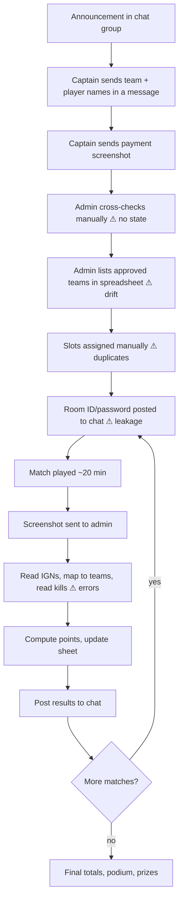
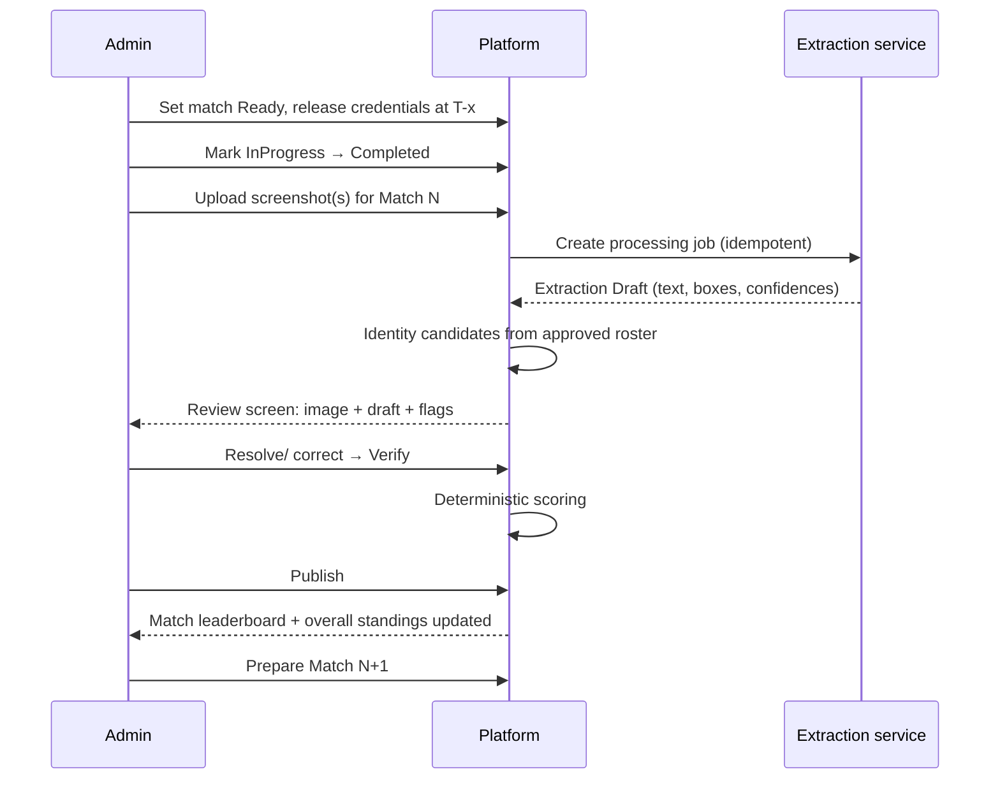
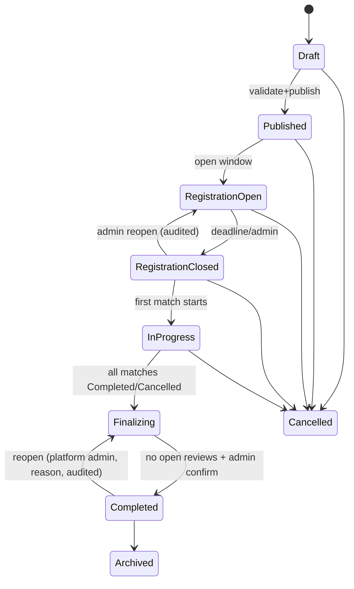
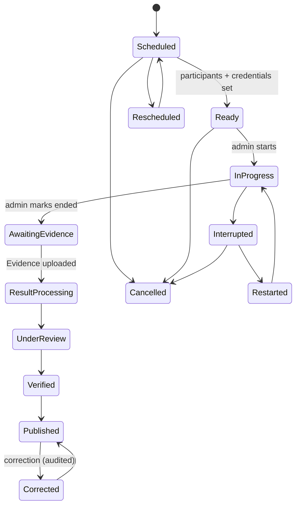

# problem.md — Esports Tournament Management Platform

> **Status:** Draft v1.0 — foundational problem-definition document
> **Date:** 2026-10-18
> **Initial scope:** College Free Fire MAX battle-royale tournaments
> **Not in this document:** application code, final schemas, API routes, infrastructure choices.

## How to read this document

Every substantive statement carries (explicitly or by section convention) one of these evidence tags:

| Tag | Meaning |
|---|---|
| **[BRIEF]** | Supplied by the project owners in the project brief. Treated as given, not independently verified. |
| **[VERIFIED]** | Verified through external research during preparation of this document (cited in §33). |
| **[OBSERVED]** | Directly observed on the reference site during this research session. |
| **[INFERENCE]** | Reasoned from the above; plausible but not proven. |
| **[PROPOSAL]** | Proposed product behavior. Not yet validated with organizers. |
| **[ASSUMPTION]** | Provisional assumption that lets the document proceed; must be confirmed (tracked in §31). |
| **[OPEN]** | Unresolved question requiring stakeholder input or testing (tracked in §32, IDs `Q-xx`). |

**Terminology (used consistently throughout):**

- **Tournament** — one organized event with rules, schedule, and capacity.
- **Player Profile** — a platform-level person identity (account).
- **Team** — a reusable team identity (name, captain) across tournaments.
- **Registration** — a Team's tournament-specific application to enter one Tournament.
- **Roster Entry** — a Player Profile's membership in a Registration's tournament roster, with the IGN claimed for *that* tournament.
- **Slot** — a Team's numbered place in the tournament (e.g., Slot 7 of 12).
- **Match** — one game round inside a Tournament.
- **Evidence** — an uploaded screenshot (or other artifact) used to produce a result.
- **Extraction Draft** — machine-produced, unverified structured data derived from Evidence.
- **Identity Resolution** — linking a detected IGN to a Roster Entry.
- **Verified Result** — administrator-confirmed match data, not yet visible publicly.
- **Published Result** — a Verified Result released as official.
- **IGN** — in-game name.

---

# 1. Executive Summary

College esports organizers currently run tournaments through chat groups, spreadsheets, payment screenshots, and hand-calculated scores **[BRIEF]**. The costliest moment is *between matches*: a match may end near 3:20 PM and the next start at 3:25 PM **[BRIEF]**, leaving the administrator about five minutes to read a result screenshot, map in-game names to teams, total kills, apply placement points, check rankings, announce results, and prepare the next room.

This document defines the problem for a single platform that carries a tournament from discovery through registration, roster submission, payment verification, approval, slot assignment, scheduling, room-credential release, result-screenshot intake, OCR-assisted extraction, identity resolution, human verification, deterministic scoring, leaderboard publication, final standings, and archival.

Three principles shape every requirement:

1. **Evidence → draft → verified → published.** OCR output is never official data. Only verified data can score.
2. **Identity before attribution.** Screenshots show IGNs, not team names. A team's kills exist only after an IGN has been resolved to a registered player with sufficient confidence or by explicit human decision.
3. **Deterministic scoring.** Arithmetic is performed by testable application logic with versioned, organizer-configured rules — never by a language model.

The operational objective is to *minimize administrator workload in the inter-match window while preserving result integrity*. No claim of 100% accuracy or guaranteed five-minute turnaround is made; these must be measured on representative screenshots (§30).

---

# 2. Project Background and Motivation

- The initial use case is Free Fire MAX tournaments in a college gaming community **[BRIEF]**.
- Typical event: 12 teams × 4 players, 6 matches on varying maps, per-player kills, team placement points, configurable scoring, cumulative standings, three podium prizes **[BRIEF]**.
- Current tooling: messaging groups, spreadsheets, payment screenshots, individual messages, game screenshots, manual score calculation **[BRIEF]**.
- Stated consequences: confusion, delays, inconsistent information, admin overhead, mistakes **[BRIEF]**.
- Future intent: other games and formats without complicating the initial scope **[BRIEF]**.

**Motivation:** a small volunteer-run organizing team handles money, identity, scheduling, and live scoring under time pressure. Failures are visible and emotional (prize money, college reputation), so *trust and explainability* matter as much as speed.

---

# 3. Problem Statement

> Organizers of college battle-royale tournaments must collect and verify registrations and payments, control access to match rooms, and convert post-match screenshots into correct team scores within a very short inter-match window — using general-purpose chat and spreadsheets that provide no structured state, no identity linkage between in-game names and registered teams, no audit trail, and no protection against duplicate or inconsistent data.

### 3.1 Sub-problems

| # | Problem | Mechanism of difficulty |
|---|---|---|
| P1 | Fragmented information | Registration, payment proof, rosters, and schedules live in different chats/sheets; no single status per team. |
| P2 | Payment/approval ambiguity | A payment screenshot in a chat has no explicit state (pending/verified/rejected), so a team may be approved without verified payment, or vice versa. |
| P3 | Room-credential leakage | Room ID/password pasted in a group chat reaches non-participants or unapproved teams. **[INFERENCE]** |
| P4 | Identity gap | Result screens list IGNs; teams are known by team name. The admin must recall or look up each player's team. |
| P5 | Stylized names | IGNs may use Unicode decoration that is hard to read, hard to type, and may differ from what was typed at registration. |
| P6 | Time pressure | ~5 minutes for read → map → add → rank → announce → prepare next room **[BRIEF]**. |
| P7 | Silent errors | A misread kill count or misattributed player changes team totals and potentially the podium without any record. |
| P8 | No audit/dispute trail | Corrections after publication cannot be traced or explained. |
| P9 | Duplicate/stale data | Repeated edits and re-sent screenshots create conflicting versions. |

### 3.2 Why "manual scoring is hard" is too vague

Concrete mechanism for one match (12 teams, 48 players) **[INFERENCE from BRIEF]**: for each result row the admin must (a) read a possibly decorated IGN, (b) find the player's team in a roster document, (c) read that player's kill number, (d) add it to a running team total, (e) separately determine each team's placement, (f) look up placement points, (g) compute match points, (h) update cumulative totals, (i) sort, and (j) communicate. That is up to 48 name lookups plus 12 sums, 12 placement lookups, and a re-sort, with ~5 minutes available, while also preparing the next room. One misread digit or one misattributed name silently changes a team's total; because cumulative standings add six matches, the error persists unless noticed.

---

# 4. Existing Tournament Workflow ("As-Is")

Reconstructed from the brief **[BRIEF]**; steps marked ⚠ are inferred risk points **[INFERENCE]**.



Known unknowns about the as-is process are in §32 (e.g., who sends screenshots, how many screenshots per match, which screens are used).

---

# 5. Root-Cause Analysis

| Symptom | Proximate cause | Root cause |
|---|---|---|
| Wrong team totals | Misread kills or misassigned player | No structured link between IGN and team; no verification step; no recorded evidence. |
| Slow result turnaround | Manual reading and lookup | Data entry is the only path; nothing pre-matches names to rosters. |
| Payment disputes | "I already paid" | Proof is unstructured; verification state is not recorded or visible. |
| Room ID shared with wrong people | Credentials broadcast in groups | Access control tied to chat membership, not tournament participation. |
| Disputed results | Team disagrees with leaderboard | No score breakdown, no evidence link, no correction history. |
| Duplicate/ conflicting records | Re-sent screenshots, multiple editors | No idempotency, no single source of truth. |
| Name mismatch | Registered IGN ≠ displayed IGN | Registration accepted only what the user could type; exactness not recorded. |

Causal chain example **[INFERENCE]**: approximate IGN at registration → ambiguous OCR match → unresolved team attribution → incomplete team kills → wrong match points → wrong cumulative standings → wrong podium.

---

# 6. Evidence, Research Findings, and Assumptions

### 6.1 Evidence ledger

| Item | Class | Notes |
|---|---|---|
| Scenario (12 teams, 4 players, 6 matches, 5-minute gap) | BRIEF | Not independently verified; frequency across other tournaments unknown. |
| Reference site structure | OBSERVED | See §6.2. |
| Unicode NFKC folds compatibility variants (e.g., full-width) and is lossy | VERIFIED | UAX #15; Apache OpenNLP docs. |
| Multiple OCR engines and vision-language models exist; no comparative accuracy on Free Fire screens is established | VERIFIED (existence) / UNKNOWN (accuracy) | Third-party benchmarks are generic and not game-specific; not relied on. |
| Frequency of misread names/kills in college tournaments | UNKNOWN | Hypothesis requiring a screenshot corpus. |
| Result-screen layouts, fields visible, UID visibility | UNKNOWN | Must be established from real screenshots (Q-01…Q-05). |

> **Limitation (honest disclosure):** No publicly documented organizer experiences specific to this college workflow were found in this session. Problems P1–P9 are therefore *hypotheses grounded in the brief and in mechanism analysis*, not proven industry-wide frequencies. They need validation through organizer interviews and a shadowed tournament.

### 6.2 Reference-site inspection (eagleesport.com)

Pages fetched: home, tournaments list (`user-free`), rankings (`user-rankings`). Not fetched: login/signup flows, dashboard, scrims, about, terms, contact.

**[OBSERVED] static content:**
- Primary navigation: Home, Tourns, Rankings, Scrims, Profile; Login and Join actions.
- Landing sections: stats strip (player/team/match counts — self-reported marketing figures, unverified), "Live Action", "Why Choose Eagle" (anti-cheat, UPI payouts, daily scrims, live stats), Featured Squad (week/month/Hall of Fame), Top Players (week/month), community links (WhatsApp, Discord, YouTube, Instagram).
- A signed-in state shows a welcome area, Top Teams (week/month), "My Tickets", and a Tournaments feed.
- Tournaments page: "Live Tournaments" and "Upcoming Tournaments" sections with an empty state ("No Tournaments Active"), a confirm/cancel dialog, and a system-alert dialog.
- Rankings page: Weekly / Monthly / All Time toggles.

**Limitations:** Lists and rankings load dynamically; the fetched pages showed no data. Registration forms, payment flows, team pages, result presentation, and anything behind login were **not observed**. Advertised claims (anti-cheat, instant payouts, counts) are marketing statements, not verified functionality, and are not adopted as requirements.

**Adaptable patterns [INFERENCE]:** live/upcoming split on tournament list; periodic leaderboard scopes; a "my tickets" style personal-registration view; explicit empty and error states; bottom-tab mobile navigation (mobile-first audience likely). **Not adopted:** branding, wording, visual design, wallet/payout features, daily-scrim model (outside initial scope).

### 6.3 Core assumptions (summary; full list §31)

- A1 Result screenshots are produced by the game client and uploaded by a trusted person (admin or designated uploader).
- A2 Players are reachable through accounts with at least phone or email.
- A3 Payment is off-platform (e.g., UPI) with proof uploaded; the platform does not process payments initially.
- A4 One organizing team operates one tournament at a time initially.

---

# 7. Product Vision and Intended Outcomes

**Vision [PROPOSAL]:** one reliable place where a college tournament can be run end to end, where every number on a leaderboard can be traced to evidence, and where the admin's job between matches is *review and confirm* rather than *read and type*.

**Intended outcomes (objectives, not demonstrated results):**
1. Single authoritative status per registration, payment, approval, and slot.
2. Room credentials visible only to eligible, authenticated participants at the right time.
3. Draft results ready for admin review soon after screenshot upload, with ambiguous identities flagged rather than guessed.
4. Deterministic, reproducible standings with a per-team score breakdown.
5. Full audit trail for corrections and disputes.

---

# 8. Scope and Non-Goals

### 8.1 Required for initial usable product (MVP candidate) [PROPOSAL]
Tournament configuration and publication; account registration; team and roster submission with IGN exactness tracking; payment proof submission and review; approval and slot assignment; match scheduling with map; gated room-credential release; screenshot upload; OCR draft extraction; identity resolution with candidates; admin review UI; deterministic scoring with versioned rules; match and overall leaderboards; corrections with audit; public tournament/results pages.

### 8.2 Needs further validation
Result-banner generation; dispute submission workflow beyond a simple report; waiting list; notifications beyond essentials; second OCR engine/VLM fallback; player lifetime statistics; platform-admin organizer onboarding (single-organization may suffice).

### 8.3 Future enhancements
Other games/formats (e.g., round-robin, bracket); in-platform payments; live-feed integrations; custom OCR model training (only if data shows existing approaches insufficient); multi-organization marketplace; anti-cheat; streaming overlays.

### 8.4 Explicit non-goals (initial)
Cloning any reference product; payouts/wallets; direct game-state integration (the platform cannot observe in-game events unless an official integration exists); automated cheating detection; custom model training as a mandatory step; asserting official Free Fire scoring rules.

---

# 9. Stakeholders and User Roles

| Role | Core responsibility | Key limitation |
|---|---|---|
| Public visitor | Discover tournaments, read rules, view published results | No private data; no registration actions. |
| Registered player | Maintain profile; belong to rosters; see own participation | Sees only own team's private data. |
| Team captain | Register team, manage roster, submit payment proof, receive room access | Cannot approve own team or edit published results. |
| Tournament administrator | Operate one tournament end-to-end | Scoped to assigned tournaments; destructive actions audited. |
| Platform administrator | Manage organizers, global settings, escalations | Should not routinely edit tournament results; any such action audited. **[PROPOSAL]** |
| Spectator | Follow standings and winners | Public data only. |

*Whether Platform Administrator is a separate role in v1 is an open decision (Q-20); a single-organization deployment may merge it with a super-admin tournament administrator.*

Additional stakeholders: prize sponsors/college authorities (care about fairness), result uploader (may be a trusted helper), support volunteers (read-only access to payment status — optional).

### 9.1 Role journeys

**Public visitor / spectator.** Lands on home → sees live/upcoming tournaments → opens tournament detail (rules, format, schedule, entry fee, capacity status, scoring rules) → views published match leaderboards, overall standings, podium → decides to sign up. *Failure/alternate:* tournament not found/archived (show archived state); results not yet published (explicit "pending" rather than blank); registration closed (explain and show next steps).

**Registered player.** Sign up/log in → complete profile (display name, contact, game identifiers) → accept team invitation or be added by captain → confirm own IGN (exact/approximate) → view team status, slot, match info → view published results and personal kills → report dispute via captain or directly (Q-16). *Failure:* player already on another team in same tournament; IGN conflict; account lacks required game ID.

**Team captain.** Create team → create Registration for a tournament → add/invite 4 players (+ substitutes if allowed) → submit IGNs/identifiers → submit payment proof → track statuses → respond to correction requests → receive slot and room access when eligible → view results/breakdown → raise disputes. *Failure/alternate:* incomplete roster blocks submission; rejected payment → resubmit; roster change request after lock → needs admin approval; withdrawal.

**Tournament administrator.** Create/configure → publish → review registrations and payments → approve and assign slots → schedule matches → release credentials → upload screenshots → review OCR drafts and resolve identities → verify → publish → resolve disputes → finalize → archive. Detailed in §12.

**Platform administrator.** Manage organizer accounts and role grants; configure global defaults (retention, upload limits, supported games); handle escalations (e.g., admin dispute, abuse); view cross-tournament audit; suspend accounts. *Constraint:* actions on a tournament's results must be attributed and require a reason.

---

# 10. User Personas and Their Needs

*These personas are **[PROPOSAL]** archetypes derived from the brief, not from user research. They must be validated by interviews.*

| Persona | Context | Needs | Pain today (hypothesis) |
|---|---|---|---|
| **Aarav — Organizer-admin** (final-year student, volunteer) | Runs tournaments alongside classes; mobile + laptop | Fast review screen; zero double entry; clear state per team | Time pressure; errors under stress; being blamed for mistakes. |
| **Riya — Team captain** | Coordinates 3 teammates, handles fee | Know exactly what's missing; timely room access; understandable score breakdown | Unsure if payment/registration counted; leaked or late room details. |
| **Kabir — Player with stylized IGN** | Uses decorative Unicode; can't copy name easily | Register without friction; be recognized in results | Name rejected or misrepresented; kills attributed elsewhere. |
| **Meera — Spectator/friend** | Mobile, casual | Quick standings, final podium | Scattered chat posts. |
| **Dev — Platform owner** | Maintains the system | Clear audit; safe corrections; low ops burden | Manual cleanups after incidents. |

---

# 11. Complete End-to-End User Workflows

Each workflow lists: **Inputs · Actor · Preconditions · Expected outcome · Failure states · Dependencies.**

### 11.A Tournament creation and configuration
- **Inputs:** game, format, name, description, rules text, eligibility (college/affiliation, ID requirements), team size, substitutes allowed, capacity, entry fee and payment instructions, registration window, match list (count, planned time, map), scoring rules, roster-lock policy, dispute window, visibility.
- **Actor:** Tournament administrator. **Precondition:** admin account authorized.
- **Outcome:** Tournament in `Draft` → validated → `Published` → `RegistrationOpen`.
- **Failures:** invalid schedule (overlapping matches), no scoring rules, capacity < 2, end-before-start; blocked from publishing with explicit validation messages.
- **Dependencies:** all downstream workflows read this configuration; scoring rules freeze at the policy-defined point (§19).
- **Lifecycle extras:** reschedule (notify registered teams), cancel (all pending registrations flagged; refunds are off-platform — Q-11), complete, archive.

### 11.B Player registration and team formation
- **Inputs:** account details; team name; captain; players with IGN, IGN exactness, optional UID, contact.
- **Preconditions:** registration open; captain logged in.
- **Outcome:** Registration `Draft` → `Submitted`.
- **Failures:** duplicate team name within tournament; duplicate player across teams; missing required identifiers; incomplete roster; unavailable name.
- **Dependencies:** roster quality directly determines OCR identity resolution accuracy (§17).

### 11.C Payment submission and verification
- **Inputs:** payer reference, amount, proof image, optional transaction ID.
- **Actor:** captain submits; admin verifies. **Outcome:** Payment `Verified` (independent of approval).
- **Failures:** missing/unreadable/duplicate proof, wrong amount, wrong reference, rejected → resubmission, late verification.

### 11.D Approval and slot assignment
- Approval requires: complete roster ∧ verified payment (or admin-recorded waiver with reason) ∧ eligibility checks. Slot assigned only to approved teams with capacity remaining. See §14.

### 11.E Match preparation
- Admin creates match (number, scheduled time, map), confirms participants (all approved, non-withdrawn teams), enters room ID/password (stored protected), sets release time. Credentials release only to eligible participants (§15).

### 11.F Match execution and status
- Status model: `Scheduled → Ready → InProgress → Completed` plus `Delayed`, `Cancelled`, `Restarted`. These states are **administrator-declared** — the platform cannot observe game state **[VERIFIED by absence of any known integration; INFERENCE]**.

### 11.G Screenshot submission
- **Actor:** admin or designated uploader. **Inputs:** image(s), match selection, optional note.
- **Validation:** file type/size, image decode check, match selected explicitly, duplicate-by-hash detection, resolution warning.
- **Outcome:** Evidence stored immutably; a processing job queued.

### 11.H OCR extraction and identity resolution → see §16–17.

### 11.I Verification and publication → see §18.

### 11.J Match leaderboard publication
- Verified Result → deterministic scoring → ranked match leaderboard → publish to public and participant dashboards → optional banner.

### 11.K Overall standings
- Recomputed from all `Published` match results using the scoring-rule version attached to each result; reflects corrections (§22).

### 11.L Finalization
- Preconditions: all matches `Completed` or `Cancelled`; no `Unresolved` or `UnderReview` results; no open disputes blocking (policy). Output: final ranking, podium, winners record, archival.

### 11.M Disputes and corrections → see §22.

---

# 12. Complete Administrative Workflows

### 12.1 Pre-tournament
1. Draft tournament → validate → publish → open registration.
2. Monitor submissions queue (filter by status: roster incomplete, payment pending, ready to approve).
3. Verify payments; request corrections with reasons visible to captain.
4. Approve teams; assign slots; manage waitlist and withdrawals.
5. Close registration at deadline; lock rosters (policy §14).
6. Schedule matches, maps; prepare credentials.

### 12.2 Match day loop (the time-critical path)



**Time-budget decomposition (to be measured, not assumed):** upload → extraction latency → review time (dominant term when ambiguity exists) → scoring (negligible) → publish. Review-time minimization is the primary UX objective.

### 12.3 Post-tournament
Final review → finalize → podium → archive → evidence retention per policy; dispute window handling; export.

### 12.4 Admin-only safeguards
Every state-changing action records actor, time, reason (where required), and before/after values. Concurrent edits are detected (§28). Destructive deletion of Evidence is prohibited; "retire" instead.

---

# 13. Tournament and Match Lifecycles





Notes: `Rescheduled` is transient and records old/new times. `Restarted` creates a new *match attempt* so earlier Evidence is not conflated with the new attempt (§28). Whether a Completed tournament can be reopened is Q-18; the diagram shows the proposed controlled path.

---

# 14. Registration, Payment, Approval, and Slot Rules

**Principle:** Registration, payment, approval, and slot are four independent states with enforced dependencies.

| Dimension | States |
|---|---|
| Registration | `Draft`, `Submitted`, `NeedsCorrection`, `Withdrawn`, `Cancelled` |
| Payment | `NotRequired`, `Pending`, `ProofSubmitted`, `Verified`, `Rejected`, `Waived` |
| Approval | `Unreviewed`, `Approved`, `Rejected`, `Waitlisted`, `Disqualified` |
| Slot | `Unassigned`, `Assigned`, `Released` |

### 14.1 Business rules [PROPOSAL unless noted]

| ID | Rule |
|---|---|
| BR-R1 | A Registration can be `Submitted` only with a complete roster meeting minimum size and required identifiers. |
| BR-R2 | A Player Profile may appear on at most one active Registration per Tournament. |
| BR-R3 | Team names are unique within a tournament (case/Unicode-normalized comparison). |
| BR-P1 | Payment `Verified` requires admin action recorded with actor and time. |
| BR-P2 | Payment verification does **not** automatically approve a team. |
| BR-P3 | A `Verified` payment may be reversed only by an admin with a reason; reversal of a payment on an `Approved` team flags the team for re-review rather than silently un-approving. |
| BR-P4 | A transaction reference/proof hash already used on another Registration in the same tournament raises a duplicate flag. |
| BR-A1 | Approval requires: roster complete, payment `Verified` or `Waived` (reason), eligibility checks passed. |
| BR-A2 | Approval before payment verification is not allowed (override only via explicit `Waived` with reason). |
| BR-S1 | A Slot can be assigned only to an `Approved` team; one team per slot; one slot per team. |
| BR-S2 | If approved count equals capacity, further approvals go to `Waitlisted`. |
| BR-S3 | Withdrawal after slot assignment sets Slot `Released`; waitlist promotion is an admin action (or optional auto-offer — Q-12). |
| BR-S4 | Disqualification does not delete prior match results; it applies a defined policy (Q-14). |
| BR-L1 | After registration closes, roster changes require admin-approved change requests; changes after the first match are restricted (Q-09). |
| BR-L2 | Late payment verification after close is allowed only for registrations submitted before close, at admin discretion, logged. |

### 14.2 Dependency matrix

| Action | Requires |
|---|---|
| Submit registration | roster complete |
| Verify payment | proof present (or waiver) |
| Approve | roster complete ∧ payment ok ∧ capacity or waitlist |
| Assign slot | approved |
| View room credentials | approved ∧ slot assigned ∧ not disqualified ∧ release time reached ∧ authenticated roster member |
| Appear in match scoring | approved ∧ slot assigned |

---

# 15. Room-Credential and Match-Access Requirements

**Problem:** posting room ID/password in a shared chat reaches anyone in that chat **[INFERENCE]**.

**Requirements [PROPOSAL]:**
1. Credentials are stored per Match, protected at rest, and never included in public pages, notifications bodies by default, or logs.
2. Access requires authentication and eligibility per §14.2: any *roster member* (captain and players) of an approved, slotted, non-disqualified team — roster membership is verified, not just team affiliation.
3. Release time is configurable (e.g., T-10 minutes) and enforced server-side; before release the UI shows "available at HH:MM".
4. Credential change after release creates a new credential version; all eligible users see the latest; the previous version is marked superseded; eligible users are notified of the change; the admin sees who viewed which version (access log) to support "I never got it" disputes.
5. Admin entering credentials requires explicit match selection and a confirmation summary ("Match 3 · Map X · 15:00") to prevent wrong-match entry.
6. If a team is disqualified or withdrawn after release, subsequent views are denied; the platform cannot revoke knowledge of already-seen credentials — rotation is the mitigation (Q-13: is rotation operationally feasible mid-lobby?).
7. Rescheduling changes release time and triggers notification; credentials remain unchanged unless admin rotates.

**Failure states:** wrong credentials posted; credentials unavailable (admin offline); delayed release; leaked credentials (admin can rotate and re-notify).

---
# 16. OCR and Screenshot-Processing Problem

### 16.1 Pipeline stages (conceptually separate)

```mermaid
flowchart LR
  E[Evidence: screenshot] --> V[Upload validation]
  V --> P[Preprocess: crop, scale, layout detect]
  P --> X[Text + box extraction]
  X --> R[Row/field assembly]
  R --> N[Normalization]
  N --> M[Identity candidate ranking]
  M --> D[Extraction Draft with flags]
  D --> H[Human review]
  H --> VR[Verified Result]
  VR --> S[Deterministic scoring]
  S --> PUB[Published Result]
```



**Key separations:** (1) *reading* text is not (2) *matching* it to a person; (3) a draft is not a verified result; (4) a verified result is not published.

### 16.2 What a screenshot can and cannot supply
- The screenshot identifies players by IGN, **not by team name** **[BRIEF]**.
- Which statistics are visible (per-player kills, squad placement, damage, survival time) depends on the game screen. Different screens may show different sets **[BRIEF: "do not assume all screens contain the same information"]**.
- Whether placement and individual kills appear on the *same* screen, whether a UID is visible, and how many layouts exist are **unknown** (Q-01…Q-05). The product must accommodate: (a) one screenshot with everything, (b) multiple screenshots per match, (c) kills on one screen and placement on another, (d) placement supplied manually.
- A kill feed is a stream of events and may not give a complete final per-player count **[INFERENCE]**; it must not be treated as equivalent to a final-statistics screen.

### 16.3 Required vs. optional fields (provisional)

| Field | Source | If missing |
|---|---|---|
| Player IGN (per row) | OCR | Row stays `Unresolved`. |
| Player kills | OCR | Admin must enter/confirm; result cannot verify with blank. |
| Team placement | OCR or admin | Admin must supply; result cannot verify without it. |
| Other stats (damage, survival) | OCR optional | Ignored unless configured as scoring/tie-break input. |

### 16.4 Extraction method options (comparison without untested accuracy claims)

| Option | Strengths (generally) | Risks for this use case | Status |
|---|---|---|---|
| Traditional OCR engines (e.g., Tesseract, EasyOCR, PaddleOCR) | Run locally, return boxes and confidences, inexpensive | Stylized/decorative fonts, low-contrast game UI, Unicode coverage vary by engine and model | Candidate; accuracy on game screens **UNKNOWN**. |
| Managed OCR services | Maintained models, broad script coverage | Cost, latency, data leaving the system, rate limits, availability | Candidate; evaluate on corpus. |
| Vision-capable language models | Handle layout and context; flexible | Can produce plausible but wrong text; non-deterministic; cost/latency | Candidate as secondary reader for difficult crops; output always a draft. |
| Custom-trained model | Could fit game UI | Needs labeled data and maintenance | **Future option only** if corpus evidence shows others insufficient. |

Third-party benchmarks found (e.g., generic OCR-vs-VLM comparisons, PaddleOCR vs EasyOCR vs Tesseract guides) describe general document or scene text and are not evidence for stylized game names; they are not relied upon. **A bake-off on a real screenshot corpus is a prerequisite for choosing an engine (Q-08).**

### 16.5 Row-field association
- Use bounding boxes to group text into rows by vertical position; associate numeric fields with the name box on the same row.
- Risks: overlapping or partially hidden rows, rows reordered, number belonging to adjacent row, truncated names, UI elements (icons, badges) between name and number.
- Requirement: the draft stores per-field bounding boxes so the review UI can highlight *the exact region* that produced each value.
- Requirement: structural sanity checks (e.g., expected number of rows vs. players in lobby, kills non-negative integers, kills plausibly bounded by lobby size, placement within 1..N and unique per team) produce flags, not silent corrections.

### 16.6 Confidence and fallback behavior

| Situation | Behavior |
|---|---|
| Clearly recognized, exact normalized match, unique | Pre-filled; marked high-confidence; still part of review but quick-confirm. |
| Minor OCR error, single strong candidate with clear margin | Pre-filled as *suggested*; flagged "fuzzy"; admin confirms. |
| Roster entry has approximate IGN | Match limited to "needs confirmation" regardless of score until admin confirms. |
| Multiple plausible candidates | Candidates ranked with evidence; row `Ambiguous`; no auto-select. |
| Two roster players normalize identically | Collision flag; admin must choose using screenshot crop (and UID if available). |
| Unreadable name | Row `Unreadable`; crop shown; admin types or selects from roster of the lobby. |
| Name not in approved roster | Row `UnknownPlayer`; possible roster/registration problem or intruder; admin decides (map to roster entry, mark outside player, or hold). |
| Missing kills | Field empty and flagged; blocks verification. |
| Missing/conflicting placement | Flagged; blocks verification. |
| Incomplete screenshot (missing rows) | Missing roster players listed; admin can request/upload another screenshot or enter manually with reason. |
| Two extraction methods disagree | Both values shown; flagged `Conflict`; admin chooses/edits. |

**Hard rule:** the system does not force a match to complete the pipeline.

### 16.7 Processing job lifecycle
`Queued → Running → Succeeded | PartiallySucceeded | Failed | TimedOut | Cancelled`; `Failed/TimedOut → Retrying (bounded) → ...`; `Superseded` when evidence is replaced. Jobs are idempotent per (evidence hash, match attempt, pipeline version); reprocessing creates a *new* draft version and never overwrites verified data.

---

# 17. Unicode Normalization and Player-Identity Matching

### 17.1 Required relationship
**Screenshot → Detected IGN → Registered-player candidate → Verified player identity → Tournament roster → Team → Match statistics.**
If identity is uncertain, statistics remain unresolved.

### 17.2 What gets stored (for each Roster Entry) [PROPOSAL]
- `submitted_ign_raw` — exactly as submitted, never modified.
- `ign_exactness` — `Exact` | `Approximate` | `Unverified`.
- Derived, separately stored representations (versioned by normalization algorithm): NFKC-folded form; case-folded; "skeleton" form (confusable-folded, optionally punctuation-stripped); each marked as derived.
- Optional `game_uid` (if available) and its verification state.
- Verification history (who confirmed the IGN and how: admin-confirmed against in-game screenshot, UID match, etc.).

### 17.3 Registration capture workflow
1. Prefer copy/paste of the exact IGN; show a helper explaining how to copy it in-game (to be confirmed per game, Q-06).
2. If exact entry is impossible, user selects "I can't type my exact name" and enters the closest keyboard approximation; the entry becomes `Approximate`.
3. Optionally, user uploads a screenshot of their in-game profile showing IGN (and UID if shown) to support later confirmation.
4. Admin may confirm an approximate/unverified IGN pre-tournament (e.g., by comparing the profile screenshot), upgrading its state to `AdminConfirmed`.
5. Never block registration solely because the IGN is approximate; surface the risk to the captain ("matching may need manual confirmation on match day").

### 17.4 Unicode normalization analysis
- Unicode defines canonical and compatibility equivalence; NFKC applies compatibility decompositions and composition, e.g., full-width/half-width variants fold together **[VERIFIED: UAX #15]**.
- NFKC is lossy: it can change appearance or meaning and is a deliberate choice for search/recall, not a safe default for identity **[VERIFIED: Apache OpenNLP documentation]**.
- Likely safe folds [INFERENCE — to be confirmed with a test over actual Unicode data and real names]: full-width letters/digits → ASCII; mathematical alphanumeric styles (bold/italic/script/fraktur/double-struck) → plain letters.
- Likely **not** folded by NFKC [INFERENCE, to be verified]: small-cap letters used as Latin lookalikes, many decorative symbols, enclosed/other-script lookalikes (e.g., Cyrillic/Greek homoglyphs), emoji/ornaments.
- Rules: (1) normalization output is a *candidate-generation key*, never an identity; (2) never delete all symbols globally — treat "stripped" forms as a weak tier because different players can collide; (3) preserve both raw and derived forms; (4) record the normalization version so changes can be re-applied or audited.
- Confusables (O/0, I/l/1, S/5, B/8, Z/2 and OCR-typical lookalikes): apply as a *controlled substitution table* only within fuzzy comparison, each substitution carrying a small penalty, never as a destructive normalization.

### 17.5 Candidate ranking (conceptual tiers)

| Tier | Comparison | Interpretation |
|---|---|---|
| T1 | Exact raw match | Strong, but still checked for roster collisions. |
| T2 | Exact after NFKC + case-fold | Strong. |
| T3 | Exact after confusable-skeleton | Moderate; collision-prone. |
| T4 | Edit-distance within threshold (with OCR-confusion-weighted costs) | Weak–moderate; requires margin over runner-up. |
| T5 | Stripped-of-symbols fuzzy | Weak; suggestion only. |

Interpreting scores:
- A similarity score is **evidence, not proof**.
- Auto-suggestion requires both a minimum score *and* a minimum **margin** between best and second-best candidate (thresholds are set from corpus measurements, Q-08/Q-22, not guessed).
- Candidates are drawn from the **approved roster of the lobby for that match** (a small closed set of ~48 players), which materially reduces ambiguity versus searching all users **[INFERENCE]**.
- Entries with `Approximate` exactness never reach "confirmed" automatically.
- Other contextual signals may adjust ranking but never override human decision: team-level consistency (e.g., a row cluster matches several players of the same team), row position stability across earlier matches in the same tournament, previously admin-confirmed OCR-name→player mappings (an alias learned from review).

### 17.6 Learned aliases
When an admin confirms "this displayed OCR string = Player X," store an **alias** (OCR string → Roster Entry, scope: tournament, confirmed-by, evidence link). Aliases accelerate later matches but are scoped to the tournament and revocable; they must not silently apply to a different player who later collides.

### 17.7 Identity-match lifecycle
`Unmatched → Suggested → Confirmed (auto-confirmed forbidden for low tiers) → Overridden/Rejected`. Each transition records actor (system/admin), evidence, and candidate list snapshot.

---

# 18. Result Verification and Manual Review

### 18.1 Data maturity ladder

| Stage | Meaning | Visible to |
|---|---|---|
| Evidence | Raw uploaded image | Admins (and disputing team on request, policy) |
| Extraction Draft | Machine output + boxes + confidences | Admins |
| Proposed Match | Candidate identity per row | Admins |
| Corrected Data | Admin edits applied to draft | Admins |
| Verified Result | Admin-confirmed complete match data | Admins |
| Published Result | Released official standings entry | Public/participants |

Only `Verified` data is eligible for scoring; only `Published` data feeds public leaderboards.

### 18.2 Review interface requirements (the critical screen)
- Side-by-side: original screenshot (zoom/pan) and extracted table; clicking a row highlights the source region.
- Rows sorted as in the screenshot; flagged rows sorted/colored first; keyboard shortcuts for confirm/next/edit; one-tap accept for high-confidence rows; bulk accept restricted to rows above threshold *and* unflagged.
- Per row: IGN crop, detected text, candidate list with scores and evidence, kills, team (derived, read-only unless roster correction is performed in a separate audited action).
- Team panel: derived team kills, team placement input, completeness indicator (4/4 players resolved per team).
- Roster-correction action available inline (adds/changes a mapping) but audited and flagged for later roster review.
- Compare with other extraction methods when present.
- Autosave of draft edits with optimistic concurrency (§28).

### 18.3 Validation before `Verified` (all must pass or be explicitly overridden with reason)
1. Every detected row has resolved identity or is explicitly marked "outside player/ignored" with reason.
2. Every approved, participating team has placement assigned; placements are valid and unique per rules.
3. Kills are non-negative integers for every resolved player; teams with fewer resolved players than roster size are flagged (absent players recorded as 0 kills only by explicit "did not play" marking).
4. Sum sanity check (e.g., total kills ≤ plausible maximum for lobby) shows warning, not a block.
5. No unresolved ambiguity or conflict flags remain.
6. Reviewer identity recorded; second-admin confirmation optional by tournament policy (Q-17).

### 18.4 Verification vs. publication
Verification locks the data; publication is a separate explicit admin action. This permits the admin to verify, glance at the computed leaderboard, then publish.

---

# 19. Configurable Scoring and Ranking Rules

Baseline concepts **[BRIEF]** (not universal rules):

```
TeamKills    = Σ verified player kills of the team in the match
KillPoints   = TeamKills × PointsPerKill
MatchPoints  = KillPoints + PlacementPoints(placement)
OverallPoints= Σ published MatchPoints
```

### 19.1 Configurable elements
Points per kill; placement-points table (rank → points); maximum rank awarded; optional kill caps; per-match multipliers (optional); penalties (point deductions with reason); tie-break order; which statistics count; handling of disqualified teams; handling of cancelled matches.

No official Free Fire MAX point table is asserted here; defaults are organizer-supplied (Q-07).

### 19.2 Versioning and freezing
- A **Scoring Rule Set** is immutable once used. Edits create a new version.
- Each match result records the rule version it was scored under.
- [PROPOSAL] Rules freeze at the first match start; changes afterwards require explicit "rescore with version X" action (audited) that recomputes all affected published results and shows an impact preview before applying (Q-15).

### 19.3 Ties [PROPOSAL, provisional]
Ordered tie-break list, organizer-configured; suggested default: (1) higher overall points, (2) more first-place finishes, (3) higher total kills, (4) better placement in the most recent match, (5) admin decision recorded with reason. *Tie-break rules are open (Q-10).* Podium ties unresolved by rules require explicit admin resolution before finalization.

### 19.4 Penalties and disqualification
- Penalty: signed point adjustment attached to a team + match (or tournament), with reason and actor; shown in score breakdown.
- Disqualification: policy options (a) keep earned points but exclude from podium, (b) void all results (re-rank others), (c) void from DQ match onward. Choice is configuration (Q-14).

### 19.5 Determinism and testability
- Scoring is a pure function of (verified data, rule version, penalties); same input → same output.
- No language model participates in arithmetic.
- Idempotency: scoring a given (match attempt, version) twice yields one record; recomputation replaces, with history.
- Test vectors: worked examples with expected outputs maintained in the test strategy.

### 19.6 Score explanation
Every team sees: per-player verified kills, team kills, kill points, placement, placement points, penalties, match points, running total, rule version, and a link to the evidence (policy permitting).

**Illustrative hypothetical example (not official rules):** with 1 point per kill and a *hypothetical* placement table giving 12 points for 1st, a team with 9 kills and 1st place scores 9×1 + 12 = 21 for that match.

---

# 20. Match and Overall Leaderboards

- **Match leaderboard:** rank by `MatchPoints`; tie-break within a match by configured order (e.g., placement, then kills).
- **Overall standings:** Σ of published matches' points (+ penalties), ordered by tie-break list; recomputed when any published result is added, corrected, voided, or rescored.
- Update rule: overall standings reflect *published* results only; a verified-but-unpublished result does not appear.
- **Correction propagation:** correcting match N recomputes match N leaderboard → overall standings → (if tournament finalized) podium; each recomputation produces a snapshot with version/timestamp for audit and a "changed rankings" diff for notification.
- Public view: rank, team name, points, kills, placement; participants additionally see their own breakdown. Private data (contact details, payment) never shown.
- Provisional marker: standings carry "as of Match N" and "pending review" indicator when a dispute is open.
- Player statistics: per-player kills are public only if the policy permits (Q-19).

---

# 21. Result Banners and Public Presentation

- Banner (image) generated from *published* data only: tournament name, match number/map, top-N teams, points; theme template configurable.
- Requirements: regeneration after correction produces a new version and marks the old one superseded (old links show "superseded" notice); banner failure must not block publication; banner content uses data from the same snapshot as the leaderboard.
- Use of team names/logos: organizer ensures permission; no copyrighted third-party assets by default.
- Status: **needs validation** whether banners are required for MVP (§8.2).

---

# 22. Disputes, Corrections, and Audit History

### 22.1 Dispute lifecycle
`Open → UnderInvestigation → (Upheld → Corrected) | Rejected | Withdrawn → Closed`.
- Who may open: team captain (and optionally any roster member — Q-16), within a configured window after publication.
- Required: match, claimed issue, optional evidence (their own screenshot).
- Admin can attach reviewed Evidence, compare drafts, and respond with explanation; both parties see the status and the final explanation.

### 22.2 Correction workflow
1. Admin opens a Published Result → "Correct" with required reason.
2. Edits produce a new result version (old retained).
3. Re-verification and scoring run; impact preview shows changed match ranks, overall ranks, podium.
4. Publish correction; notify affected teams; banner regenerated.
5. Audit record links dispute (if any), actor, before/after, reason.

### 22.3 Audit requirements
Append-only records for: auth-sensitive actions, status transitions, payment decisions, approvals, slot changes, credential changes and views, uploads, OCR job events, identity decisions, verification, scoring runs, publication, corrections, penalties, disputes, role changes. Each record: actor (user/system), timestamp, entity, action, before/after (or diff), reason, request/correlation ID. Audit records are not editable or deletable by tournament administrators.

---

# 23. Functional Requirements

*Priority: M = initial product, V = needs validation, F = future. IDs stable for downstream docs.*

### 23.1 Tournament
| ID | Requirement | P |
|---|---|---|
| FR-T1 | Admin can create a draft tournament with game, format, capacity, fee, schedule, maps, eligibility, scoring rule set. | M |
| FR-T2 | System validates configuration before publish (e.g., non-overlapping matches, scoring present). | M |
| FR-T3 | Tournament follows lifecycle in §13 with audited transitions. | M |
| FR-T4 | Admin can reschedule/cancel with notification to registered teams. | M |
| FR-T5 | Archive makes tournament read-only. | M |

### 23.2 Registration and roster
| ID | Requirement | P |
|---|---|---|
| FR-R1 | Users can sign up/login and maintain a profile. | M |
| FR-R2 | Captain can create Team and Registration, add/invite players. | M |
| FR-R3 | System records IGN raw value, exactness status, optional UID. | M |
| FR-R4 | System enforces BR-R1…R3. | M |
| FR-R5 | Roster changes after submission follow policy with admin approval and audit. | M |
| FR-R6 | Captain can withdraw a registration. | M |

### 23.3 Payments, approval, slots
| ID | Requirement | P |
|---|---|---|
| FR-P1 | Display payment instructions per tournament. | M |
| FR-P2 | Captain uploads proof; stored privately. | M |
| FR-P3 | Admin verifies/rejects with reason; captain sees outcome. | M |
| FR-P4 | Duplicate proof/reference detection. | M |
| FR-A1 | Approval gated per BR-A1/A2; reasons recorded. | M |
| FR-S1 | Slot assignment gated per BR-S1; waitlist per BR-S2. | M/V |

### 23.4 Matches and rooms
| ID | Requirement | P |
|---|---|---|
| FR-M1 | Admin creates/schedules matches with map, participants. | M |
| FR-M2 | Admin sets match status; transitions validated per §13. | M |
| FR-C1 | Credential storage, versioning, timed release, eligibility check, access log. | M |
| FR-C2 | Notification on schedule/credential changes. | M |

### 23.5 Evidence, OCR, identity
| ID | Requirement | P |
|---|---|---|
| FR-E1 | Upload screenshot(s) tied to match attempt; validate type/size/decodability; detect duplicates by content hash. | M |
| FR-E2 | Evidence immutable; replacement creates a new version. | M |
| FR-O1 | Asynchronous OCR job per evidence with status visibility. | M |
| FR-O2 | Persist raw text, boxes, per-field confidence, pipeline version. | M |
| FR-O3 | Idempotent job processing; bounded retries; reprocess creates new draft. | M |
| FR-I1 | Identity candidates from lobby roster with tiered evidence. | M |
| FR-I2 | No auto-confirmation of ambiguous/approximate matches. | M |
| FR-I3 | Alias learning from admin confirmation, tournament-scoped. | V |
| FR-O4 | Optional second extraction method for flagged crops. | V |

### 23.6 Verification, scoring, leaderboards
| ID | Requirement | P |
|---|---|---|
| FR-V1 | Review UI per §18.2. | M |
| FR-V2 | Validation gate per §18.3. | M |
| FR-SC1 | Deterministic scoring from verified data and versioned rules. | M |
| FR-SC2 | Penalties and disqualification handling. | M |
| FR-L1 | Match and overall leaderboards from published results. | M |
| FR-L2 | Recompute on correction with snapshots/diff. | M |
| FR-L3 | Finalization with tie-break resolution and podium. | M |
| FR-B1 | Banner generation from published snapshot. | V |

### 23.7 Disputes, audit, access
| ID | Requirement | P |
|---|---|---|
| FR-D1 | Submit/track disputes; admin resolution with explanation. | M/V |
| FR-AU1 | Append-only audit per §22.3. | M |
| FR-AC1 | RBAC per §27. | M |
| FR-N1 | Essential notifications: approval/rejection, payment status, slot, schedule change, credentials available/changed, results published, correction. | M/V |

---

# 24. Non-Functional Requirements

| Area | Requirement | Quantification status |
|---|---|---|
| Reliability | Result pipeline degrades gracefully: manual entry always available if OCR is down. | Qualitative; availability target needs owner input. |
| Data integrity | No official data from unverified sources; single published version per match at any time; transactional state changes. | Hard rule. |
| Security | See §27. | — |
| Performance | Upload→draft latency and page-load targets set from measurement. | **Unquantified** — measure on corpus; owner defines acceptable target. The 5-minute gap is an *operational objective*, not a tested SLA. |
| Usability | Admin review reachable in ≤ a small number of interactions per row; mobile-friendly participant UI. | Targets via usability testing. |
| Maintainability | Rule sets, normalization versions, and pipeline versions are explicit and replaceable. | Qualitative. |
| Testability | Scoring/standing logic independently testable; OCR evaluated via labeled corpus; state machines have transition tests. | Qualitative. |
| Accessibility | Keyboard-navigable admin UI; sufficient contrast; screenshots have text alternatives where possible. | Target standard (e.g., WCAG level) to be chosen. |
| Scalability | Initial: single organizer, few concurrent tournaments; burst at match end. | Q-21: concurrent tournaments and users. |
| Observability | Job queue depth, OCR latency/failure, review time, publication time, error logs with correlation IDs. | Metrics defined in §30. |
| Recovery | Backups, restore tests, retry-safe operations. | RPO/RTO need owner input. |

---

# 25. Business Rules and State Transitions

### 25.1 Rule register (cross-workflow)

| ID | Rule |
|---|---|
| BR-X1 | Only `Verified` data is scored; only `Published` results appear publicly. |
| BR-X2 | Results cannot be verified with unresolved identity, missing placement, or missing kills (override: explicit "ignore row"/manual entry with reason). |
| BR-X3 | Room credentials visible only per §14.2. |
| BR-X4 | Scoring rule version frozen at first match; later changes require rescore action. |
| BR-X5 | A published result can be corrected only by an authorized admin with reason; creates new version, never overwrites. |
| BR-X6 | Tournament cannot be Completed while any match is `UnderReview`/`Unresolved` or any required result is missing, unless explicitly voided/cancelled. |
| BR-X7 | Completed tournaments are not editable; reopening is a controlled, audited exception (Q-18). |
| BR-X8 | Evidence is never deleted by tournament admins; retired evidence retained per policy. |
| BR-X9 | One active processing result per match attempt; duplicates deduped by content hash + attempt. |
| BR-X10 | Concurrent edits require version checks; stale writes are rejected with a refresh prompt. |

### 25.2 Entity state tables

**Screenshot-processing job:** `Queued→Running→Succeeded|PartiallySucceeded|Failed|TimedOut|Cancelled|Superseded`; trigger: system worker (Running/Succeeded/Failed/TimedOut), admin (Cancel/Retry), evidence replacement (Superseded). Invalid: `Succeeded→Running` (reprocess creates a new job).

**Player identity match:** see §17.7. Invalid: `Unmatched→Confirmed` without actor evidence; `Suggested→Confirmed` by system when row has an ambiguity flag or approximate exactness.

**Result verification:** `Draft → InReview → Verified`; `Verified → InReview` (reopen by admin, only if unpublished); invalid: `Draft → Verified` (skips review).

**Result publication:** `Unpublished → Published → Superseded(correction) | Voided`. Invalid: `Unpublished → Superseded`.

**Room-credential release:** `NotSet → Set → Released → Superseded(new version) | Revoked`. Invalid: `Released` for ineligible viewers.

**Dispute:** §22.1. **Slot:** `Unassigned→Assigned→Released/Reassigned`. **Payment:** `Pending→ProofSubmitted→Verified|Rejected`, `Rejected→ProofSubmitted`, `Verified→Rejected` (reason + flags approval), `Verified→Waived` n/a.

### 25.3 Transition authority

| Transition | Actor |
|---|---|
| Tournament publish/open/close | Tournament admin |
| Payment verify/reject | Tournament admin |
| Approve/assign slot | Tournament admin |
| Evidence upload | Admin or designated uploader |
| OCR job status | System |
| Identity confirm/override | Admin |
| Verify/Publish/Correct | Authorized admin (policy may require second admin) |
| Reopen completed tournament | Platform admin |

Invalid transitions are rejected server-side with an auditable denial, not merely hidden in UI.

---
# 26. Conceptual Data Entities and Relationships

*Conceptual only; not a schema.*

| Entity | Represents | Key relationships |
|---|---|---|
| User / Player Profile | A person account, platform-wide | Has roles; may have many Roster Entries over time |
| Role & Permission Grant | What a user may do, scoped (platform / tournament) | User ↔ Tournament scope |
| Team | Reusable team identity (name, captain) | Many Registrations over time |
| Tournament | One event with rules | Has Registrations, Matches, Scoring Rule Set versions |
| Registration | A Team's entry in one Tournament | Has Payment(s), Approval, Slot, Roster Entries |
| Roster Entry | A Player Profile's membership in a Registration, with tournament-specific IGN | Links Player Profile ↔ Registration |
| In-Game Name record / Alias | Raw IGN, exactness, derived forms, confirmed OCR aliases | Belongs to Roster Entry (or Player Profile history) |
| Payment | A submission and its verification decision | Belongs to Registration; has Evidence file |
| Slot | Numbered tournament place | 0..1 per Registration |
| Match (and Match Attempt) | A scheduled round; attempt supports restarts | Tournament 1..n; has participants, credentials, Evidence |
| Match Participant | A Registration/slot expected in a match | Match ↔ Registration |
| Room Credential (versioned) + Access Log | ID/password versions and who viewed | Belongs to Match |
| Evidence / File reference | Uploaded screenshot or proof with hash | Match Attempt / Payment / Dispute |
| Processing Job | OCR run on one Evidence at one pipeline version | Evidence 1..n |
| Extraction Draft (rows, fields, boxes) | Machine output | Job 1..1 |
| Identity Match record | Candidate set + decision for one row | Draft row ↔ Roster Entry |
| Player-Match Statistic | Verified kills (and other stats) for a Roster Entry | Match Attempt ↔ Roster Entry |
| Team-Match Result | Placement, kills, points, penalties, rule version, publication state, version number | Match Attempt ↔ Registration |
| Scoring Rule Set (versioned) | Points, tables, tie-breaks | Tournament |
| Standing Snapshot | Computed overall/match ranking at a time | Tournament |
| Dispute | Report + investigation + resolution | Match / Result |
| Audit Record | Append-only action log | Any entity |
| Notification | Message intent + delivery status | User |

**Identity distinctions that must not be conflated:**
- *Player Profile identity* (a human account) ≠ *Team identity* (a name that persists) ≠ *Registration* (a team's participation in one tournament) ≠ *Roster Entry* (a player's role in that registration, with that tournament's IGN).
- Team attribution of a kill is derived through the **Roster Entry of that tournament**, never through a player's current or past team.
- The same player may use different IGNs across tournaments; IGN belongs to the Roster Entry (with history on profile).

---

# 27. Permissions, Privacy, and Security Requirements

### 27.1 Data sensitivity

| Data | Sensitivity | Who may access |
|---|---|---|
| Payment proof, transaction refs | High | Submitting captain; tournament admins; platform admin on escalation. **Never public.** |
| Room credentials | High (time-bound) | Eligible roster members (§14.2); admins. |
| Contact details (phone/email) | High | Self; tournament admins for operations; not teammates by default, not public. |
| College ID / affiliation proofs (if collected) | High | Admins; self. |
| Result screenshots (raw) | Medium | Admins; disputing team policy-dependent; may contain other players' names/UIDs. |
| Roster (team name, IGNs) | Low–Medium | Team members; admins; public display only as policy allows (Q-19). |
| Published standings | Public | Everyone. |
| Per-player stats | Policy | Public vs participants-only (Q-19). |
| Audit log | High | Admins (tournament-scoped); platform admin full. |

### 27.2 Role-based access matrix (summary)

| Capability | Visitor | Player | Captain | Tourn. admin | Platform admin |
|---|---|---|---|---|---|
| View public pages/results | ✔ | ✔ | ✔ | ✔ | ✔ |
| Own profile | – | ✔ | ✔ | ✔ | ✔ |
| Create/edit own registration | – | – | ✔ | – | – |
| View own team's status | – | ✔ | ✔ | ✔ | ✔ |
| View credentials | – | if eligible | if eligible | ✔ | ✔ (audited) |
| Verify payment/approve/slot | – | – | – | ✔ | ✔ (audited) |
| Upload evidence/review OCR/verify/publish | – | – | – | ✔ | ✔ (audited) |
| Correct published result | – | – | – | ✔ (reason) | ✔ (reason) |
| Manage organizers/roles | – | – | – | – | ✔ |
| Reopen completed tournament | – | – | – | – | ✔ (reason) |

### 27.3 Requirements
1. Authorization enforced server-side on every request; object-level checks (user must belong to the registration).
2. Files (proof, screenshots) stored privately; access via short-lived authorized links; no guessable public URLs.
3. Safe uploads: type allow-list by content (not extension alone), size limits, image re-encoding/sanitization, malware scanning if feasible, filename sanitization, no execution.
4. All user-submitted text (team names, IGNs, notes) treated as untrusted: output-escaped, length-limited, Unicode-normalized for comparison, and displayed safely (control/bidirectional override characters handled).
5. Anti-abuse: rate limits on login, uploads, dispute submission; lockout/verification for account security.
6. Retention: policy for payment proofs, screenshots, personal data (retention period: Q-15 in §32); deletion requests handled for personal data while retaining integrity of audit/results (pseudonymization option).
7. Backups and tested restore; secrets managed outside the repository.
8. External-service failures (OCR, storage, messaging) must not expose data or corrupt state; processing data sent to external OCR providers must be disclosed in the privacy notice and is a decision point (Q-08).
9. Audit tamper-resistance: append-only; elevated actions require reason.
10. Session/stale-state protection: write operations carry version tokens; session expiry on admin actions re-authenticates.

---

# 28. Edge-Case Catalogue

**Format per row:** Trigger/affected · Expected behavior · Preserve · Human? · Recovery · Integrity/security requirement · Test. (Abbrev.: **Y**=human required, **N**=no, **C**=conditional.)

### 28.1 Registration and roster

| ID | Trigger / affected | Expected behavior | Preserve | Human | Recovery | Integrity/security | Test |
|---|---|---|---|---|---|---|---|
| ER-01 | Duplicate team name (captain) | Reject; suggest variant; Unicode/case-normalized uniqueness | Attempted name in logs | N | Captain renames | BR-R3 | Submit "Alpha" & "ａｌｐｈａ" → 2nd rejected |
| ER-02 | Same team registers twice | Block second active Registration; point to existing | Both attempts | N | Withdraw first if intended | One active Registration per team/tournament | Double-submit test |
| ER-03 | Player listed on two teams | Block second; notify captain; admin may adjudicate | Conflict record | C | Remove from one roster | BR-R2 | Cross-team add |
| ER-04 | Missing player details | Block submit with field-level errors | Draft | N | Complete fields | BR-R1 | Validation tests |
| ER-05 | Wrong contact info | Allow edit pre-lock; post-lock via admin; bounced notification flagged | Old/new values | C | Admin corrects | Audit on change | Edit-after-lock test |
| ER-06 | Incomplete roster at deadline | Registration stays Draft/NeedsCorrection; not approvable | Draft | Y | Admin grace extension (audited) | BR-R1 | Deadline test |
| ER-07 | Player changes IGN after registration | Change request; new IGN recorded with exactness; prior kept as alias | History | C | Admin approves | Roster change policy | Rename during tournament; OCR still matches old/new |
| ER-08 | Approximate IGN unmatched reliably | Flag at approval as "match-risk"; encourage profile screenshot | Raw IGN, exactness | Y (pre-match confirm) | Admin confirms with in-game proof | No auto-confirm | Approximate IGN fixtures |
| ER-09 | Unauthorized roster replacement (non-captain) | Deny; log attempt | Attempt | N | — | Object-level auth | Unauthorized API call |
| ER-10 | Registration at deadline second | Server time is authority; accepted iff before cutoff; clock shown | Submission timestamp | N | Admin discretion for disputes | Server-side timestamps | Boundary-time test |
| ER-11 | Registration after capacity | Waitlist if enabled, else closed message | Attempt | N | Promote if slot opens | BR-S2 | Capacity test |
| ER-12 | Name with bidi/control chars or homoglyph impersonation | Sanitized display; warn admin of confusable with existing team | Raw + sanitized | C | Admin rename | Untrusted text handling | Fuzz names |

### 28.2 Payments and approvals

| ID | Trigger / affected | Expected behavior | Preserve | Human | Recovery | Integrity/security | Test |
|---|---|---|---|---|---|---|---|
| EP-01 | No proof submitted | Payment stays Pending; not approvable | — | N | Captain uploads | BR-A1 | Approve attempt blocked |
| EP-02 | Unreadable proof | Admin rejects with reason; captain resubmits | Rejected proof | Y | Resubmit | Proof immutable | Reject→resubmit flow |
| EP-03 | Duplicate proof/transaction | Flag duplicate across registrations | Hashes/refs | Y | Admin decides valid | BR-P4 | Same image twice |
| EP-04 | Wrong amount/ref | Admin rejects with reason or marks partial | Submission | Y | Top-up/resubmit | Verified requires exact rule | Mismatch tests |
| EP-05 | Rejected then resubmitted | New submission linked to prior; history kept | Both | Y | Verify new | No overwrite | History test |
| EP-06 | Payment verified, roster incomplete | Not approvable; captain told what's missing | State | N | Complete roster | BR-A1 | Dependency test |
| EP-07 | Team approved without verified payment (admin attempt) | Blocked unless explicit Waived + reason | Waiver | C | Verify payment | BR-A2 | Override audit test |
| EP-08 | Verified after registration closed | Allowed only per BR-L2 | Timestamps | Y | — | Audit | Late-verify test |
| EP-09 | Accidental reversal of Verified | Requires reason; flags approval for re-review; undo possible | Prior state | Y | Revert with audit | BR-P3 | Reversal test |
| EP-10 | Admins disagree on a payment | Single decision owner; second admin comment; escalate | Notes | Y | Escalate | Decision attribution | Concurrent decision test |
| EP-11 | Fraudulent/edited proof suspected | Hold approval; request alternate evidence (bank statement) | Evidence | Y | Reject | Private evidence | Manual review |

### 28.3 Slots and scheduling

| ID | Trigger / affected | Expected behavior | Preserve | Human | Recovery | Integrity/security | Test |
|---|---|---|---|---|---|---|---|
| ES-01 | Two admins assign same slot | Second rejected (uniqueness + version check) | Attempts | N | Choose free slot | BR-S1 | Concurrent assign |
| ES-02 | Capacity reached | Waitlist/closed | — | N | Promotion on release | BR-S2 | Capacity |
| ES-03 | Withdrawal after slot assigned | Slot Released; credentials denied; matches note | Withdrawal reason | Y | Waitlist promote | State machine | Withdraw test |
| ES-04 | Disqualified team | Apply configured policy; access revoked; leaderboards annotated | Prior results | Y | Policy-defined | BR-S4 | DQ scoring test |
| ES-05 | Late join attempt after deadline | Denied; admin exception audited | Attempt | C | Exception | BR-L | Deadline |
| ES-06 | Wrong map entered | Admin edits; participants notified if before start | Edit history | Y | Fix & notify | Audit | Edit test |
| ES-07 | Room ID/password changed after release | New credential version; notify; log | Versions | Y | Supersede | §15.4 | Version test |
| ES-08 | Match rescheduled at short notice | Update time, notify, shift release time, flag conflicts | Old time | Y | Notify | Overlap validation | Reschedule test |
| ES-09 | Overlapping match schedules | Block save with conflict message | — | N | Adjust times | Validation | Overlap test |
| ES-10 | Credentials entered for wrong match | Confirmation summary; edit allowed pre-release; post-release rotate | Audit | Y | Correct & notify | §15.5 | UI confirm test |

### 28.4 Match execution and evidence

| ID | Trigger / affected | Expected behavior | Preserve | Human | Recovery | Integrity/security | Test |
|---|---|---|---|---|---|---|---|
| EM-01 | Team missing players | Mark players "did not play"; kills 0 only by explicit mark | Mark + reason | Y | Edit | BR-X2 | Missing-player scoring |
| EM-02 | Disconnected player | Same as above; kills as shown | Evidence | C | — | — | Fixture |
| EM-03 | Match interrupted/incomplete | Admin sets Interrupted; result policy: restart/void/partial (Q) | Interruption notes | Y | Restart/cancel | Attempt model | State test |
| EM-04 | Match cancelled | Excluded from standings; credentials revoked | Reason | Y | Reschedule | BR-X6 | Cancel test |
| EM-05 | Match restarted | New attempt; prior evidence archived and not scored | Attempt link | Y | — | Attempt isolation | Restart test |
| EM-06 | Evidence missing | Match stays AwaitingEvidence; admin can manual-enter with reason | Reason | Y | Late upload | No publish without data | Manual-entry test |
| EM-07 | Delayed screenshot | Allowed; timestamps recorded; standings show pending | Upload time | N | Process on arrival | Pending state | Delay test |
| EM-08 | Different screens show different stats | Support multiple evidence per attempt with per-field source | Source per field | C | Combine | Field provenance | Multi-layout fixtures |
| EM-09 | Screenshot attached to wrong match | Detect via team/roster mismatch & hash reuse; admin can reassign evidence (audited) | Original link | Y | Re-link, reprocess | No cross-match scoring | Wrong-match test |
| EM-10 | Same screenshot uploaded twice | Hash dedupe returns existing evidence/job | Hash | N | — | BR-X9 | Duplicate upload |

### 28.5 OCR and identity resolution

| ID | Trigger / affected | Expected behavior | Preserve | Human | Recovery | Integrity/security | Test |
|---|---|---|---|---|---|---|---|
| EO-01 | Fancy Unicode IGN | NFKC/skeleton candidates; if still unmatched, flag | Raw, derived | C | Admin picks | No lossy-only identity | Unicode fixture set |
| EO-02 | Compatibility-form differences (full-width vs ASCII) | Match at T2 | Both forms | N | — | Derived separate from raw | Normalization tests |
| EO-03 | Lookalikes (O/0, I/l) | Controlled substitution with penalty; flag | Substitution used | C | Admin confirm | Margin required | Confusable fixtures |
| EO-04 | Partially obscured name | Candidate suggestion, low confidence, crop shown | Crop | Y | Type/select | No auto-confirm | Occlusion fixtures |
| EO-05 | Low-resolution text | Resolution warning; try upscaling; flag | Warning | C | Re-upload higher quality | — | Low-res fixtures |
| EO-06 | Kill count misread (e.g., 8↔6) | Highlight number crop; sanity checks; second reader on suspicious | Raw digits | Y | Edit | Verification required | Digit-confusion fixtures |
| EO-07 | Row misalignment | Row-geometry check; flag name/number pairing mismatch | Boxes | Y | Edit | Provenance | Misaligned layout fixtures |
| EO-08 | Unknown player | `UnknownPlayer` row; admin maps/ignores | Reason | Y | Map to roster/alias | BR-X2 | Outside-player fixture |
| EO-09 | Ambiguous best match | Row `Ambiguous`; margin not met | Candidates | Y | Choose | No forced match | Close-names fixture |
| EO-10 | Identical normalized names | Collision flag; use UID/crop/team context | Both candidates | Y | Choose | Never silently pick | Collision fixture |
| EO-11 | Missing player row | Team shows <4; request other screenshot/manual | List of missing | Y | Upload/enter | Completeness check | Missing-row fixture |
| EO-12 | Unrecoverable name | Admin selects from lobby roster by elimination | Crop | Y | Roster correction | Audit | Fixture |
| EO-13 | OCR engines disagree | Both values shown; `Conflict` | Both outputs | Y | Choose | No silent merge | Dual-engine test |
| EO-14 | Right IGN, wrong row pairing | Detect via structural checks (e.g., implausible kill totals, placement consistency); flagged | Boxes | Y | Edit | Verification gate | Seeded misalignment |
| EO-15 | Approximate registration name conflicts with another player's real name | Block auto-match; ask admin | Both IGNs | Y | Confirm with proof | BR | Fixture |
| EO-16 | Alias learned wrongly | Alias revocable; re-evaluation prompt on later collision | Alias history | Y | Revoke | Scoped aliases | Alias test |

### 28.6 Scoring and leaderboards

| ID | Trigger / affected | Expected behavior | Preserve | Human | Recovery | Integrity/security | Test |
|---|---|---|---|---|---|---|---|
| EL-01 | Duplicate result for same attempt | Reject/merge; one active result | Both attempts | N | — | BR-X9 | Idempotency |
| EL-02 | Incorrect team total | Detected via recompute from player stats; mismatch blocks | Inputs | N | Recompute | Totals derived, never typed | Property tests |
| EL-03 | Missing/invalid placement | Block verify | Draft | Y | Enter placement | §18.3 | Validation |
| EL-04 | Tied rankings | Apply tie-break list; if unresolved, admin decision | Decision | C | — | Deterministic order | Tie fixtures |
| EL-05 | Misconfigured scoring (e.g., empty table) | Block publish of config; preview with sample match | Config | Y | Fix | FR-T2 | Config validation |
| EL-06 | Penalty applied | Shown in breakdown; affects ranking | Reason/actor | Y | Reverse via new adjustment | Audit | Penalty test |
| EL-07 | Correction after publication | New version; impact preview; notify | Old version | Y | — | BR-X5 | Correction flow |
| EL-08 | Correction changes podium | Highlight podium diff; require confirm; re-announce | Prior podium | Y | — | Snapshots | Podium-change test |
| EL-09 | Recalculation more than once | Idempotent; recompute replaces with history | Run IDs | N | — | Pure function | Re-run test |
| EL-10 | Finalize with unresolved match | Blocked | — | Y | Resolve/void | BR-X6 | Finalize gate |
| EL-11 | Complete while review in progress | Blocked | — | Y | Finish review | BR-X6 | Gate |
| EL-12 | Rule change mid-tournament | Blocked or controlled rescore | Both versions | Y | Rescore preview | BR-X4 | Rule freeze test |

### 28.7 Security and administrative operations

| ID | Trigger / affected | Expected behavior | Preserve | Human | Recovery | Integrity/security | Test |
|---|---|---|---|---|---|---|---|
| EX-01 | User views another team's registration | 403; log | Attempt | N | — | Object-level auth | IDOR test |
| EX-02 | Unauthorized credential request | Deny; log | Attempt | N | — | §15 | Eligibility matrix |
| EX-03 | Payment proof URL leaked | Links short-lived/non-guessable; revoke | Access logs | Y | Rotate | Private storage | Link expiry test |
| EX-04 | Captain hits admin endpoint | 403 | Attempt | N | — | RBAC | Authz test |
| EX-05 | Result altered without authorization | Denied; alert | Attempt | N | — | RBAC + audit | Authz |
| EX-06 | Two admins edit same result | Version conflict; merge/refresh | Both edits | C | Refresh | BR-X10 | Concurrency test |
| EX-07 | Stale session submits old result | Reject on version mismatch | Attempt | N | Reload | Version tokens | Stale-write test |
| EX-08 | Repeated request creates duplicates | Idempotency keys | Key | N | — | No dup records | Retry test |
| EX-09 | Accidental deletion of evidence | Soft retire only; restore | Evidence | Y | Restore | BR-X8 | Delete test |
| EX-10 | Disputed result changed without audit | Impossible: write path always audits | — | — | — | Audit invariant | Audit coverage test |
| EX-11 | Admin account compromise | Session revoke, platform admin intervention, audit review | Logs | Y | Revert via corrections | Strong auth | Runbook drill |

### 28.8 Reliability and performance

| ID | Trigger / affected | Expected behavior | Preserve | Human | Recovery | Integrity/security | Test |
|---|---|---|---|---|---|---|---|
| ER-01R | OCR service down | Job Failed/Queued; UI offers manual entry template with roster | Evidence | C | Retry/manual | Manual path always available | Fault injection |
| ER-02R | OCR timeout | `TimedOut`; bounded retry; alternate engine optional | Partial output | C | Retry | Idempotent | Timeout test |
| ER-03R | Database temporarily unavailable | Fail safe; no partial writes; clear error | — | N | Retry | Transactions | Fault injection |
| ER-04R | Upload interrupted | Partial upload discarded; resumable/retry | — | N | Re-upload | Integrity hash | Interrupt test |
| ER-05R | Partial processing failure (some rows) | `PartiallySucceeded`; failed rows flagged | Output | Y | Fill manually | No silent drop | Partial fixture |
| ER-06R | Banner generation failure | Publish unaffected; banner retried/manual | Error | N | Retry | Decoupled | Failure test |
| ER-07R | Network failure during approval | Idempotent approval; UI re-fetches state | Request ID | N | Retry | Idempotency | Dropped-response test |
| ER-08R | Saved but UI error shown | UI reconciles by fetching authoritative state | Server state | N | Refresh | Source of truth server | Simulated failure |
| ER-09R | Retry duplicates data | Idempotency keys & unique constraints | Keys | N | — | No duplicates | Retry test |
| ER-10R | Multiple matches queued (backlog) | Queue ordering by match start; priority for current match; backlog visible | Queue state | C | Scale workers/manual | Fairness | Load test |
| ER-11R | Backlog during live tournament | Show ETA; allow manual entry fallback | — | Y | Manual path | — | Load test |

---

# 29. Failure Handling and Recovery Requirements

1. **Manual-first fallback:** every automated step has a manual equivalent usable under time pressure (manual result entry using the lobby roster).
2. **Idempotency:** approval, upload, job creation, scoring, publication, and notification are retry-safe.
3. **Partial failure visibility:** each job/row exposes explicit status; no silent drops.
4. **Recovery of published results:** corrections via new versions; never delete history.
5. **Operational runbook items:** OCR outage, storage outage, credential leak, wrong publication, admin compromise.
6. **Backup and restore:** regular backups; restore rehearsal before first tournament.
7. **Degraded mode during live events:** read-only public pages remain available even if admin processing is degraded.
8. **Consistency checks:** periodic invariant checks (one active result per attempt; every standing line traces to published results; every published result traces to Verified data and evidence).

---

# 30. Measurable Success Criteria

*No baselines are claimed. Targets are set after measurement and stakeholder agreement.*

| Measure | How measured | Owner of target |
|---|---|---|
| Time to register and approve a team | Timestamps submission→approval | Organizer |
| Payment verification time | Proof submitted→verified | Organizer |
| Slot assignment time | Approval→slot | Organizer |
| Upload→draft latency | Job timestamps | Engineering |
| Upload→verified publication time (end-to-end, per match) | Timestamps; reported as distribution (median/p90) | Organizer + Eng |
| Player-name extraction accuracy | Corpus vs manually verified labels (per field) | Engineering |
| Kill-count extraction accuracy | Same | Engineering |
| Placement extraction accuracy | Same | Engineering |
| Correct registered-player identification rate | Corpus | Engineering |
| Correct team-assignment rate | Corpus | Engineering |
| Incorrect automatic-match rate (**critical**; should be driven toward zero) | Corpus; any auto-confirmed wrong match counted | Engineering |
| Ambiguous-match frequency | Share of rows flagged | Engineering |
| Admin correction frequency | Fields edited / fields shown | Engineering |
| Manual identity-resolution share | Rows needing admin choice | Engineering |
| Scoring errors | Post-hoc audit vs independent recomputation | QA |
| Duplicate-result incidents | Count | QA |
| Banner generation time | Job timestamps | Engineering |
| Final standings time | Last result→finalized | Organizer |
| Dispute frequency (score-related) | Count per tournament | Organizer |

**Evaluation dataset:** a corpus of real or appropriately obtained representative screenshots (multiple layouts, devices, resolutions, and name styles) with manually verified expected results, covering stylized IGNs. Privacy review required before collection (screenshots contain other people's names).

**Do not claim** 100% accuracy or five-minute completion until corpus-based and live-trial results support it.

---

# 31. Assumptions and Dependencies

| ID | Assumption/Dependency | Risk if wrong | Validation |
|---|---|---|---|
| A-01 | Results screenshot shows per-player IGN and kills | Core pipeline invalid | Collect screenshots |
| A-02 | Placement visible or admin-enterable | Manual burden | Same |
| A-03 | Admin or designated trusted person uploads screenshots | Evidence quality varies | Interview |
| A-04 | Payments happen off-platform with proof | Fraud/reconciliation | Interview organizers |
| A-05 | Players have accounts and phone/email | Notification gaps | Pilot |
| A-06 | One tournament live at a time initially | Scaling | Organizer |
| A-07 | Approved lobby roster (~48 players) is the candidate universe for matching | Mixed lobbies break assumption | Confirm lobby composition |
| A-08 | Players' IGNs can be provided or confirmed before match day | Higher manual load | Registration pilot |
| A-09 | Existing OCR options can read most game names with review | Else VLM/custom | Bake-off |
| A-10 | Mobile-first usage | UI choices | Analytics/interviews |
| D-01 | OCR provider(s) available and affordable | Pipeline failure | Cost study |
| D-02 | Messaging channel for notifications (email/WhatsApp/in-app) | Missed notices | Organizer |
| D-03 | Hosting budget | Architecture limits | Owner |

---

# 32. Open Questions and Unresolved Decisions

### 32.1 Require organizer/stakeholder input

| ID | Question | Why it matters | Depends on it | Resolving evidence | Temporary assumption OK? |
|---|---|---|---|---|---|
| Q-07 | Exact scoring system (kill points, placement table, caps) | Core scoring | §19, FR-SC | Organizer rulebook | Yes: configurable defaults |
| Q-09 | Can rosters change after approval/close/first match? | Fairness, matching | BR-L1, FR-R5 | Organizer policy | Yes: admin-approved changes only |
| Q-10 | Tie-break rules | Podium correctness | §19.3, finalization | Organizer rulebook | Yes: default list |
| Q-11 | Refund policy for cancellations/withdrawals | Payments | Cancel workflow | Organizer | Yes: off-platform |
| Q-12 | Waitlist: auto-promote or manual? | Slot flow | BR-S3 | Organizer | Yes: manual |
| Q-13 | Credential rotation feasibility mid-lobby | Leak handling | §15.6 | Organizer / game behavior | Yes |
| Q-14 | Disqualification policy (keep/void points) | Standings | §19.4 | Organizer | Yes: keep earned, exclude from podium |
| Q-15 | Evidence/personal data retention period; rule freeze timing | Privacy/legal/ops | §27, §19.2 | College policy, legal advice | Yes: provisional period |
| Q-16 | Who may open disputes; dispute window | Dispute flow | §22 | Organizer | Yes: captains, 24h |
| Q-17 | Second-admin approval required? | Integrity vs speed | §18.3 | Organizer | Yes: optional |
| Q-18 | Can completed tournaments be reopened? Who? | Corrections | §13, BR-X7 | Organizer | Yes: platform admin only |
| Q-19 | Public vs private per-player stats | Privacy | §20, §27 | Organizer/players | Yes: public team ranks; player stats participants-only |
| Q-20 | Is a separate platform admin needed in v1? | Scope | §9 | Owner | Yes: single super-admin |
| Q-21 | Concurrent tournaments/users expected | Scaling | §24 | Owner | Yes: single |
| Q-23 | Essential notification channels and events | Delivery | FR-N1 | Organizer | Yes: in-app + email |
| Q-24 | Hosting/budget constraints | Architecture | downstream | Owner | Yes |
| Q-25 | Payment verification workflow details (UPI refs, who verifies) | Payments | §14 | Organizer | Yes |
| Q-26 | Are there eligibility requirements (college ID, year)? | Registration | FR-R | Organizer | Yes: configurable fields |
| Q-27 | Interruption policy (partial results, restarts) | Match flow | EM-03 | Organizer | Yes: admin discretion |

### 32.2 Answerable through research or testing

| ID | Question | Why it matters | Resolving evidence | Temporary assumption |
|---|---|---|---|---|
| Q-01 | Which result screens exist and which will be supported first? | Pipeline scope | Gather real screenshots | Support one primary layout first |
| Q-02 | Which statistics appear consistently? | Required fields | Screenshot audit | Kills + IGN required; placement may be manual |
| Q-03 | Is placement on the same screen as kills? | Multi-evidence design | Screenshot audit | Allow multiple evidence |
| Q-04 | Can a match require multiple screenshots? How many layouts? | Data model | Screenshot audit | Yes, allow |
| Q-05 | Is UID visible on any result screen? | Identity strength | Screenshot audit | Not assumed visible |
| Q-06 | Can players copy exact IGN in-game? Instructions? | Registration UX | Game testing | Provide approximate path |
| Q-08 | Which OCR engine/VLM performs best on stylized names? Data-privacy implications? | Pipeline choice | Bake-off on corpus | None selected |
| Q-22 | Similarity/margin thresholds | Auto-suggest safety | Corpus calibration | Conservative: suggest only |
| Q-28 | Which Unicode characters actually appear in real IGNs and are they handled by NFKC? | Normalization design | Name census from registrations | Table in §17.4 is hypothesis |

---

# 33. External Research and Reference Notes

**Verified sources**
1. Unicode Standard Annex #15, *Unicode Normalization Forms* — canonical vs. compatibility equivalence; NFKC applies compatibility decompositions then composition; width variants fold together. https://unicode.org/reports/tr15/
2. Apache OpenNLP, `NfkcCharSequenceNormalizer` documentation — NFKC folds full-width/half-width letters, ligatures, super/subscript digits; it is lossy and a deliberate choice for search/recall rather than a safe default. https://opennlp.apache.org/docs/3.0.0-M5/apidocs/opennlp-runtime/opennlp/tools/util/normalizer/NfkcCharSequenceNormalizer.html

**Reference site (observed 2026-10-18):** https://eagleesport.com/ — home, tournaments list, rankings pages only; dynamic data not rendered; no authenticated flows inspected; marketing claims not verified.

**Reviewed but not relied upon:** generic OCR comparisons (e.g., PaddleOCR vs Tesseract/EasyOCR guides; community OCR/VLM benchmark repos). They address documents/scene text broadly and do not measure stylized game IGNs; vendor and README-reported accuracy figures were not adopted.

**Not found / not done:** publicly documented organizer workflows specific to college Free Fire MAX events; official Free Fire MAX tournament scoring documentation; Free Fire result-screen specifications. These must be gathered directly from the organizers and the game client.

**Recommended follow-up research:** organizer interviews and shadowing; screenshot corpus collection; Unicode census of real IGNs; OCR bake-off; review of data-protection obligations for storing payment proofs and personal data.

---

# 34. Implications for Subsequent Design Documents

| Downstream artifact | Derives from this document | Gaps to resolve first |
|---|---|---|
| `ideation.md` | Problems P1–P9, vision, scope tiers, hypotheses | Organizer interviews; validate banner/dispute priority |
| PRD | FR/NFR inventories, personas (to validate), scope §8, success criteria | Q-07, Q-09, Q-10, Q-14, Q-16, Q-19, Q-23 |
| `workflow.md` | §11–13, §22 | Interruption/restart policy Q-27 |
| `business-rules.md` | §14, §15, §19, §25 | Policy answers above |
| `database-design.md` | §26 entities; versioning/immutability requirements; identity distinctions | Evidence/attempt model; Q-15 retention |
| `architecture.md` | Boundaries (public site, participant, admin, OCR, scoring, storage, external services), async job needs, fallback modes | Q-21, Q-24, OCR hosting decision Q-08 |
| `api-specification.md` | State machines §25, idempotency/versioning requirements, authz matrix §27 | Final entity model |
| `ocr-design.md` | §16–18, edge cases EO-xx, metrics §30 | Screenshot corpus; Q-01…Q-06, Q-08, Q-22, Q-28 |
| `scoring-design.md` | §19–20, EL-xx, test-vector requirement | Q-07, Q-10, Q-14, Q-15 |
| `ui-ux-design.md` | §12.2 timeline, §18.2 review screen, role journeys, states | Layout inventory; accessibility target |
| `security.md` | §27, EX-xx | Retention/privacy decisions; OCR provider data flow |
| `testing-strategy.md` | Edge-case "Test" column, deterministic scoring, corpus evaluation | Corpus, labeling protocol |
| `deployment.md` | NFR recovery, backup, observability | Q-24, RPO/RTO |
| Implementation phases / AI-agent task breakdown | Dependency order: identity & registration → payments/approval/slots → matches/credentials → evidence/OCR → review/verification → scoring/leaderboards → disputes/corrections → banners | Prioritization (§8) agreed with owners |

**Consistency review (self-check):** roles covered (§9); lifecycle documented (§11–13); registration/payment/approval/slot distinguished (§14); credentials gated (§15); OCR separated from identity and scoring (§16–19); stylized/approximate IGNs explicit (§17); unresolved identities cannot produce official scores (BR-X1, BR-X2, §18.3); match/overall consistency and correction propagation (§20, §22); assumptions vs facts tagged (§1, §6, §31); unverified capabilities and accuracy not promised (§16.4, §30).

**Known weaknesses of this draft:** the personas and most problem frequencies are unvalidated; Unicode folding examples beyond width variants are inferences; Eagle Esports inspection was shallow; no real Free Fire screenshots have been examined.
